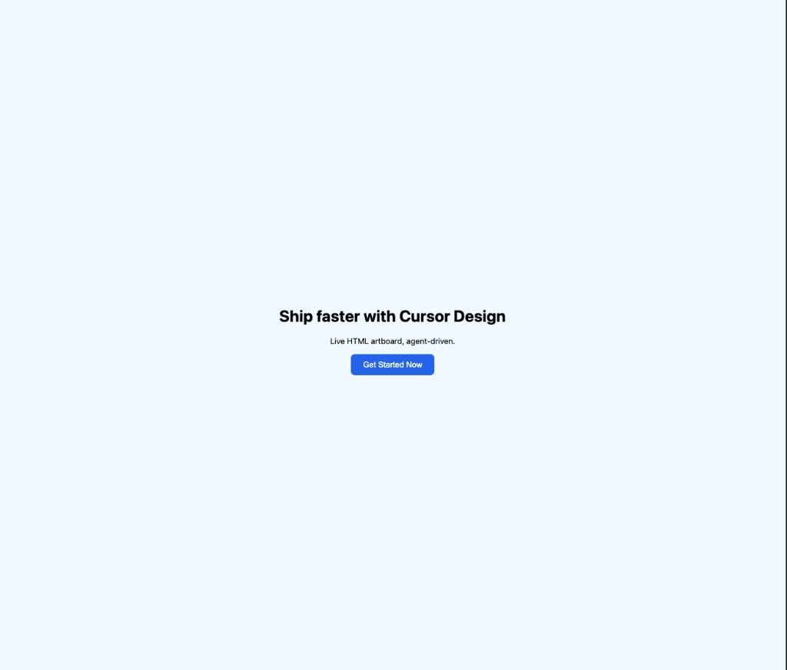

# cursor-design

Agent-driven live HTML artboard for **Cursor** - Claude Design–style canvas without in-panel chat.

- **Panel:** Webview artboard (host chrome + sandboxed HTML iframe)
- **Brain:** Cursor Agent (your subscription) via local MCP + disk under `.cursor-design/`
- **Not:** a Next.js app, Chrome extension, or in-extension LLM calls

## Status

v0.1.0: installable `.vsix` with an artboard panel, seven MCP tools, export handoff + stale badge, and documented v1 limits.

0.3: Svelte chrome, frame drag and resize, and comments for the Agent (Comment mode, pins, Comments panel, Copy for Agent). 11 MCP tools.

0.4: Edit mode: change an element's text, font size, colour, padding and margin in the panel, saved straight to the artboard file, with Undo / Redo (20 steps per frame for the panel session). 11 MCP tools, unchanged.



Spec (source of truth): [Notion - Cursor Design](https://app.notion.com/p/3d5500344e0881019a9fd659ccb7ffb4)

## MCP tools

Server name: `cursor-design`. Tools:

- `set_artboard` - create a new artboard id (`html` required; empty string allowed)
- `update_artboard` - replace HTML; requires `baseGeneration` and/or `baseHash`
- `read_artboard` - HTML + meta; `artboardId` optional (defaults to active)
- `list_artboards` - ids on disk (no HTML bodies) plus `frames`, the stage layout from `.cursor-design/canvas.json` (missing frames auto-placed)
- `set_active_artboard` - switch the active id (does not open the panel)
- `place_frame` - set one frame's `x`, `y`, `width`, `label`, or `group` in `canvas.json`; returns every frame
- `export_artboard` - write `.cursor-design/handoff/<exportId>/` and record `lastExport` (call before implementing)
- `handoff_status` - `{ stale, activeArtboardId, activeHash, lastExport? }`; re-export when `stale` is true
- `list_comments` - comments from `.cursor-design/comments.json` with `stale` / `targetMissing` flags (`null` = unchecked) and `replyCount`; `status` optional (`open`, `sent`, `resolved`), omitted = every unresolved comment
- `get_comment` - one comment with its replies and those flags checked against the artboard on disk; call it before acting on a comment
- `resolve_comment` - resolve after changing the target; the one-line `note` shows as the Agent's reply in the thread

**Allowlist** the server if Cursor prompts. If MCP is denied, edit `.cursor-design/**` on disk and tell the user to allowlist the tools.

## Install

1. From this repo: `pnpm vsix` writes `cursor-design-0.1.0.vsix` at the repo root.
2. In Cursor: Command Palette → **Extensions: Install from VSIX…** → pick that file → reload. Updating an installed version? Quit and reopen Cursor instead (see Limits).
3. Open a trusted folder. Command Palette → **Cursor Design: Open Artboard**.
4. Settings → MCP: allowlist `cursor-design` (toggle off/on if the tool count stays 0; see Limits).

Smoke-tested 2026-11-20, Cursor 3.29.9 (agent-driven run on the packaged `.vsix`).

## Comments for the Agent

1. In the panel press `C` (or pick **Comment** in the toolbar's mode switch). The hover outline shows what a click will target; Alt+click or ↑ picks the parent, ↓ the child. Clicking empty space in a frame comments on the whole frame. Links and buttons in the design don't fire in Comment mode.
2. Type in the popover and press Enter (**Add comment**). Shift+Enter adds a newline, Esc cancels. The comment is saved to `.cursor-design/comments.json` and its pin follows the element.
3. **Comments** in the toolbar opens the panel: Reply, Resolve, Reopen, and click a comment's target to jump to its pin.
4. **Copy for Agent** copies the prompt for one comment; **Copy N open comments for Agent** copies one prompt with every open id. Paste it into Cursor Agent chat. Copied comments are marked `sent`.
5. The Agent calls `get_comment`, changes the target with `update_artboard`, then `resolve_comment` with a one-line note that shows as a reply.

## Edit mode

1. In the panel pick **Edit** in the toolbar's mode switch (it has no key; Esc or pressing **Edit** again goes back to Interact). Click an element to select it. As in Comment mode, links and buttons don't fire, Alt+click or ↑ picks the parent and ↓ the child; the Inspector's arrow buttons do the same. Clicking empty space in a frame selects its `body`.
2. The Inspector shows **Text**, **Font size**, **Color**, **Padding** and **Margin**. Typing previews in the frame. Text, size and spacing save on Enter or when the field loses focus; **Color** saves when you release the picker. A bare number gets `px`; an empty field removes the declaration. A size or spacing value with characters other than letters, digits, spaces and `.%+-*/(),`, unbalanced parentheses or over 200 characters shows an error and is not saved; a value the browser ignores (`abc`) is saved as typed.
3. A save writes only that element's text, or one property of its `style` attribute, to `.cursor-design/artboards/<id>.html`. `padding` and `margin` replace their longhands (`padding-left` and so on). Your own save does not reload the frame.
4. Text is editable only when the element holds plain text. An element that holds other elements or an HTML comment, or text over 5,000 characters, shows a hint to ask the Agent; the style fields still work. A `style` attribute over 5,000 characters replaces the style fields with a hint. An element a script created or copied shows "Not editable": ask the Agent.
5. **Undo** and **Redo** in the Inspector, or Cmd/Ctrl+Z and Cmd/Ctrl+Shift+Z from the panel (outside a text field) or the focused frame, step through your saves in the frame you last picked in. Each step rewrites the file and reloads the frame. History is 20 steps per frame, kept in memory until the panel closes or the workspace folders change. An outside change to the file (the Agent, an editor) clears that frame's history. After the panel reloads (for example when you switch to another tab and back), Undo and Redo stay disabled until you pick an element in that frame again in Edit mode.
6. A comment on an element you edited, or on an element that contains it, reads `stale` until the element is back as it was, for example after Undo. The panel numbers elements in its own copy only (`data-cd-src`); the file on disk, `read_artboard` and the export never get those tags.

## Develop

```bash
pnpm install
pnpm compile
pnpm verify
```

Confirm `dist/mcp.js` exists after compile or the watch/`preLaunchTask` build. F5 will not register a working stdio server without it.

In Cursor: open this folder → **F5** (Run Extension). The Extension Development Host opens `fixtures/dev-workspace` (positional folder arg in `.vscode/launch.json`). The panel does **not** open on startup.

Then in the **Extension Development Host** window (not this repo window):

1. Command Palette → **Cursor Design: Open Artboard** - chrome + disk preview, no CSP errors in the **webview** console.
2. Check MCP: Settings → MCP. Server name `cursor-design`. Activation is `onStartupFinished`, so it registers without opening the panel.
3. Allowlist `cursor-design` (toggle off/on if the tool count stays 0).

Commands:

- **Cursor Design: Open Artboard** - open/reveal the panel
- **Cursor Design: Reveal Design Folder** - reveal `.cursor-design/` if it exists (does not create it)
- **Cursor Design: Export Handoff** - export every frame on the canvas to `.cursor-design/handoff/<exportId>/`

Output: **View → Output → Cursor Design**.

Agent entry: [`AGENTS.md`](./AGENTS.md)

Workflow overlay: [AI Blueprint](https://github.com/aiblueprinthq/ai-blueprint) (plans and review gates, not the product stack).

## Export to implement trial

F5 in the Extension Development Host with `fixtures/dev-workspace` open:

1. Command Palette → **Cursor Design: Open Artboard**. No handoff badge.
2. Design at least two frames via Cursor Agent (`set_artboard` / `update_artboard`), for example a desktop page and a mobile page, and lay them out with `place_frame` (with `group`).
3. Call `export_artboard` (or Command Palette → **Cursor Design: Export Handoff**). Confirm `.cursor-design/handoff/<exportId>/` holds `IMPLEMENT.md`, `canvas.html`, `tokens.json`, and one `<group-folder>/<frame-id>/index.html` per frame, and that `manifest.json` `lastExport.frames` lists every frame. Badge still hidden. `canvas.html` opens in a browser as a view-only preview of the canvas.
4. In a second Agent session, open `.cursor-design/handoff/<exportId>/IMPLEMENT.md` (from `manifest.json.lastExport.exportId`) and implement into `fixtures/dev-workspace/sample-app/`: one responsive page from the desktop and mobile variants. Do not copy `.cursor-design/` into the app.
5. Edit any frame's `artboards/<id>.html` and save. Within ~200ms the panel badge shows `Handoff out of date. Re-export.`
6. Re-export. Badge clears. The previous handoff directory stays on disk.

Then `cd fixtures/dev-workspace/sample-app && pnpm install --ignore-workspace && pnpm dev` to view the implemented page. (`--ignore-workspace` is required because this repo has a root `pnpm-workspace.yaml`; without it, `pnpm install` no-ops and `vite` is missing.) 0.1 trial, observed 2026-09-12: Vite 8.3.0 served `index.html` at `http://localhost:5173/` (`Implement the exported artboard here.`).

**0.1 trial performed:** 2026-09-12 (live F5 pass, steps 2–6 green; 6 handoffs on disk, `stale:false`, Vite 200 with latest implement).

**0.2 canvas trial:** 2026-10-18 (6f dogfood: four frames exported clean, responsive sample-app built from the handoff).

**0.3 verification:** 2026-11-18 (8i, agent-run: a headless Agent loop over real stdio MCP processes covering comments, sent, fresh process, resolve, stale, target missing, unchecked and a byte-equal export, plus a `.vsix` smoke; no manual Cursor run, earlier per-feature F5 passes cited or waived).

## Limits (v1)

Facts, not a roadmap. Drift vs the rules or overview is labeled.

- Cursor only: MCP registration uses `vscode.cursor.mcp.registerServer`. In plain VS Code the server is not registered (warning in Output → Cursor Design); the panel still renders `.cursor-design/` from disk, with no Agent loop.
- The panel uses the first workspace folder only (`hostFs.ts`). MCP tools see every open folder and take an optional `rootPath` when more than one is open.
- Untrusted workspaces unsupported (`capabilities.untrustedWorkspaces.supported: false`); artboard HTML is executable workspace content.
- One canvas per workspace folder; every artboard file is a frame on it. `set_active_artboard` still picks the frame that `read_artboard` and `handoff_status` default to.
- Writes: one process-wide MCP queue for every tool, reads included (`mcpQueue.ts`; recorded drift vs the overview's "MCP serializes writes per artboard id"). `update_artboard`, panel edits and Undo / Redo (HTML + meta), and every `canvas.json` and `comments.json` read-modify-write run under a cross-process lock (`.cursor-design/.lock`, `workspaceLock.ts`) shared by every MCP process and the panel. After an update, until Cursor is quit, the older MCP server keeps running, and an older version's `update_artboard` and export may take no lock (see the update line below). A write that skips the lock (an editor save, the Agent's direct file edit) can still land between `update_artboard`'s compare and its write and be overwritten (`artboardFs.ts` ponytail). `manifest.json` writes from `set_artboard` and `set_active_artboard` take no lock: across windows the last writer wins (`artboardFs.ts`). Export's meta refresh and manifest write run under the lock and re-read first, so the meta refresh no longer overwrites a newer locked meta write, and an unlocked `set_active_artboard` change is reverted only if it lands during the locked tail (`exportFs.ts`). Failed multi-file writes leave partial files (no journal/rollback); orphan handoff dirs are never deleted.
- Artboard iframe: `sandbox="allow-scripts"`. CSP blocks inline event handlers and external subresources in the artboard (`artboardChromeHtml.ts`); `style=""` attributes render (`style-src-attr 'unsafe-inline'`, 0.4). Each frame also gets a second, inline-only policy (`FRAME_CSP` in `stampArtboardHtml.ts`), so even a `<script src>` that carries the stamped nonce, or one artboard JS adds at runtime, never loads. Chromium's CSP does not govern WebRTC or DNS prefetch hints. The exported `canvas.html` preview is opened in your own browser and is not restricted.
- Agent skill: on start in Cursor the extension copies `skills/cursor-design/SKILL.md` to `~/.cursor/skills/cursor-design/` when it differs. In a remote window that is the remote home, which Cursor may not read. Two extension versions running at once (F5 host plus an installed `.vsix`) overwrite each other's copy; the last window started wins. Uninstalling leaves the file; it tells Agents to ignore it when the tools are missing.
- Each frame's `index.html` carries its whole document (no CSS/JS split; recorded Phase 3 lock vs overview "HTML+CSS+JS"); `.cursor-design/assets/` is copied manually; `tokens.json` is passed through without validation.
- Brain is Cursor Agent only: no in-panel chat, no model API keys, no `vscode.lm`.
- Not on the Marketplace; install from `.vsix` (**Extensions: Install from VSIX…**).
- Cursor MCP settings may show **0 tools** until the server is toggled off/on. That fixes the tool count, not the version: after updating the extension, quit and reopen Cursor. Toggling the server or reloading the window keeps the old MCP server process running, so the Agent's tools run the old code, with the old descriptions, until Cursor quits.
- Comment flags are checked against the static artboard HTML on disk. A target that the artboard's own script creates at runtime reads as unchecked (`null`), never guessed (`commentTarget.ts`).

## License

MIT - see [LICENSE](./LICENSE).
