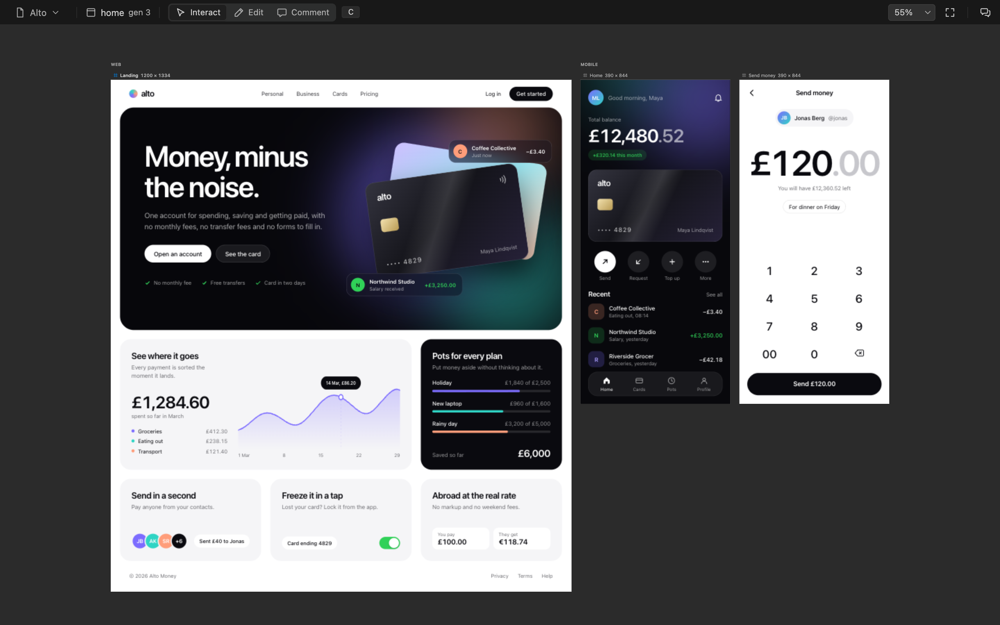
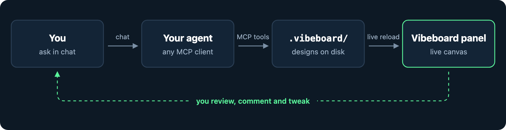
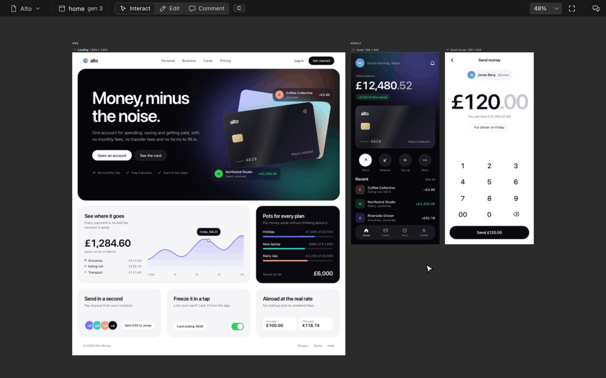
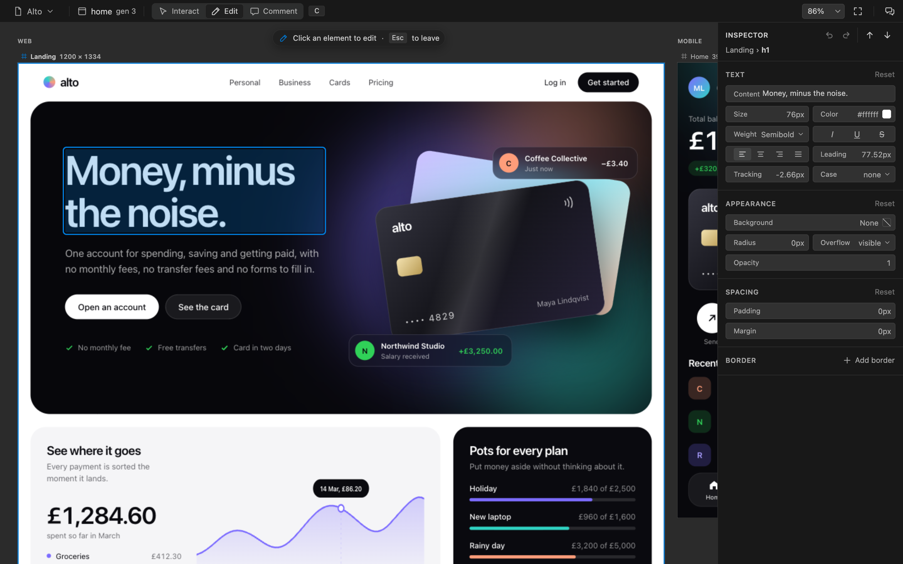

<p align="center">
  
</p>

<p align="center">
  <strong>Agent design canvas for Cursor and VS Code.</strong><br>
  Your AI agent designs live HTML artboards. You review, comment and tweak them on a canvas, right next to your code.
</p>

<p align="center">
  <a href="./LICENSE"></a>
  
  
  
</p>

<p align="center">
  
</p>

## Contents

- [Why Vibeboard](#why-vibeboard)
- [Quick start](#quick-start)
- [How it works](#how-it-works)
- [Comments for the agent](#comments-for-the-agent)
- [Edit mode](#edit-mode)
- [Handoff](#handoff)
- [Use with any agent](#use-with-any-agent)
- [MCP tools](#mcp-tools)
- [Commands](#commands)
- [Limits](#limits)
- [Contributing](#contributing)
- [License](#license)

## Why Vibeboard

Coding agents write good UI, but you only see it after it lands in your app. Vibeboard gives the agent a canvas first: it designs, you point at what to change, and when you like the result you hand it off to build.

- **Any agent.** Cursor Agent, GitHub Copilot, Claude Code, Codex or any other MCP client.
- **Live canvas.** Every artboard is a real HTML page in a sandboxed frame. Pan, zoom, drag and resize.
- **Pages.** Keep several designs per project and switch from the Pages menu.
- **Comments.** Click an element, leave a comment, copy it to your agent. The agent fixes it and replies.
- **Edit mode.** Change text, colours, spacing and borders yourself, with Undo / Redo.
- **Handoff.** Export every frame plus an `IMPLEMENT.md`, so an agent can build the real page.
- **Local and private.** Designs live in `.vibeboard/` in your workspace. No model calls, no API keys.

## Quick start

1. **Install.** Vibeboard is not on the Marketplace yet. Run `pnpm vsix` in this repo, then **Extensions: Install from VSIX…** in Cursor or VS Code and pick `vibeboard-0.1.0.vsix`.
2. **Open the panel.** Open a trusted folder and run **Vibeboard: Open Artboard** from the Command Palette.
3. **Connect your agent.**
   - Cursor: allowlist `vibeboard` in Settings → MCP.
   - VS Code: start the **Vibeboard** server when asked.
   - Anything else: see [Use with any agent](#use-with-any-agent).
4. **Ask for a design** in your agent's chat:

   ```text
   Use vibeboard to design a pricing page: a desktop frame at 1280 px and a mobile frame at 390 px, side by side.
   ```

The frames appear in the panel as the agent writes them.

> **Updating?** Quit and reopen the editor afterwards. Until then the old MCP server keeps running.

## How it works

<p align="center">
  
</p>

- **Disk is the source of truth.** Everything lives in `.vibeboard/` in your workspace. Add it to `.gitignore` unless you want designs in git.
- **The agent is the brain.** The panel has no chat, and the extension never calls a model.
- **Artboards are sandboxed.** Each frame runs in an `allow-scripts` iframe under a strict CSP: inline CSS and JS only, nothing loaded from outside.

## Comments for the agent

<p align="center">
  
</p>

1. **Pick.** Press `C` (or choose **Comment** in the toolbar) and click an element. Clicking empty space comments on the whole frame.
2. **Write.** Type your comment and press Enter. Its pin follows the element.
3. **Send.** **Copy for Agent** copies one comment, **Copy N open comments for Agent** copies all open ones. Paste into your agent's chat.
4. **Done.** The agent changes the design and resolves the comment with a one-line reply in the thread.

<details>
<summary><strong>Keys and details</strong></summary>

- The hover outline shows what a click will target. Alt+click or ↑ picks the parent, ↓ the child.
- Links and buttons in the design don't fire in Comment mode.
- In the popover, Shift+Enter adds a newline and Esc cancels.
- **Comments** in the toolbar opens the panel: Reply, Resolve, Reopen, and click a comment's target to jump to its pin.
- Comments are saved to `.vibeboard/pages/<pageId>/comments.json`. Copied comments are marked `sent`.
- The agent calls `get_comment`, changes the target with `update_artboard`, then `resolve_comment`.

</details>

## Edit mode

<p align="center">
  
</p>

Choose **Edit** in the toolbar and click an element. The Inspector shows the sections that fit it, and each save writes only what you changed to the artboard file.

| Section        | What you can change                                                         |
| -------------- | --------------------------------------------------------------------------- |
| **Text**       | Content, size, colour, weight, style, alignment, leading, tracking and case |
| **Appearance** | Background, radius, overflow and opacity                                    |
| **Spacing**    | Padding, margin and gap                                                     |
| **Border**     | Width, style and colour                                                     |

**Undo** and **Redo** are in the Inspector, or use Cmd/Ctrl+Z and Cmd/Ctrl+Shift+Z: 20 steps per frame. Esc goes back to Interact.

Every field, value rule and edge case: [Edit mode reference](./docs/edit-mode.md).

## Handoff

When the design is right, run **Vibeboard: Export Handoff** (or let the agent call `export_artboard`). It writes every frame plus an `IMPLEMENT.md` to `.vibeboard/handoff/<exportId>/`. Ask your agent to follow `IMPLEMENT.md` to build the real page.

Change a design after exporting and the panel shows **Handoff out of date**. Export again to refresh it.

## Use with any agent

Any MCP-capable agent can drive the artboard. The panel itself runs in Cursor or VS Code.

| Agent                                 | Setup                                                                      |
| ------------------------------------- | -------------------------------------------------------------------------- |
| **Cursor**                            | Automatic. Allowlist `vibeboard` in Settings → MCP.                        |
| **VS Code** (GitHub Copilot)          | Automatic. Start or trust the **Vibeboard** server when VS Code asks.      |
| **Claude Code, Codex, Cline, others** | Add the server by hand (below) and keep the panel open on the same folder. |

The server is `dist/mcp.js` inside the installed extension (`~/.vscode/extensions/` or `~/.cursor/extensions/`), run with Node. Adjust the version in the paths below.

<details>
<summary><strong>Claude Code</strong></summary>

From the workspace folder:

```bash
claude mcp add vibeboard -e VIBEBOARD_WORKSPACE_ROOT="$PWD" -- node ~/.vscode/extensions/bombic.vibeboard-0.1.0/dist/mcp.js
```

</details>

<details>
<summary><strong>Codex CLI</strong></summary>

In `~/.codex/config.toml` (absolute paths):

```toml
[mcp_servers.vibeboard]
command = "node"
args = ["/Users/you/.vscode/extensions/bombic.vibeboard-0.1.0/dist/mcp.js"]
env = { VIBEBOARD_WORKSPACE_ROOT = "/Users/you/projects/my-app" }
```

</details>

<details>
<summary><strong>How the server finds your workspace</strong></summary>

- The server asks the connected client for its workspace folders (MCP roots). A client that supports roots gets the right folder automatically.
- `VIBEBOARD_WORKSPACE_ROOT` (one folder) or `VIBEBOARD_WORKSPACE_ROOTS` (a JSON array; the first is the default) is the fallback only for clients without roots support.
- A client that supports roots but reports no folder gets `NO_WORKSPACE`. A `rootPath` argument must name one of the reported folders.

</details>

On connect, the server sends its agent skill ([`skills/vibeboard/SKILL.md`](./skills/vibeboard/SKILL.md)) as MCP instructions, so the agent learns the workflow. If your agent ignores server instructions, add that file to its instructions.

## MCP tools

Server name: `vibeboard`, 14 tools. Exact arguments and error codes are in the [agent skill](./skills/vibeboard/SKILL.md).

| Tool                  | What it does                                                              |
| --------------------- | ------------------------------------------------------------------------- |
| `list_artboards`      | List artboard ids and the canvas layout (`frames`)                        |
| `set_artboard`        | Create a new artboard from HTML                                           |
| `read_artboard`       | Read an artboard's HTML and meta (defaults to the active one)             |
| `update_artboard`     | Replace an artboard's HTML; needs `baseGeneration` and/or `baseHash`      |
| `set_active_artboard` | Switch the active artboard                                                |
| `place_frame`         | Set one frame's `x`, `y`, `width`, `label` or `group` on the canvas       |
| `export_artboard`     | Write the handoff to `.vibeboard/handoff/<exportId>/`                     |
| `handoff_status`      | Report whether the last handoff is stale                                  |
| `list_comments`       | List comments on the open page (every unresolved one unless `status` set) |
| `get_comment`         | Read one comment with its replies                                         |
| `resolve_comment`     | Resolve a comment with a one-line note, shown as the agent's reply        |
| `list_pages`          | List the pages and which one is open                                      |
| `create_page`         | Create a page with one blank artboard and open it                         |
| `open_page`           | Open a page; every other tool then acts on it                             |

> **Tip:** agents should use the tools, not edit `.vibeboard/` files. The tools check conflicts, take the workspace lock and keep the page and canvas layout valid. If MCP is denied, allowlist the server; until then an agent can edit the open page's files under `.vibeboard/pages/<pageId>/` (`openPageId` in `.vibeboard/project.json`).

## Commands

| Command                             | What it does                                                         |
| ----------------------------------- | -------------------------------------------------------------------- |
| **Vibeboard: Open Artboard**        | Open or reveal the panel                                             |
| **Vibeboard: Reveal Design Folder** | Reveal `.vibeboard/` if it exists (does not create it)               |
| **Vibeboard: Export Handoff**       | Export every frame on the canvas to `.vibeboard/handoff/<exportId>/` |

Logs: **View → Output → Vibeboard**.

## Limits

Facts, not a roadmap. The ones you are most likely to meet:

- **Install from `.vsix`.** Vibeboard is not on the Marketplace yet.
- **Trusted folders only.** Artboard HTML is executable workspace content, so untrusted workspaces are unsupported.
- **First folder only.** In a multi-root workspace the panel shows the first folder. MCP tools see every folder and take an optional `rootPath`.
- **Self-contained artboards.** No external scripts, images, fonts or stylesheets, and no inline event handlers.
- **Restart after an update.** The old MCP server runs until the editor quits. In Cursor, MCP settings may also show **0 tools** until you toggle the server off and on.
- **Direct file edits can be lost.** A write that skips the tools also skips the workspace lock, and an `update_artboard` can overwrite it.

The full list, with the locking and sandbox details: [Known limits](./docs/limits.md).

## Contributing

Building, debugging (F5), tests and the manual checks are in [CONTRIBUTING.md](./CONTRIBUTING.md). Agents start at [`AGENTS.md`](./AGENTS.md).

## License

[MIT](./LICENSE)
