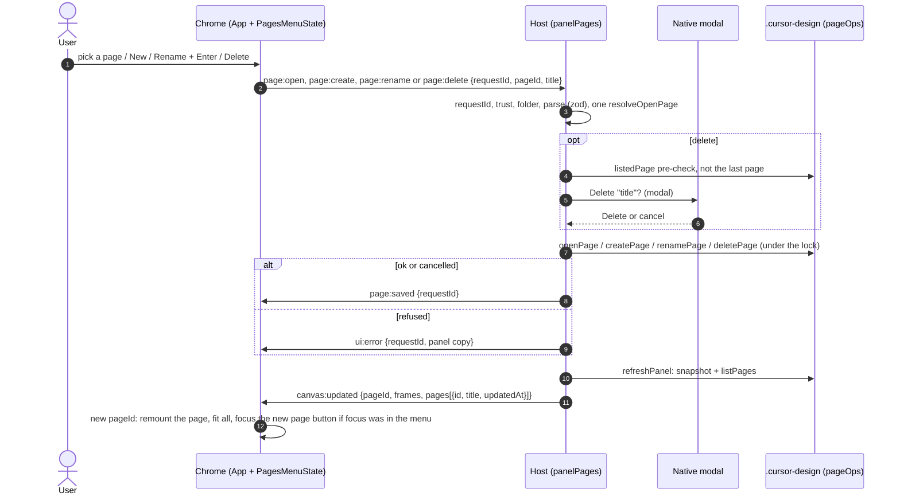

# Feature 10d: Pages menu - Overview for review

> **Generated file.** Human-facing steering summary of the active work item:
> same content as `current-feature.md`, trimmed. Written at `/feature` when the
> spec is created, and kept current if the spec is revised. `/complete` may
> polish this into the archive-ready one-pager; it is not the first write.
> Open in Markdown preview to render the diagrams.

Source of truth: `blueprint/history/features/10d-pages-menu.md`. This file is the steering summary, not the build spec.

## TL;DR

The panel can now switch, add, rename and delete pages. A toolbar button shows the open page's
title and opens a Pages menu: every page with its last-edited time, **New blank page**, inline
**Rename**, and **Delete** behind a native Cursor dialog (off on the last page). The disk ops and
the Agent's page tools shipped in 10c; 10d adds the menu and the four messages behind it. No disk
format, MCP tool or Agent skill change.

## What you will see

- **Toolbar, far left:** page icon + open page title (ellipsis, full title on hover). Off only
  when there is no project (no folder, untrusted workspace).
- **Menu:** pages in creation order, each with "5 minutes ago"-style time, Rename and Delete; the
  open page has a check mark; **New blank page** at the bottom; long lists scroll.
- **Open** switches the stage (fit all). Picking the open page just closes the menu.
- **Rename** turns the row into a field: Enter saves, Escape cancels, a bad title shows its error
  under the field.
- **Delete** asks `Delete "<title>"?` ("Its files move to .cursor-design/deleted/."). Cancel
  writes nothing.
- **One request at a time:** buttons grey out, a line says "Deleting page…"; the menu stays open
  until the answer, even if the Agent switches pages meanwhile.
- **Keyboard:** arrows / Home / End between pages, Tab through every control, Escape closes and
  returns focus to the button without leaving Comment or Edit mode.

## Key loop

## Architecture decisions

- **The page list rides on `canvas:updated`**, not a separate message. Every snapshot already goes
  through the one `refreshPanel`, so the list can never disagree with the stage it came with, and
  the outbox replays it on a webview reload for free. Cost: one `listPages` stat pass per refresh
  (marked `ponytail:`, F-20).
- **Page requests are not page-bound.** The 8 earlier requests carry the *staged* page and are
  dropped after a switch; `page:*` carries a *target* page id and `hostBridge` adds none. The
  host resolves the open page once and the disk op checks the target under the lock.
- **Answer once, then refresh, always.** `page:saved` or `ui:error` per valid `requestId` (a
  cancelled modal is `page:saved`), then `refreshPanel`, errors included. The chrome never waits
  for the file watcher, and last-started-wins makes the watcher echo post nothing new.
- **The host owns the delete confirm.** A native modal is outside the webview, so artboard script
  cannot click it; the last-page check runs before the modal and again under the lock.
- **Panel copy is an allowlist.** `pageRequestErrorMessage` maps known error classes to panel
  wording; the disk lib's Agent-facing text never reaches the panel. `PageNotFoundError` keeps a
  `reason` field so "gone" and "folder missing" get different copy.
- **Menu state spans pages, so App owns it.** `PagesMenuState` lives in `App.svelte`, above the
  per-page `DesignPage` remount, so a switch mid-request keeps the menu, the rename draft and the
  in-flight request. The view (`PagesMenu.svelte`) is props in, callbacks out; the two pure rules
  (`pageRows`, `nextRowIndex`) sit in `pagesMenu.ts` with Vitest tests.
- **Focus follows where it was, not who switched.** If focus was in the page button or menu, the
  new page's button takes it after the remount; otherwise it stays put. Answers move focus only
  when focus is still in the menu (or lost to body).
- **Undo histories die with the page.** `forgetPageHistories` drops keys whose page part equals
  the deleted id exactly (`page-1` never matches `page-10`).

## Decisions locked

- One open page, shared with the Agent; deleted pages go to `.cursor-design/deleted/` (Bombic
  2026-11-21). Rename and delete stay panel-only (D9).
- Recorded on the Notion 0.5 page under "Shipped decisions" (2026-11-24).

## Out of scope

Rename or delete over MCP; duplicate page, page search, frame links (0.5.1); emptying `deleted/`
or restoring from the UI; page shortcuts and reordering; README / Notion prose pass (10e).

## Glossary

| Term | Why it exists |
|---|---|
| Open page | The one page both the panel and the Agent work on (`openPageId` in `project.json`) |
| Page-bound request | A panel request tied to the staged page; dropped if the page changed |
| `requestId` | Pairs each panel request with its one answer |
| `refreshPanel` | The one path that reads disk and posts the stage to the panel |
| Remount | The per-page view is rebuilt on a page switch; App-owned state survives it |

## Your actions

None. The real native dialog and Cursor focus around it are 10e's real-Cursor checks.

## Done means

Menu, messages, host answers and docs shipped; 21 Pages menu browser tests, 6 gallery states in
both themes; `pnpm verify` green (866 unit); two fresh independent reviews passed with no P0-P2
open. F-20 (unverified perf) and F-29 (docs, fixed at completion) stay in the ledger.
