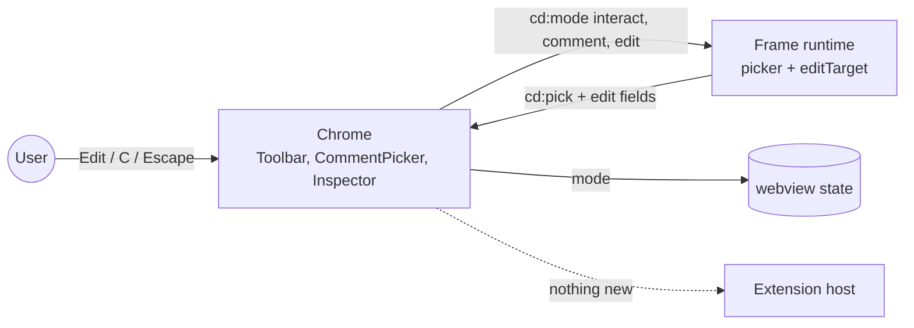
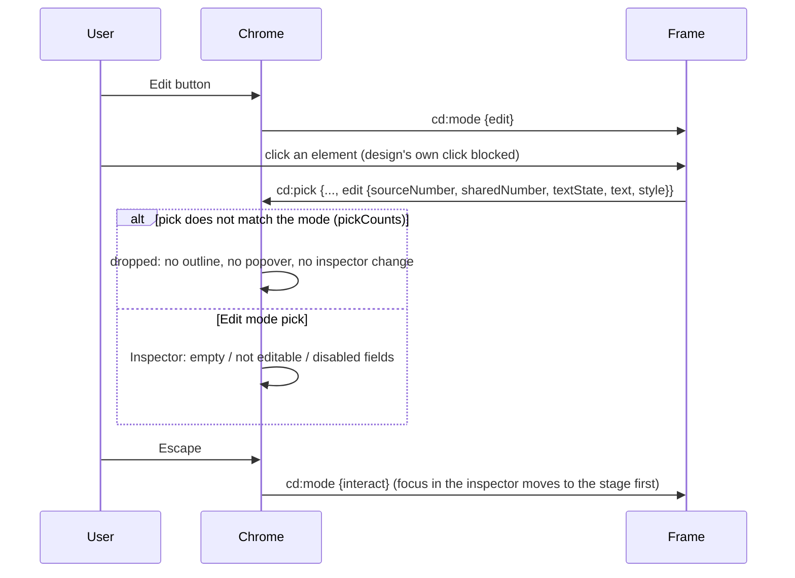

# 9d Edit mode + selection - Overview for review

Source of truth: `blueprint/history/features/09d-edit-mode-selection.md`. This file is the steering summary, not the build spec.

## TL;DR

The toolbar now has **Interact · Edit · Comment**. In Edit mode you click an element in a frame
(the same picker as comments: click, Alt+click, ↑ / ↓, parent / child buttons). An **Inspector**
on the right then shows its text, font size, colour, padding and margin, still disabled: saving
is 9e. Style fields show the element's own `style` value exactly as typed, with the computed value
as the grey placeholder. Elements the file can't place (made or copied by a script) say "not
editable". Mixed content says "ask the Agent". No disk, MCP or host change.

## System map

## Key loop

## What you will see

- An Edit segment between Interact and Comment, and the hint "Click an element to edit · Esc to leave".
- The Inspector at the right edge (240 px): frame › tag, Select parent / child, then Text, Font
  size, Color (swatch plus typed value), Padding, Margin, all greyed.
- "Not editable" for script-made or script-copied elements; a hint instead of Text for mixed
  content or text over 5,000 characters; no Text field for `img`, `input` and similar.
- Edit mode survives a tab switch; the selection does not.

## Architecture decisions

- One picker for Comment and Edit mode; Edit-mode picks add an `edit` object read with DOM reads
  only (the frame runtime is embedded in exported `canvas.html`, so it stays small: a size-budget
  test).
- One acceptance rule, `pickCounts`, decides for the pick and the comment draft, so a late or
  forged pick from the other mode does nothing.
- The inspector reads inline values with the same tokenizer the 9b edit core edits, so 9e can
  save "only what changed".
- Constants the frame needs moved to `layout.ts`, so parse5 never enters the frame or chrome bundle.

## Decisions locked

- Escape leaves Edit mode; `C` goes from Edit to Comment; the Edit button toggles; no `E` shortcut.
- Edit mode is saved across a tab switch (`mode` key, Interact omitted).
- Handed to 9e: send the raw `edit.text` as `liveText` and re-read it before a save; tell an absent
  style attribute from an over-cap one before enabling style fields.

## Out of scope

Saving, live preview and the `artboard:edit` sender (9e); undo / redo (9f); mode switch opening a
panel (0.4.1); renaming the comment-picker modules.

## Glossary

| Term | Why it exists |
|---|---|
| Source number (`data-cd-src`) | The host tags each element written in the file, so an edit can name its exact spot |
| Shared number | A script cloned an element: two live elements claim one file spot, so neither is editable |
| `pickCounts` | The one rule for which picks count in which mode |
| Inspector | The Edit-mode side panel; read-only until 9e |

## Your actions

- Done 2026-11-19: F5 walk-through in Cursor (8 steps), all passed.

## Done means

`pnpm verify` green (667 unit tests), `pnpm test:browser` 147 passed (11 new Edit-mode tests),
gallery contrast clean, independent review passed (fresh Opus 5.5 subagent) for the refactored
checkpoint, and the F5 walk-through passed.
