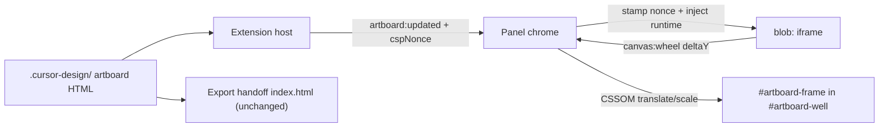
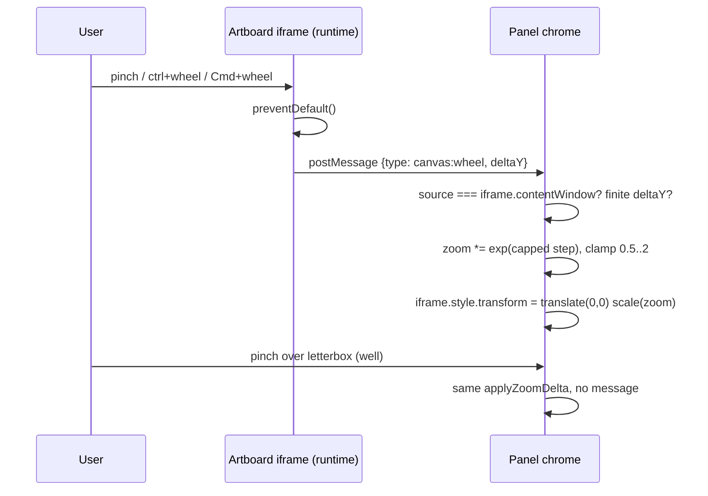

# Blob inject (6a) - Overview for review

Source of truth: `blueprint/history/features/06a-blob-inject.md`. This file is the steering summary, not the build spec.

## TL;DR

First slice of the 0.2 Interact canvas. The artboard iframe now sits in a clip "well" and zooms 50–200% from its top-left with pinch, ctrl+wheel, or Cmd+wheel. Zoom scales the iframe element, not the artboard's own `body`, so `position: fixed`, `vh`, and native scroll behave as they will in the real implementation. A tiny gesture runtime is injected only into the preview blob; disk and export HTML stay byte-identical to what the agent wrote.

## Flow

## Key loop

## What you will see

- Pinch or Cmd/ctrl+wheel over the artboard zooms it from the top-left; one mouse notch is about 20%, stopping at 50% and 200%.
- At 50% the well background shows right of and below the artboard; pinching there also zooms the artboard, not the Cursor window.
- Plain wheel still scrolls the artboard natively. Clicks on the scaled artboard still land.
- Editing the artboard file or switching artboards keeps the current zoom.

## Architecture decisions

- Scale the host iframe, not artboard `body` (approved deviation from the Notion 0.2 lock): body transforms re-root `position: fixed`, break letterboxing, and fight native scroll.
- The runtime is injected at blob build with the chrome CSP nonce, placed right after `<meta charset>` so it runs before every artboard script. Spoofed runtime scripts are removed first.
- Iframe messages are trusted by source identity (`event.source === iframe.contentWindow`) and only ever reach the zoom handler, never host branches.

## Decisions locked

- Only marker is `data-cd-canvas-runtime`; only message is `canvas:wheel`; chrome never posts into the iframe.
- Nothing is stripped on export; tests assert disk and handoff HTML byte-equal the authored HTML.

## Out of scope

- Zoom around the cursor, plain-wheel pan, zoom-math unit tests (6b).
- Zoom menu, ready-handshake, persisted zoom across panel hide/show (6c).

## Glossary

| Term | Why it exists |
|---|---|
| Well | Clipping box around the artboard so a zoomed-out artboard letterboxes |
| Blob | The preview document built in chrome from disk HTML; the only place the runtime lives |
| Runtime | Tiny script in the artboard that forwards zoom gestures to chrome |
| Chrome | The panel's own UI around the artboard |

## Your actions

- Known limit: zoom resets to 100% when you switch to another editor tab and back (6c fixes it).
- Open P3 follow-ups for a later `/fix`: F-08 (test for the finite-`deltaY` guard), F-09 (stale Blueprint manifest hashes after the adapter symlinks), F-07 (carried doc nit).

## Done means

Pinch/Cmd/ctrl zoom works over artboard and letterbox within 50–200%, fixed headers and native scroll unaffected, export stays pristine, and 78/78 tests plus types, lint, and compile pass.
