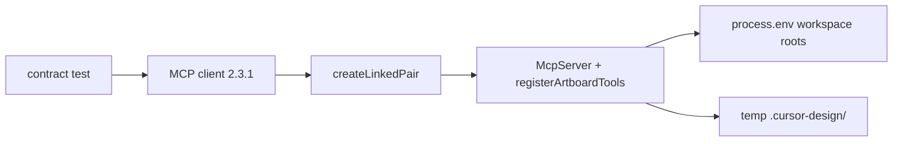
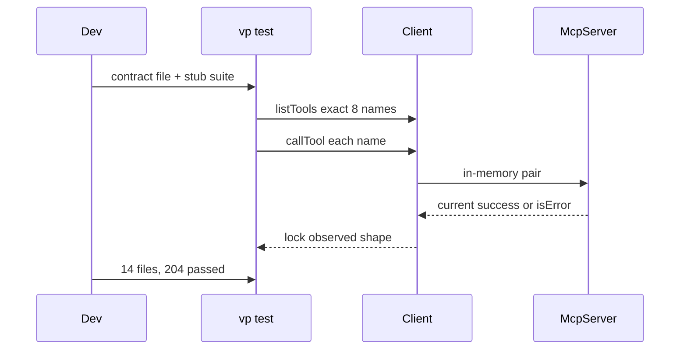

# MCP contract tests - Overview for review

Source of truth: `blueprint/history/features/07g-mcp-contract-tests.md`. This file is the steering summary, not the build spec.

## TL;DR

A real MCP client talks to the real server over `InMemoryTransport.createLinkedPair()`. Tests lock all 8 tools plus the exact `listTools` name set, including current errors. If the client path disagrees with the stub suite, the test changes, not the product. No product change. No Verify command yet (that is 7h).

## Flow

1. Work sits on `feature/mcp-contract-tests`, stacked on 7f (`feature/test-depth` `6634262`). `main` is still 7b (`43cce2c`).
2. `@modelcontextprotocol/client` `^2.2.0` resolved to **2.3.1** as a test-only devDependency. It is not in pack `alwaysBundle`.
3. `vp test` moved from **13 files / 186 passed** to **14 files / 204 passed**.
4. `pnpm knip` still exits 0. `pnpm compile` still writes `dist/extension.js` and `dist/mcp.js`.

## System map

## Key loop

## What you will see

- New `src/mcp/artboardTools.contract.test.ts`. The stub handler suite stays.
- `package.json` has `@modelcontextprotocol/client` `^2.2.0` under `devDependencies` only.
- Each case builds a fresh pair, then `afterEach` closes the client, then the server, then removes the temp workspace.
- `listTools` is a sorted-set of the 8 imported tool-name constants. Happy-path is a record keyed by that same array.
- Failure cases lock current codes: `NO_WORKSPACE`, `INVALID_ROOT`, `conflict`, `ARTBOARD_NOT_FOUND`, `INVALID_ARGS`.
- F5 behavior unchanged. No F5 or `.vsix` proof required for 7g.

## Data flow

Tests set both workspace-root env names, call tools through the client, and restore env. Tool errors resolve as `isError` on the returned value. After export, handoff status is `stale: false` with `lastExport` present. There is no `exported` field on that result.

## Architecture decisions

- Client is test-only. Production MCP still uses stdio. Do not bundle the client into `dist/mcp.js`.
- Both pair halves come from `@modelcontextprotocol/client`. Do not mix a server-package transport.
- `ARTBOARD_TOOL_NAMES` lives in the contract file only. Do not add an export to `toolNames.ts`.
- `set_artboard` currently sets the active pointer. The `set_active_artboard` case seeds two ids so it is not implied by create.
- Concurrent `update_artboard` is in-process FIFO. First `Promise.all` element wins; the other is `conflict`.

## Decisions locked

- Branch from 7f (`6634262`), not from `main`. Attempt 1. Archive `blueprint/history/features/07g-mcp-contract-tests.md`.
- Resolved client **2.3.1**. Proven import: `Client` + `InMemoryTransport` from `@modelcontextprotocol/client`, then `createLinkedPair()`.
- Unit lock is **204 passed** across **14** files. Starting lock was 186 / 13.
- Verify is undeclared. Test command is `vp test`.
- No product source files changed.

## Out of scope

Verify + CI (7h), F5 / `.vsix` smoke, product/MCP/disk edits, deleting the stub suite, bundling the client, Electron suite, coverage thresholds, inventing a transport.

## Glossary

| Term | Why it exists |
|---|---|
| Contract test | Drives tools through the real MCP client and server, not a captured handler. |
| Characterise | Lock today's result. Do not "fix" the product to match a nicer error. |
| Linked pair | `InMemoryTransport.createLinkedPair()`. Production still uses stdio. |
| Stub suite | Existing handler tests that bypass SDK validation. They stay. |

## Done means

`vp test` is 14 / 204; knip is 0; compile still writes both `dist/` files; client is a test-only 2.3.1 dep; no product behavior change.
