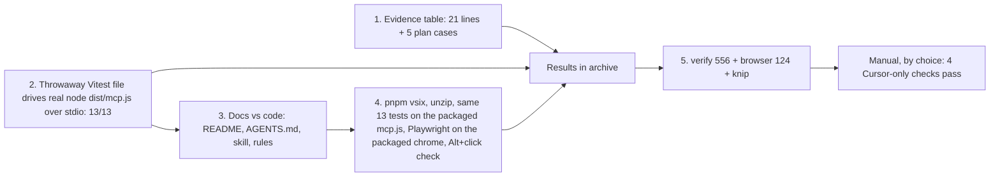

# 8i Verify - Overview for review

Source of truth: `blueprint/history/features/08i-verify.md`. This file is the steering summary, not the build spec.

## TL;DR

0.3 Comments for Agent is verified and closed. Every one of the 21 Notion done-when lines is backed by a named test, an earlier F5 pass the archives actually record, or Bombic's waiver. Agents ran everything headlessly; Bombic then chose to run the four Cursor-only checks by hand, and all four passed. README and AGENTS.md now match the shipped code. No product code changed.

## Flow

## What you will see

- README: 0.3 status line, 11 MCP tools (adds `list_comments`, `get_comment`, `resolve_comment`), a "Comments for the Agent" how-to, a dated 0.3 verification line, and corrected Limits. The false "chrome is vanilla script" line is gone, and the multi-root and lock lines are fixed.
- AGENTS.md: "0.3 Comments for Agent shipped … no active build-plan item".
- Build plan: 8i and parent 8 checked, with the waiver noted on the 8i line.
- A fresh `cursor-design-0.1.0.vsix` at the repo root (gitignored).

## Decisions locked

- Evidence has four kinds: a committed test, this feature's agent runs, an F5 pass quoted from an archive, or **waived**. "Owed", "not run" or "gap accepted" in an archive never counts as a pass.
- The stdio check stayed a throwaway file (it needs a built `dist/`), deleted after use.
- Version stays `0.1.0`. Notion is untouched until Bombic says yes.

## Out of scope

- Product fixes. The one gap found becomes the next `/fix`.
- Pushing, publishing, installing the `.vsix` into Cursor.

## Glossary

| Term | Why it exists |
|---|---|
| Waived | A Cursor-only check with no recorded F5 pass that Bombic chose not to run by hand; listed by name, never counted as passed |
| stdio MCP | How Cursor talks to the extension's tool server: a separate `node dist/mcp.js` process. The new check spawns it exactly like that |
| Unchecked | A comment whose target the server can't verify from the HTML on disk (for example, an element a script adds); reported as `null`, never guessed |

## Your actions

- Next: `/fix` so an open pin thread or Add-comment box (and its draft text) survives a tab switch. A permanent Alt+click browser test rides along.
- Optional: say yes to update Notion (done-when boxes, hub tool list and disk tree; the text is drafted in the archive's Notes).

## Done means

21/21 Notion lines dispositioned with no gap. `pnpm verify` (556), `pnpm test:browser` (124, identical on the packaged chrome) and `pnpm knip` are green. The headless Agent loop passes 13/13 from both `dist/` and the extracted `.vsix`. The four Cursor-only checks passed by hand.
