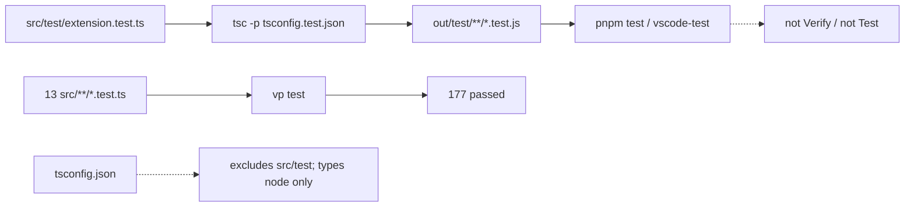

# Electron suite home - Overview for review

Source of truth: `blueprint/history/features/07d-electron-suite-home.md`. This file is the steering summary, not the build spec.

## TL;DR

The Electron mocha sample still runs through `@vscode/test-electron`, but it now compiles from its own `tsconfig.test.json` into `out/test/` only. The old full-tree `compile-tests` / `watch-tests` glue is gone. Unit tests stay on `vp test`. F5 and product behavior do not change. Electron stays out of Verify.

## Flow

1. Work sits on `feature/electron-suite-home`, stacked on 7c (`feature/vp-test`). `main` is still 7b.
2. `pnpm compile-electron-tests` (`tsc -p tsconfig.test.json`) writes `out/test/extension.test.js` from `src/test/` only.
3. `pnpm test` is still `vscode-test` and still needs a display. That is not the Test command.
4. `vp test` still prints **177 passed** (or 175 + 2 skipped as root).

## System map



## Key loop

```mermaid
sequenceDiagram
  participant Dev
  participant Tsc as compile-electron-tests
  participant Out as out/test
  participant Cli as vscode-test
  Dev->>Tsc: clean out/, then tsc -p tsconfig.test.json
  Tsc->>Out: extension.test.js only
  Note over Cli: display required; not a gate
  Dev->>Cli: optional pnpm test
```

## What you will see

- `pnpm compile-electron-tests` on a cleaned `out/` writes `out/test/extension.test.js` and no `disk` / `mcp` / `panel` trees.
- Main `tsconfig.json` `types` is `["node"]` and excludes `src/test`. Mocha types live only on `tsconfig.test.json`.
- `compile-tests`, `watch-tests`, `npm-run-all`, and `.npmrc` are gone. `pnpm watch` is `vp pack --watch`.
- `tsconfig.test.json` is listed in `.vscodeignore` so it does not ship in the `.vsix`.
- No Verify command. No GitHub workflow.

## Data flow

Developer compiles the mocha sample with the Electron tsconfig → `out/test/**/*.test.js` → optional `vscode-test`. Unit files never enter that emit. `vp test` stays the Blueprint gate.

## Architecture decisions

- Home is a second tsconfig + `tsc` to `out/`, not a `vp pack` entry under `dist/`.
- Child `exclude: []` clears the inherited parent exclude so `src/test` is visible.
- `@vscode/test-cli` stays because `pnpm test` invokes `vscode-test`.
- Compile (`pnpm compile` writing `dist/extension.js` + `dist/mcp.js`) remains the F5 proxy.

## Decisions locked

- Minimal `tsc` home, not a pack entry.
- Mocha sample file stays byte-unchanged.
- Main `types` is `["node"]` only.
- Electron is excluded from any future Verify command (7h).
- Unit lock stays 177 (7c).
- Branch from 7c, not `main`.

## Out of scope

Type-aware lint/knip (7e), fast-check/snapshots/coverage (7f), MCP client contracts (7g), Verify+CI (7h), rewriting or deleting the mocha sample, packing tests into `dist/`, live `pnpm test` or F5 as 7d proof.

## Glossary

| Term | Why it exists |
|---|---|
| `tsconfig.test.json` | Electron-only emit so mocha does not live on the product program. |
| `compile-electron-tests` | `tsc -p tsconfig.test.json` → `out/test/**/*.test.js`. |
| `vp test` | Documented unit Test command; 177 cases; not Electron. |
| `vscode-test` | Electron runner (`pnpm test`); needs a display; not Verify. |

## Done means

Electron emit is `out/test` only; dead full-tree scripts and watch glue are gone; `pnpm run check`, `vp test` (177), and `pnpm compile` (both `dist/` files) pass; no product change.
