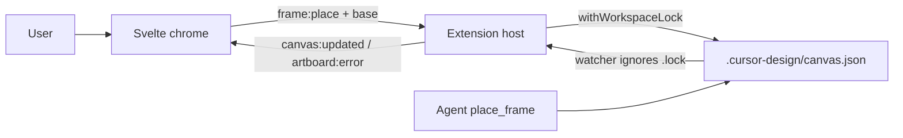
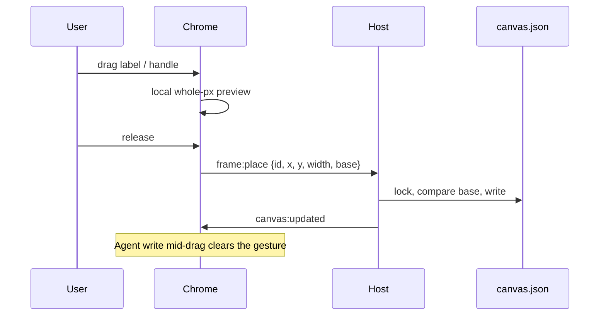

# Frame drag/resize - Overview for review

Source of truth: `blueprint/history/features/08c-frame-drag-resize.md`. This file is the steering summary, not the build spec.

## TL;DR

Drag a frame by its label, or resize its width with the right-edge handle. Positions round to whole stage pixels (no grid) and persist in `canvas.json` on release. If the Agent moves the same frame during or after the drag, the Agent wins.

## Flow

1. Grab the label to move, or the right-edge handle to change width.
2. Chrome shows a local preview while you drag.
3. Release writes once through `frame:place` → locked `placeFrame` with a `base` check.
4. Host answers with a fresh snapshot. A failed write also posts `artboard:error`, so the preview never sticks.

## System map

## Key loop

## What you will see

- Labels are move buttons. A thin handle sits on each frame’s right edge.
- Drag follows the cursor in whole pixels. Escape snaps back. A click under 3px writes nothing.
- Keyboard: Tab to a label, arrows nudge 8px (Shift 64). Tab to the handle, Left/Right resize. Release the last arrow to commit.
- Agent-wins, lock-busy, and corrupt-canvas failures show a banner and restore the disk position.

## Data flow

Chrome sends one `frame:place` on release. Host parses it, refuses untrusted workspaces, then `placeFrame` under `.cursor-design/.lock`. `base` must still match disk or the write is skipped (`FRAME_MOVED`). `canvas:updated` frames now carry `generation`.

## Architecture decisions

- In-house gestures, no Moveable.
- Lock is a `wx` file plus a `.lock.break` sub-lock for stale (30s) breakers. Only the small `canvas.json` read-modify-write sits inside the lock.
- Gesture rules live in pure `frameGesture.ts` so they have unit tests.
- Chrome-written coords are whole px within ±100000; width 120–3840. MCP `place_frame` is unchanged and never sends `base`.

## Decisions locked

- No 8px snap grid (F5 2026-10-22).
- Agent wins mid-drag. Failed writes that leave disk equal to `base` clear via `artboard:error`.
- Per-frame `generation` on the wire; no wire `hash`.
- Comment-mode inertness is 8f1’s job.

## Out of scope

Comment mode, picking, height editing, multi-select, guides, undo, locking writers other than `canvas.json`, MCP schema changes.

## Glossary

| Term | Why it exists |
|---|---|
| `base` | The frame’s x/y/width at gesture start. If disk moved, the chrome write is skipped. |
| Workspace lock | Cross-process `.lock` so Agent and chrome cannot interleave a `canvas.json` write. |
| Agent wins | A mid-drag `place_frame` (or disk edit) cancels the gesture and shows the disk position. |
| `generation` | Artboard meta generation copied onto each posted frame for later features. |

## Your actions

F5 in `fixtures/dev-workspace` to drag, resize, press Escape, and try the Agent-wins snippet in the archive.

## Done means

Frame drag/resize works with no Moveable. Positions persist after reload. Agent `place_frame` during or after a drag is reflected correctly.
