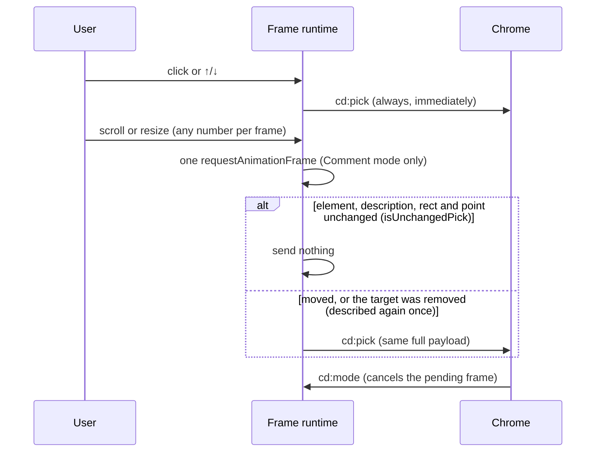

# Fewer pick re-posts on scroll - Overview for review

Source of truth: `blueprint/history/fixes/fewer-pick-re-posts-on-scroll.md`. This file is the steering summary, not the build spec.

## TL;DR

In Comment mode, the frame used to re-send the full pick (selector, text and styles, up to about 4 KB) on every scroll event, even when nothing about the pick had moved. It now sends at most one re-send per animation frame, and only when the picked element, its details, its outline or its point actually changed. Clicks and ↑/↓ still always send. The `cd:pick` message itself is unchanged. Fixes F-46.

## Key loop

## Decisions locked

- **Fewer sends, same message:** the smaller re-send message waits for 8f2's `cd:anchor-rects`.
- **The skip rule is pure and tested:** `isUnchangedPick` and `sameRect`, in `pickTarget.ts`.
- **A removed target is described again exactly once per pick:** a `WeakSet` tracks it (F-60).

## Done means

`pnpm verify` passes (307 tests). The audit closed F-46; F-59 and F-60 were fixed and wait for the next audit to close them. The behaviour check moves to the 8d3 Playwright suite: scrolling an unrelated box sends no `cd:pick`.
