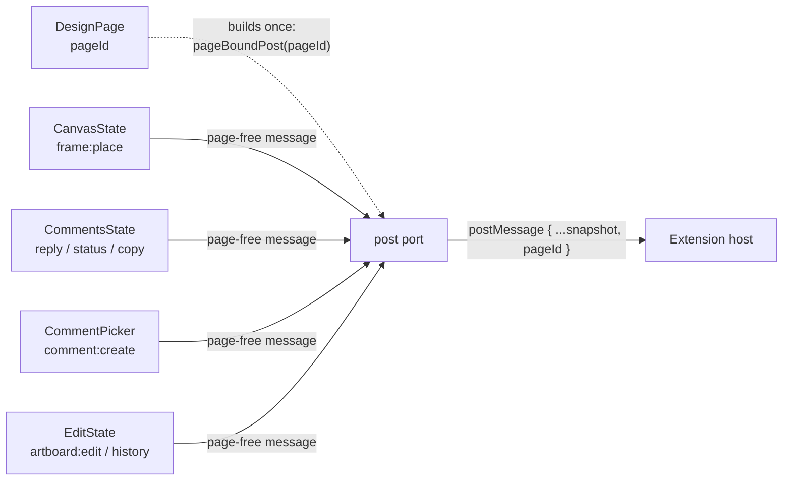

# Page-bound post port (11c4) - Overview for review

Source of truth: `blueprint/history/features/11c4-page-bound-post-port.md`. This file is the steering summary, not the build spec.

## TL;DR

Four chrome state classes used to keep their own page id and call one of three hostBridge post
helpers with it. Now `DesignPage` builds one post port per page, `pageBoundPost(pageId)`, and hands
the same function to all four. The classes post page-free messages; the port adds the page id.
Nothing the host receives changed.

## What you will see

Nothing. Every request leaves the panel with the same bytes as before.

## Data flow (inside the chrome)

`App` remounts `DesignPage` for each page (`{#key}`), so each page has exactly one port bound to
its own id.

## Decisions locked

- One port function with one identity and no per-class wrapper. Each class's type accepts only
  the requests it sends: the picker only `comment:create`, `CommentsState` the other four comment
  writes.
- `CanvasState` keeps a private `pageId` for the saved stage view only.
- No new unit test: runes and `acquireVsCodeApi` do not run in Node Vitest. The browser specs
  assert `pageId` on all 8 page-bound request types (the undo one was added here). A mutation
  probe that dropped `pageId` failed the undo test.

## Out of scope

Saved-state helpers, `postToFrame`, page-menu requests, host code, message shapes, 11d and 11e.

## Glossary

| Term | Why it exists |
| --- | --- |
| Page-bound request | A chrome request that acts on the page it came from, not the page open now |
| Post port | One function that posts a page's requests and stamps its page id |

## Done means

`pnpm verify` passes (75 files, 927 tests). `pnpm test:browser`: 231 passed. The dual audit
passed, and F-01 (P3, a comment) is closed.
