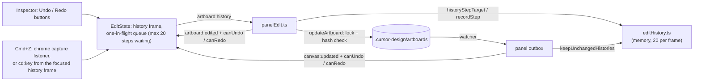

# 9f Undo/redo - Overview for review

> **Generated file.** Human-facing steering summary of the active work item:
> same content as `current-feature.md`, trimmed. Written at `/feature` when the
> spec is created, and kept current if the spec is revised. `/complete` may
> polish this into the archive-ready one-pager; it is not the first write.
> Open in Markdown preview to render the diagrams.

Source of truth: `blueprint/history/features/09f-undo-redo.md`. This file is the steering summary, not the build spec.

## TL;DR

Undo and Redo for your own Edit-mode saves. The extension keeps up to 20 whole-file snapshots
per frame in memory while the panel is open. Undo writes the previous file back through the same
hash-checked, locked write an edit uses, so it can never overwrite the Agent's or the editor's
work. An outside change clears that frame's history; a new edit clears redo. Inspector buttons
plus Cmd+Z / Cmd+Shift+Z (checked in Cursor by an agent and by Bombic).

## System map



## Key loop

```mermaid
sequenceDiagram
  participant U as User
  participant C as Chrome
  participant F as Frame
  participant H as Host
  participant D as Disk
  U->>C: Undo (button, or Cmd+Z with focus on the inspector or in the edited frame)
  C->>H: artboard:history {requestId, frameId, step}
  H->>D: updateArtboard {snapshot from memory, baseHash: last written}
  alt written
    H->>C: artboard:edited {…, html, canUndo, canRedo}
    C->>F: reload the frame from the restored file
  else file changed outside, or gone
    H->>H: forget this frame's history
    H->>C: ui:error ("…its undo history was cleared.")
  end
  D-->>H: watcher echo
  H->>C: canvas:updated (flags read at send; own echo keeps the history)
```

## What you will see

- In Edit mode, **Undo in Hero** / **Redo in Hero** before ↑ ↓; greyed out when unavailable.
- Undo reloads the frame with the file as it was; the selection clears but the buttons keep
  acting on that frame. A screen reader hears "Undone in Hero."
- An Agent update or editor save of the file greys Undo out (the frame reloads as before).
- History survives a tab switch; closing the panel clears it.

## Decisions locked

- From Notion: 20 whole-file steps per frame, memory only, panel session; the same checked write;
  outside change clears, own echo does not; new edit clears redo; buttons, keys after a spike.
- Made in this build: a step reloads the frame; the buttons act on the frame of the latest pick
  *from a focused frame* (F-146); any history-held hash counts as the extension's own (so a slow
  refresh cannot wipe history); any folder change clears all history; one answer type
  (`artboard:edited`) for edits and steps.
- Trust: undo writes only bytes the host read or produced; a design script's `cd:key` or pick
  counts only from the focused frame in Edit mode; at most 20 steps can wait in the queue.

## Out of scope

Undoing Agent / editor changes, history on disk, keeping scroll across an undo, a history list,
undo of drag/resize or comments, Escape-to-revert. 9g does the full real-frame verify.

## Glossary

| Term | Why it exists |
|---|---|
| Snapshot | The whole artboard file at one point; undo writes one back byte for byte |
| Checked write | `updateArtboard` with the expected hash under the workspace lock; refuses if the file changed |
| History frame | The frame the Undo / Redo buttons act on |
| Echo | The file watcher's refresh after the extension's own write |

## Done means

- `pnpm verify` 729 unit tests; `pnpm test:browser` 164/164; `pnpm gallery` contrast green.
- Cursor run (agent over CDP): edit, undo to the exact original bytes, redo, keys from the
  inspector and the frame, outside change, tab switch, close/reopen: all pass. Bombic confirmed
  real Cmd+Z / Cmd+Shift+Z.
- Independent review passed (fresh Opus 5.5 subagent, target `cf238c4`); audit findings
  F-145–F-152 closed except F-149 (unverified).
