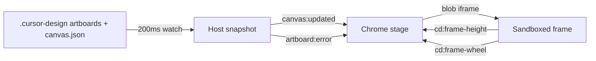
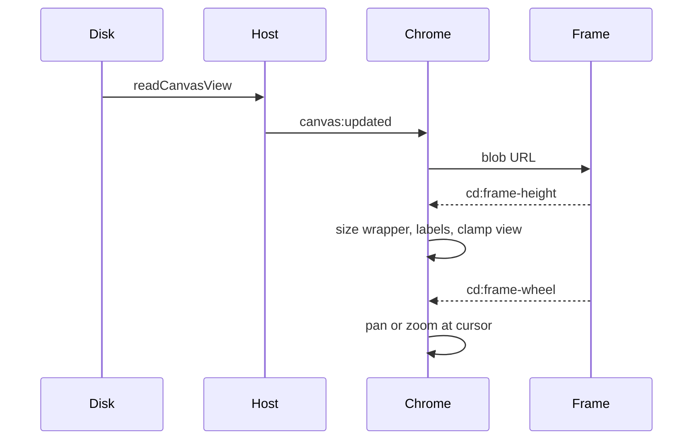

# Frames - Overview for review

Source of truth: `blueprint/history/features/06d-frames.md`. This file is the steering summary, not the build spec.

## TL;DR

Every artboard is now its own sandbox iframe on the stage: fixed width from `canvas.json`, full content height, no inner scroll. Labels and group headings sit above. An empty or broken frame is a red tile; the rest keep working. Disk HTML is still pristine. Not merged until you approve the work commit and squash.

## Flow

1. Disk reads every artboard + layout (`readCanvasView`).
2. Host posts `canvas:updated` with all frames.
3. Chrome draws one iframe (or tile) per frame, then labels/headings.
4. Each iframe reports height (`cd:frame-height`) and forwards wheel (`cd:frame-wheel`).
5. Chrome pans/zooms the stage. Nested scroll boxes inside a design get the wheel first.

## System map

## Key loop

## What you will see

- Several frames at once, each labeled; a **Desktop** (or other) heading over grouped frames.
- Active frame outlined; badge shows id + generation.
- Short sections shrink below 800px. A `100vh` hero stops growing (F5: ~1600px, not 20000) and may clip below the fold.
- Empty file: red tile `Empty artboard file.` Wheel/drag on a tile pans the stage.
- Pinch / ctrl+wheel over a frame zooms at the cursor. Plain wheel pans, unless an inner scroller can still scroll.

## Data flow

Workspace `.cursor-design/` is source of truth. MCP tools did not change in 6d (`place_frame` was 6b). Host never writes artboard HTML. Runtime is injected only into the blob copy.

## Architecture decisions

- One blob iframe per frame, `sandbox="allow-scripts"`, `scrolling="no"`.
- Frame messages trusted only as typed numbers, and only from that iframe's `contentWindow`.
- Per-frame 1.5M HTML cap (tile, no global banner). No total payload cap across frames.
- Labels/headings/tiles are `textContent` only. They scale with zoom.

## Decisions locked

- Corrupt `canvas.json` auto-places frames and shows the existing error in the banner; the file is not rewritten.
- One unreadable HTML file tiles; siblings still load; Output logs the DiskError.
- Hide/show restores the saved view; no refit.
- Export/handoff stay active-artboard-only until 6e.

## Out of scope

Canvas export and `canvas.html` (6e). Reference four-frame dogfood (6f). Drag/resize by hand, frame list, Edit mode, MCP schema changes, rewriting `vh` in the blob.

## Glossary

| Term | Why it exists |
| --- | --- |
| Frame | One artboard file, one iframe, fixed width |
| Stage | Chrome layer that pans and zooms around frames |
| `cd:frame-height` | Iframe tells chrome how tall the content is |
| `cd:frame-wheel` | Iframe forwards pinch/wheel so the stage moves |
| Tile | Error/empty stand-in so a bad file cannot kill the canvas |
| Group heading | One chrome label (e.g. Desktop) spanning grouped frames |

## Your actions

F5 into `fixtures/dev-workspace` and open **Cursor Design: Open Artboard**. Next product work is 6e (canvas export) after this merge.

## Done means

Multi-frame canvas works in the panel. 155 tests pass. Independent review passed at `7ae31016`. 6e/6f still open on the 0.2 plan.
