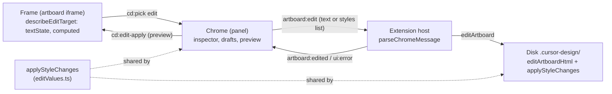
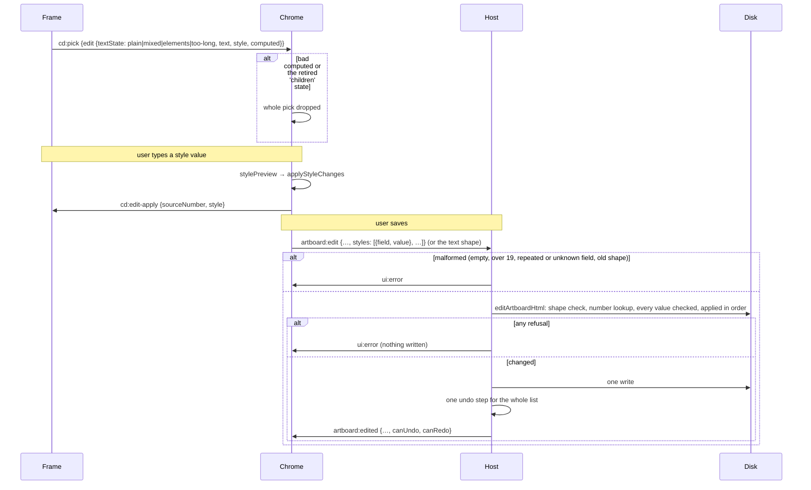

# 9h. More edit fields: saving - Overview for review

Source of truth: `blueprint/history/features/09h-more-edit-fields-saving.md`. This file is the
steering summary, not the build spec. Open in Markdown preview to render the diagrams.

## TL;DR

The save path and the canvas's report on the selected element now know everything the redesigned
inspector (9i) needs. 15 more properties can be saved, each with its own value check. One save can
change several properties as one write and one undo step. The canvas reports what an element holds
and the current value of every editable property. The inspector you see is unchanged.

## What you will see

Nothing new yet. The inspector still shows Text, Font size, Color, Padding and Margin, and the
gallery shots match `main`. One small widening is live today: Color now also accepts `#fff`,
`#ffff`, `#rrggbbaa` and `transparent`.

## System map

## Key loop

## Rule logic

- **Values:** fixed keyword lists (weight 100–900, align, case, overflow, border style, italic,
  underline / strikethrough), hex or `transparent` for the three colours, 0–1 for opacity,
  unitless `1.6` for leading (`1.` and `-1.5` refused), today's length rule for the rest. No
  saved value can hold a quote, `;`, `:`, `<` or anything that ends the style attribute.
- **Shorthands:** setting `gap`, `border-radius`, `overflow` or a border field drops only its own
  longhands. A field set before a later parent shorthand (`font`, `text-decoration`,
  `background`, `border…`) moves after it so it still applies.
- **Border Reset:** clearing all three border fields in one save also removes `border:` and its
  per-side shorthands. Clearing one or two leaves them.

## Decisions locked

- Field order: today's four first, then the 15 new ones; lists match exactly what 9i offers.
- The old single-property save shape is gone; panel and host ship together.
- `edit.computed` is the one source of current values for edit fields; `display` (9i's Gap
  check) stays in the pick's comment style list.
- The size limit on the canvas code in every export was re-baselined to 39,925 characters.
- `prototypes/` stays in the repo for 9i and is kept out of the `.vsix`.

## Out of scope

Any inspector UI change (sections, new controls, Reset and Add border buttons, set dot, tokens):
9i. Per-side spacing, font family, shadow, transform, size, layout. MCP tools, the Agent skill,
comments.

## Glossary

| Term | Why it exists |
|---|---|
| `edit.computed` | the browser's current value of each editable property, for 9i's grey inherited values |
| `textState` | what the element holds: `plain` text, text `mixed` with elements, only `elements`, or `too-long` |
| `applyStyleChanges` | the one rule that applies a list of style changes, so preview and save agree |
| Border parents | `border` and its per-side shorthands, which a later border field must not be hidden behind |

## Done means

- `pnpm verify` green (754 unit tests), `pnpm test:browser` green (169), inspector gallery
  unchanged.
- Three independent fresh-subagent reviews; the last passed at `f5d4e34` with no new findings.
  F-162, F-163 and F-164 (all P3) were found, fixed and closed.
- No F5 or real-Cursor run in 9h; 9i ends with it.

## Your actions

None.
