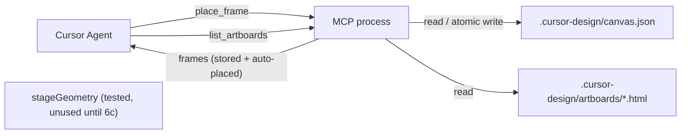
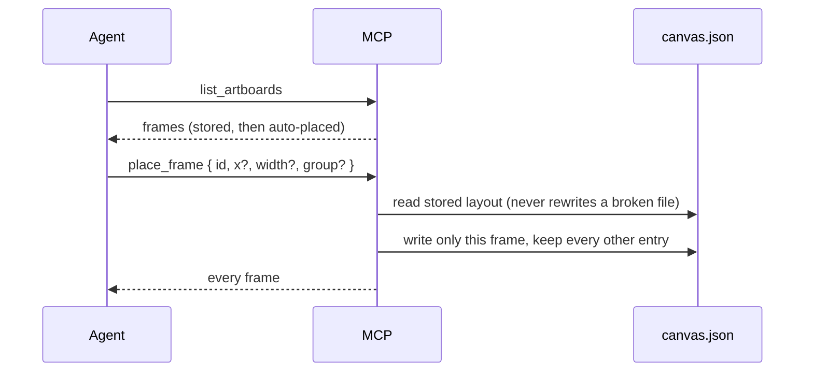

# Contract (6b) - Overview for review

Source of truth: `blueprint/history/features/06b-contract.md`. This file is the steering summary, not the build spec.

## TL;DR

The data and math foundation for the multi-frame canvas. The panel is unchanged. The Agent can now position frames on disk with `place_frame` and read the layout back from `list_artboards`, and the stage zoom/pan/fit math exists, tested, and waits for 6c.

## What you will see

- A new MCP tool, `place_frame`, to set one frame's `x`, `y`, `width`, `label`, or `group`.
- `.cursor-design/canvas.json` appears the first time a frame is placed.
- `list_artboards` also returns `frames`: every artboard with its stage position. Artboards the Agent never placed are lined up to the right of the others (24px gap), computed on read and never written.
- The Artboard panel looks the same as before.

## Data flow

## Key loop

## Decisions locked

- `canvas.json` is `{ version: 1, frames: [{ id, label, x, y, width, group? }] }`. Height is never stored. A missing file is an empty layout.
- Width defaults to 1280 and is clamped 120-3840, on `place_frame` and when reading a hand-edited file.
- A corrupt or future-version `canvas.json` is never overwritten. Tools return a clear error saying how to fix or delete it.
- `place_frame({ id })` with no other field pins that frame where it currently sits. `group: ""` removes a group. Omitted fields keep their value.
- Frames whose HTML is gone are hidden from results but kept in the file. Unplaced siblings are never pinned as a side effect.
- `place_frame` uses `id` (as Notion locks it); older tools use `artboardId`.
- `place_frame` also fails on a corrupt `manifest.json`, the same as `list_artboards`, and writes nothing.
- Stage view math: `screen = stage * zoom + translate`. One wheel notch is capped at about 20%. Frames can never be panned fully off screen. Fit-all centers and never zooms past 100%.

## Out of scope

- Stage, frames, labels, toolbar, presets, persisted view in the panel (6c/6d).
- Canvas export and `handoff_status` changes (6e).
- Dragging, resizing, or deleting frames; pruning orphan entries.

## Glossary

| Term | Why it exists |
|---|---|
| Frame | One artboard's place on the stage: position, width, label, group. |
| Stage | The shared canvas the frames sit on, in stage px. |
| Auto-placed | A frame with no `canvas.json` entry, laid out to the right on read. |
| Pin | Writing a frame's current position into `canvas.json`. |
| Orphan | A stored frame whose artboard HTML no longer exists. Hidden, kept. |
| `group` | Free-text name (for example Desktop, Mobile) to cluster frames. |

## Your actions

- Decide the stage zoom range before 6c inlines the geometry. Default is 10-400%; the shipped 6a chrome is still 50-200%.
- Remove any stale installed `cursor-design` VSIX from `~/.cursor/extensions` and fully quit Cursor, or the dev host can keep spawning an old MCP without `place_frame`.

## Done means

- Unit tests (120) pass, and the F5 MCP sequence behaved as specified: two stored frames, the rest auto-placed to the right, unknown id returns `ARTBOARD_NOT_FOUND`.
- The panel was not changed (no existing panel or host file was touched). A visual glance at the panel was not recorded.
