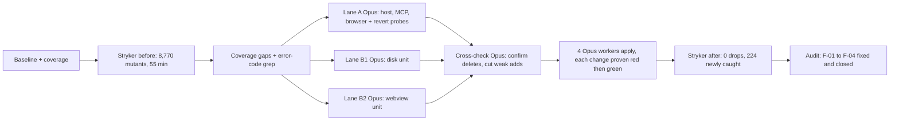

# Test effectiveness review (11f) - Overview for review

Source of truth: `blueprint/history/features/11f-test-effectiveness-review.md`. This file is the steering summary, not the build spec. Full evidence: `blueprint/reference/11f-test-review.md`.

## TL;DR

The tests were run against 8,770 deliberate small bugs (Stryker mutation testing). 85% got caught. Three Opus reviewers plus a cross-checker found which tests catch nothing unique, which important behavior had no test, and which tests only checked mocks. 56 useless tests were deleted, about 70 assertions were added or sharpened (each proven to fail against its bug), and a second run showed 87.9% caught with no previously caught bug slipping through. No product bug was found; product behavior is unchanged.

## Flow

## What you will see

| | Before | After |
|---|---|---|
| Unit tests | 836 | 794 |
| Browser tests | 209 | 210 |
| Mutation score | 85.0% | 87.9% |
| Mutants nothing catches | 1,315 | 1,060 |
| Previously caught, now missed | | 0 |

Biggest gaps closed: MCP tools on a non-first page (all six could be hard-wired to page-1 with every test green), an Agent placement lost to a panel drag, raw error text reaching the Agent, blank or oversized comments corrupting `comments.json`, `update_artboard` without a base, comment-list "last read wins", Enter and Space blocking in Comment mode.

## Decisions locked

- Stryker ran only in throwaway worktrees; nothing mutation-related is in `package.json` or CI.
- A test was deleted only when it was the sole catcher of no mutant and covered no unique branch, or a probe showed another test fails on the same break.
- Real product bugs would have been fixed here test-first; none were found.
- Host tests that only verify mock calls are listed for 11c (ports), not rewritten here.

## Out of scope

- Rewriting host tests onto ports (11c), shrinking `hostMessages` re-validation (11d).
- `submit`, `dblclick`, `auxclick`, `contextmenu` blocking in Comment mode still has no dedicated browser test (known gap in the report).
- F-05 (P3, open): `sc-` in `GENERATED_PREFIXES` is unreachable behind finder's own check.

## Glossary

| Term | Why it exists |
|---|---|
| Mutant | A small deliberate bug (flip `<`, drop an `if`) to see if any test notices |
| Killed / survived | A test failed on the mutant / every test stayed green |
| Equivalent mutant | A change with no observable effect; not a gap |
| Revert probe | Break the guarded line by hand, run the test, restore: proves the test bites |

## Done means

`pnpm verify` green (65 files, 794 tests), `pnpm test:browser` 210 passed, no previously caught mutant lost, audit findings F-01 to F-04 closed.
