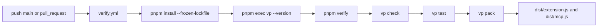
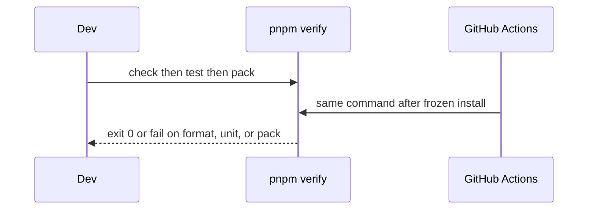

# Verify + CI - Overview for review

Source of truth: `blueprint/history/features/07h-verify-ci.md`. This file is the steering summary, not the build spec.

## TL;DR

One local command, `pnpm verify` (`vp check && vp test && vp pack`), and a GitHub workflow that runs that same command on push to `main` and on pull requests. Electron, coverage, and knip stay out. No product behavior change.

## Flow

1. Work sat on `feature/verify-ci`, stacked on 7g (`d9b719c`). `main` was still 7b (`43cce2c`).
2. `package.json` gained `scripts.verify` only. `compile` stayed `vp check --no-fmt && vp pack` so F5 stays fast.
3. `AGENTS.md` Commands lists Verify immediately after Check. README Develop fence is `pnpm install` / `pnpm compile` / `pnpm verify`.
4. `.github/workflows/verify.yml` is `contents: read`, Node 24, pnpm 12, frozen install, `pnpm exec vp --version`, then `pnpm verify`.
5. Observed `pnpm verify`: 64 files formatted, 52 lint/type clean, 14 files / 204 tests, pack wrote both dist files.
6. `.vsix` listing: `extension/dist/extension.js` and `extension/dist/mcp.js`, no `node_modules`. Live F5 was waived in the complete session (no `src/` change).

## System map

## Key loop

## What you will see

- `pnpm verify` in package scripts, AGENTS.md, and README.
- A Verify workflow on push to `main` and on pull requests.
- Product chrome, MCP, and disk unchanged versus 7g.

## Locked decisions

- Verify is check + unit test + unminified pack. Never Electron, coverage, or knip.
- Format drift fails `vp check` on purpose. Do not weaken Verify to `--no-fmt`.
- Vite+ comes from `vite-plus` 1.3.0. Prove it with `pnpm exec vp --version`. No second install.
- Workflow permissions are `contents: read` only. No secrets.
- `pnpm vsix` minifies `dist/` via prepublish. F5 compile rewrites the unminified bundle.

## Out of scope

Product edits, Electron in CI, coverage thresholds, knip in Verify, husky, `act`, Docker, branch protection, `/ci` skill, `packageManager`, committed `.vsix`.

## Glossary

| Term | Why it exists |
|---|---|
| Verify | The one check + test + pack command CI and local both run |
| `vp pack` | Unminified bundle used by Verify and by F5 compile |
| Electron suite | `pnpm test`; needs a display; not Verify |

## Done means

- `pnpm verify` exits 0 locally.
- Workflow file matches the locked contract.
- `.vsix` lists both dist files and no `node_modules`.
- No `src/` change.
