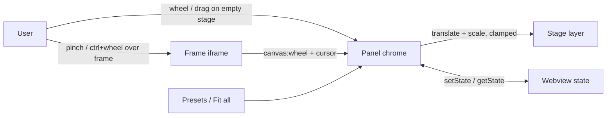
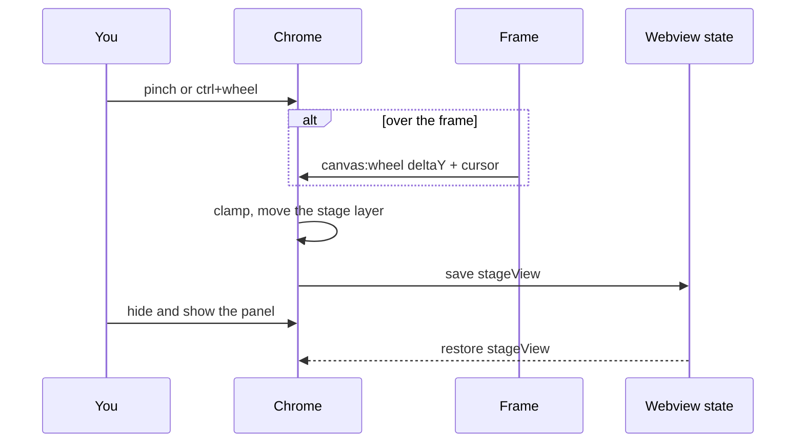

# Stage (6c) - Overview for review

Source of truth: `blueprint/history/features/06c-stage.md`. This file is the steering summary, not the build spec.

## TL;DR

The panel is now a Figma-style stage. Pinch, ctrl+wheel, and Cmd+wheel zoom around the cursor. Plain wheel and empty-stage drag pan. A toolbar shows the zoom, nine presets, and Fit all. Until 6d, the stage holds one frame: the active artboard at a fixed 1280×800.

## What you will see

- First open fits the frame (100% or less). After that, zoom and position stay when you switch tabs, edit the artboard, or switch the active artboard.
- Pinch / ctrl+wheel / Cmd+wheel zooms at the cursor, over the empty stage and over the frame. Range 5–1000%. Trackpad pinch is fine; one mouse notch is about 20%.
- Plain wheel pans the empty stage. Over the frame it still scrolls inside the page.
- Dragging the empty stage pans. The frame can never be pushed fully off screen.
- Toolbar: zoom %, presets 50–200% (with 150) around the stage center, and Fit all (never past 100%). Presets and Fit all stay disabled until an artboard is showing.
- The frame stays 1280px wide at every zoom, so a fixed header sits at the frame's top.

## Data flow

## Key loop

## Decisions locked

- Zoom and pan move the stage layer, never the frame iframe.
- Zoom 5–1000%. Presets 50–200% with 150, applied at the stage center. Fit-all capped at 100%.
- Pinch is the browser's ctrl/meta wheel event. No separate touch handling.
- The view lives only in webview state. No disk, MCP, or host change.
- The only iframe message is still `canvas:wheel`, now with the cursor. 6d renames it to `cd:frame-wheel`.
- The frame is a provisional 1280×800 at stage (0, 0) until 6d reads canvas.json widths and reported heights.

## Out of scope

- Many frames, real widths, full height, labels, error tiles (6d).
- Canvas export (6e).
- Keyboard zoom shortcuts, space-drag, inertia.
- View saved across a full window reload.

## Glossary

| Term | Why it exists |
|---|---|
| Stage | The clipped panel surface you zoom and pan. |
| Stage layer | The transformed layer the frame sits on. |
| Frame | The live artboard iframe, fixed 1280×800 in 6c. |
| `stageView` | `{ x, y, zoom }` in webview state. |
| Fit all | Zoom to show the whole frame, never past 100%. |

## Your actions

- F5 on `fixtures/dev-workspace` with `canvas-6b` if you want another pass. Reload the Extension Host after pull.
- Next planned slice is 6d Frames.

## Done means

- `pnpm compile` and 131 `node:test` cases passed.
- F5: first-open fit, zoom at cursor, wheel and drag pan, presets, Fit all, saved view across tab switch, 1280px frame, empty toolbar disabled.
