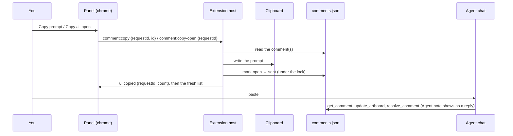

# Copy prompt - Overview for review

Source of truth: `blueprint/history/features/08h-copy-prompt.md`. This file is the steering summary, not the build spec.

Open in Markdown preview to render the diagrams.

## TL;DR

Every comment has a **Copy prompt** button, in the Comments panel and in a pin's thread. It copies
the locked Notion prompt, filled in with that comment, to your clipboard. The comment turns **Sent
to Agent** only after the copy succeeds.

**Copy all open (N)** at the top of the panel copies one prompt listing every open comment id. You
paste it into Cursor Agent chat yourself, and the Agent handles each id with `get_comment`,
`update_artboard` and `resolve_comment`.

## Flow

1. Click **Copy prompt** on a comment. The button reads **Copied** for 1.5 s, and screen readers
   hear "Prompt copied. Comment marked sent."
2. The card and its pin switch to Sent to Agent.
3. Paste into Agent chat.
4. Or click **Copy all open (3)**: one prompt with 3 ids, and all 3 turn Sent.

## Key loop



If anything fails, the host answers `ui:error` with a message under the button and still sends a
fresh list. A failed clipboard write marks nothing sent.

## The two prompts

Single (Notion, word for word):

```txt
Handle cursor-design comment {id} only.
First call get_comment("{id}"). If it is resolved, stale or the target is missing, stop and tell me.
Artboard: {artboard} (frame {frameId}, version {version})
Target: {selector} "{text}"
Current styles: {styles}
Comment: {body}
Make the change with update_artboard, then call resolve_comment("{id}", note) with a one-line note of what you changed.
```

Batch (Bombic, 2026-11-17):

```txt
Handle these cursor-design comments, in this order:
- {id1}
- {id2}
For each id: first call get_comment("{id}"). If it is resolved, stale or the target is missing, skip it and tell me at the end.
Otherwise make the change with update_artboard, then call resolve_comment("{id}", note) with a one-line note of what you changed.
```

## Decisions locked

- Clipboard first, status second.
- One copy at a time, so the clipboard always holds the prompt you were told was copied.
- Copy works on every status. A sent or resolved comment stays as it is.
- Artboard, selector and element text are forced onto one line, with quotes and direction-control
  characters removed. A design's own script then can't add fake instructions. Your comment body
  keeps its line breaks.
- The batch uses `comments.json` order, which is creation order.

## Out of scope

Prefilled or automatic Agent chat, re-sending `sent` comments in the batch, MCP or skill changes,
and 8i (full F5 dogfood, `.vsix` smoke, README).

## Glossary

| Term | Why it exists |
|---|---|
| Sent | Status meaning "handed to an Agent in a prompt". Copy all open skips these. |
| `count` | How many comments a copy actually moved from open to sent: 0 on a re-copy |
| Locked template | Notion fixes the prompt wording; a literal test fails if one character changes |

## Your actions

At `/check`, in Cursor (F5):
1. Copy one open comment, paste it into Agent chat, and compare it with the template. The card and
   pin show Sent.
2. Copy all open with 3 open comments: 3 ids in order, and all turn Sent.
3. Copy a comment the Agent already resolved: it pastes, and the comment stays Resolved.
4. Hand the batch to the Agent: it handles each id, and its notes appear as replies.

## Done means

All four build steps are checked.

| Check | Result |
|---|---|
| `pnpm verify` | 512 unit tests |
| `pnpm test:browser` | 110 tests |
| `knip` | clean |
| Independent review (fresh Opus 5.5 subagent) | passed, one P3: F-91, a duplicated copy-type check |
| F5 checks above | pending at `/check` |
