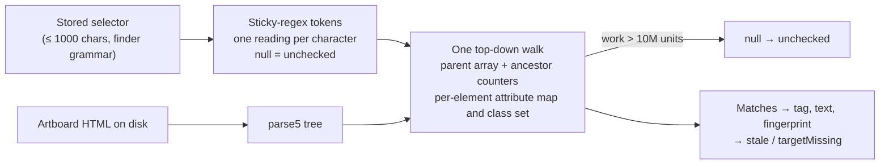

# Drop the Electron test suite and css-select - Overview for review

Source of truth: `blueprint/history/fixes/drop-the-electron-test-suite-and-css-select.md`. This file is the steering summary, not the build spec.

## TL;DR

Two dependency cuts, shipped 2026-11-18.

- **Electron test suite removed.** It only ever held the scaffold's sample test and cannot run Cursor's API. That took 99 packages out of the install, and `pnpm test` now runs the real unit suite.
- **css-select replaced.** An in-house matcher, `src/disk/selectorMatch.ts`, now checks comment targets on disk in one linear walk with one honest work limit, using matching rules proven in real Chromium. The extension ships 5 runtime packages instead of 14.
- **Reviewed hard.** Two fresh reviewers (Opus 5.5, Fable 5.2) found a hang, a crash and an unbounded-cost path. All are fixed and closed.

## Flow

## What you will see

- **Normal comments:** nothing changes. All 110 real picks gave the same match and fingerprint as css-select.
- **Comments the old caps refused:** on very deep or very wide pages, or with longer selectors, they now get a real fresh or stale answer instead of "unchecked".
- **One-time stale:** a comment whose target contains an element with both a namespaced and a plain attribute of one name (SVG `xlink:href` + `href`), or integer-like attribute names, reads stale once. The old tree format dropped or reordered those attributes in the fingerprint.
- **`pnpm test`** runs Vitest.

## Decisions locked

- **Chromium is the authority.** One case table runs through the matcher (in Verify) and through Chromium (in the browser tests).
- **Work limit:** 10 million units per match. A unit is one compound or simple-selector check, one attribute read, or one folded value character. The worst case measured about 0.3-0.7 s; past the limit the comment reads "unchecked".
- **The matcher never throws.** It returns `null` for anything outside the grammar or past 1000 characters, and a throw from it is treated as a bug.
- **No new dependencies.** Tests use fast-check, happy-dom and Playwright.

## Out of scope

- F-125 (unverified): parse5's tree can differ from Chromium's on rare markup (no doctype, declarative shadow DOM, `<select>` content). This predates the change and is tracked.
- `@vitest/coverage-v8` and knip stay.

## Glossary

| Term | Why it exists |
|---|---|
| Finder grammar | The selector shapes our picker emits: tags, `#id`, `.class`, `[attr="v"]`, `:nth-child(n)`, `:nth-of-type(n)`, joined by `" > "` or `" "` |
| Case table | One list of pages, selectors and expected matches, checked against both our matcher and Chromium |
| Work limit (`MAX_MATCH_WORK`) | The most one match may cost before it gives up as "unchecked", so a hostile page cannot freeze the extension |
| Oracle | A random cross-check against happy-dom on simple trees, with selectors built from true facts about the page |

## Done means

- `pnpm verify` passes (574 tests), `pnpm test:browser` passes (135), and `pnpm knip` is clean.
- The `.vsix` file list is unchanged.
- Findings F-118 to F-124 and F-126 to F-129 are closed and archived with the fix.
