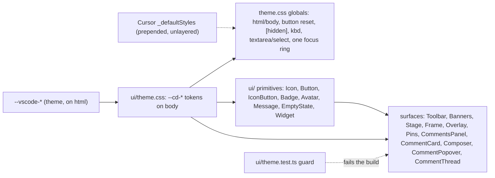

# Chrome design system - Overview for review

Source of truth: `blueprint/history/fixes/chrome-design-system.md`. This file is the steering summary, not the build spec.

## TL;DR

The whole webview chrome moved onto one design system, "native, quiet, editor-grade". It has one token file over the editor theme, a small set of shared components, and a guard test that keeps every surface on them. Behavior is unchanged, except for the approved copy and the numbered pins. The before/after of 90 states in both themes is at https://claude.ai/artifact/7Y1ZT88vtmYFiBCjuy34Hj.

## System map

## What you will see

- **Toolbar:** a title bar with the named Interact | Comment switch, one zoom control that shows its value, and icon buttons.
- **Canvas:** frames on a tinted stage with real edges. Notices have icons, and empty and error states explain the next step.
- **Comments panel:** the header stays put, with a summary and one primary action, "Copy N open comments for Agent". Cards are numbered and show status badges and threads.
- **Agent identity:** purple marks the Agent: its avatar, the reply tint, sent pins and the copy action.
- **Pins:** numbered teardrops at the element's corner; the number matches the card.
- **States:** one focus ring visible on every control, disabled controls use VS Code's colour, and saving shows a spinner with "Adding…".

## Architecture decisions

- **No cascade layers.** Cursor prepends an unlayered default stylesheet to every webview. A layered base would lose to it, so the global rules win by source order instead.
- **Tokens on `body`.** VS Code's dark and high-contrast classes sit on `body`, so declaring tokens there lets the derived tokens re-resolve per theme.
- **One theme reader.** Only `ui/theme.css` reads `--vscode-*`. Components read `--cd-*` tokens: the value-named spacing scale, sizes, named tints and `--cd-accent`.
- **Primitives own control states.** Focus, disabled, pending and pressed looks live in the primitives. The guard test fails on a raw theme variable, a colour literal, a stray state rule, `:global(`, a meaning colour on text, or an inline style.
- **Display rules are pure modules with tests:** numbers, summary, handoff copy, zoom choices and badges.
- **Browser tests use the real host stylesheet.** They run with Cursor's own default stylesheet and theme values (`vscodeHost`), and `pnpm gallery` reproduces every state with a contrast check.

## Decisions locked

- **No Zod in the chrome.** It would add about 13% to the bundle, and it can never ship in the frame runtime.
- **Pin numbers follow `comments.json` order.**
- **Copy blocking stays `aria-disabled`.**
- **The locked Agent prompts are untouched.**

## Out of scope

Grouping overlapping pins, hiding resolved pins, dismissable banners, a selection shared across pin, card and thread, constant-size frame labels, a cursor inside the artboard, and `noUncheckedIndexedAccess`.

## Glossary

| Term | Why it exists |
|---|---|
| Token (`--cd-*`) | One named value per role (surface, text level, accent), so a theme-wide fix happens in one place |
| Primitive | A shared component (Button, Badge, Widget…) that owns one control's look |
| Guard test | A static check that fails the build when a component bypasses the tokens or primitives |
| `vscodeHost` | A browser-test option that loads Cursor's real default stylesheet and theme colours |
| Gallery | `pnpm gallery`: screenshots of 90 states in both themes plus contrast numbers |

## Your actions

None required.
- **Follow-up:** F-115 (two pins on one element stack on one point) and F-116 (a 0-count copy briefly looks enabled) remain open for a small `/fix`.
- **Notion:** the 0.3 brief may still say "Copy prompt".

## Done means

| Check | Result |
|---|---|
| `pnpm verify` | 555 unit tests, 0 format, lint or type issues |
| `pnpm test:browser` | 123 passed |
| `pnpm gallery` | 182 shots; contrast fails only the documented dark input-focus ring (VS Code's own colours) |
| `pnpm knip` | clean |
| Reviews | spec (Breaker + Literalist), foundations, critical review (3 Opus reviewers), refactor review (3 reviewers + 2 validators), fresh-agent audit (P1s closed) |
