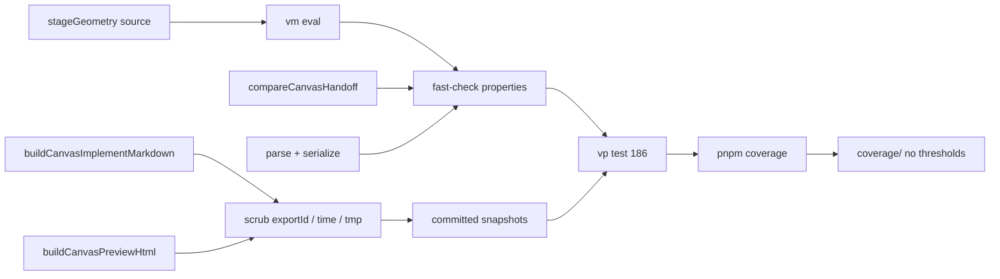
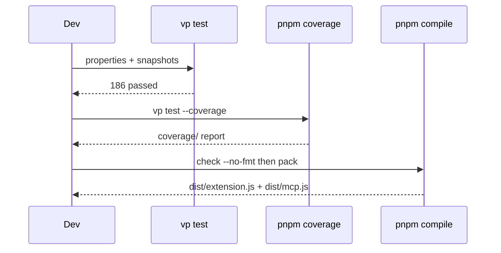

# Test depth - Overview for review

Source of truth: `blueprint/history/features/07f-test-depth.md`. This file is the steering summary, not the build spec.

## TL;DR

fast-check 4.10.2 properties lock stage geometry, the handoff stale check, and zod manifest/meta byte-equal round-trips. Scrubbed snapshots lock `IMPLEMENT.md` and `canvas.html` builder output. `pnpm coverage` writes a report with no thresholds. No product change. No Verify command yet (that is 7h).

## Flow

1. Work sits on `feature/test-depth`, stacked on 7e (`feature/stricter-static-checks` `380143f`). `main` is still 7b (`43cce2c`).
2. `vp test` is still the Test command. The lock moved from 177 to 186 passed.
3. `pnpm coverage` runs `@vitest/coverage-v8` 5.0.5 and writes `coverage/`. Lint/fmt ignore that directory.
4. `pnpm compile` still writes `dist/extension.js` and `dist/mcp.js`. Do not treat a live F5 session as 7f evidence.

## System map

## Key loop

## What you will see

- `vp test` prints **186 passed** across the same 13 files (or 184 + 2 skipped if the process uid is 0).
- Two committed snapshots under `src/disk/__snapshots__/` use `<exportId>` / `<exportedAt>` and keep hashes and frame ids.
- `package.json` has `fast-check` 4.10.2, `@vitest/coverage-v8` 5.0.5, and a `coverage` script. `vite.config.ts` sets the v8 provider only: no `thresholds`, no `coverage.enabled: true`.
- `coverage/` is in `.gitignore` and `.vscodeignore`, and ignored by lint/fmt.
- AGENTS.md has a Coverage bullet. The coding-standards Testing line names the script as report-only, not Verify.
- `pnpm knip` still exits 0. `pnpm compile` still writes both `dist/` files.

## Data flow

Properties run against current helpers only: geometry through the existing `node:vm` eval, stale through `compareCanvasHandoff`, zod through parse/serialize. Snapshots scrub builder strings, not temp export trees. Coverage is a local report, not a gate.

## Architecture decisions

- Properties characterise current functions. Existing example tests win if a property disagrees. No product file under `src/` except `*.test.ts` changed.
- Never-exported `compareCanvasHandoff` stays `{ exported: false, stale: false }` and wins even when a current hash is undefined. Do not "fix" that to match `handoff_status`.
- Snapshots import `expect` / `toMatchSnapshot` from `vite-plus/test`. No direct `vitest` dependency.
- Coverage is a script only. It is not inside `vp check`, compile, or Verify.

## Decisions locked

- Branch from 7e (`380143f`), not from `main` (`43cce2c`).
- fast-check 4.10.2. `@vitest/coverage-v8` 5.0.5.
- Unit lock is **186 passed**. Starting lock was 177.
- Scrub tokens are `<exportId>`, `<exportedAt>`, `<tmp>` only.
- No F5 or `.vsix` proof required for 7f. No Verify command.

## Out of scope

MCP contract tests (7g), Verify + CI (7h), coverage thresholds, product/MCP/disk edits, Electron suite, importing `vitest` as a package, F5 / `.vsix` proof.

## Glossary

| Term | Why it exists |
|---|---|
| fast-check | Property tests that generate many inputs. They lock today's helper behavior. |
| Scrubbed snapshot | Stored builder output with ids/times/tmp paths replaced so the file does not flake. |
| Coverage script | `pnpm coverage` writes `coverage/`. No fail-under number. Not Verify. |
| Never-exported | `lastExport` missing. The helper reports `{ exported: false, stale: false }`. |

## Done means

Properties and snapshots are green at 186; coverage script writes a report with no thresholds; knip stays 0; `pnpm compile` still writes both `dist/` files; no product behavior change.
