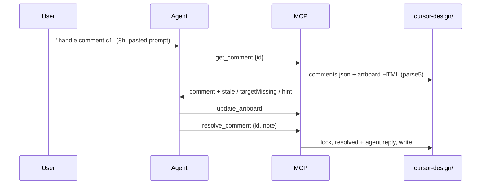
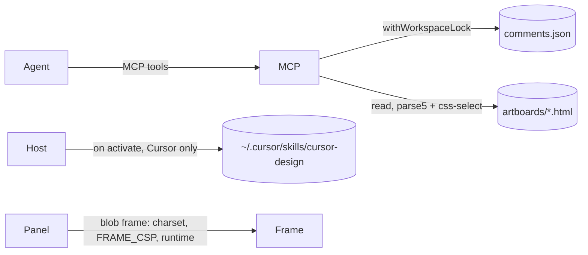

# Feature 8e: Comments disk + MCP - Overview for review

> **Generated file.** Human-facing steering summary of the active work item:
> same content as `current-feature.md`, trimmed. Written at `/feature` when the
> spec is created, and kept current if the spec is revised. `/complete` may
> polish this into the archive-ready one-pager; it is not the first write.
> Open in Markdown preview to render the diagrams.

Source of truth: `blueprint/history/features/08e-comments-disk-mcp.md`. This file is the steering summary, not the build spec.

## TL;DR

- **Comments on disk.** `.cursor-design/comments.json` now stores comments. The Agent can list
  them, read one, and resolve it with a note.
- **Accuracy flags.** Each comment says whether its element changed (`stale`) or is gone
  (`targetMissing`), checked from disk with the panel closed.
- **Agent skill.** Agents get a shipped skill that teaches them the tools and the artboard rules.
- **Frame security.** Artboard frames can no longer load anything from the network.

## What you will see

- Cursor's MCP settings list **11** cursor-design tools: the 8 artboard tools plus
  `list_comments`, `get_comment` and `resolve_comment`.
- `~/.cursor/skills/cursor-design/SKILL.md` appears after a Cursor start and updates itself with
  each extension version.
- An artboard that loads a CDN script, web font or image shows it blocked. Its own `<style>` and
  `<script>` still work.
- The panel itself looks the same. The comment UI arrives in 8f1 to 8h.

## Key loop

## System map

## Decisions locked

- **Stale means the comment's own element changed.** It compares a fingerprint of the element's
  HTML. Re-indenting doesn't count, and neither do edits elsewhere. A container goes stale when
  anything inside it changes.
- **Page comments are never stale.** They are only "missing" when their frame is deleted.
- **`artboard` is the artboard's title**, falling back to the frame id when the title is empty.
- **Uncheckable is reported, never guessed.** The check reports `null` flags with a hint for:
  - script-made targets;
  - selectors outside the picker's shape;
  - pages deeper than 64 levels, larger than 20,000 elements, or wider than 5,000 siblings.
- **Statuses.** Open → sent happens only through copy. Open or sent → resolved is done by the user
  or the Agent. Resolved → open is done by the user.
- **Caps.** 500 comments, and 2000 characters per body. 100 replies, with the last slot kept for
  the Agent's note.
- **Reply count in lists.** `list_comments` returns a `replyCount`; `get_comment` returns the
  thread.
- **Skill delivery.** The skill is copied when its bytes differ, never through a symlink. A drift
  test keeps it in step with tools, error codes and limits.

## Out of scope

- The panel's comment UI, pins and Comments panel (8f1, 8f2, 8g).
- Copy prompt (8h).
- Agent tools to add or reply to comments.
- Deleting comments.
- MCP server `instructions`.

## Glossary

| Term | Why it exists |
|---|---|
| Fingerprint | Hash of the commented element's HTML at creation; a change means stale |
| `FRAME_CSP` | The frame's own security policy: inline code only, nothing from the network |
| Agent skill | Instructions Cursor's Agent loads, so it uses cursor-design correctly |
| Lock | `.cursor-design/.lock`, so the panel and the Agent never overwrite each other's writes |

## Your actions

- One F5 check: symlink `~/.cursor/skills/cursor-design` to another folder, reload, and the linked
  file stays unchanged.
- Push `main` when ready. That needs a separate yes.

## Done means

- The archive, the build-plan tick and the system map all describe the shipped code.
- Checks passed: Verify (396 tests), browser tests (39), knip, and a `passed` independent review at
  `dff7bc0`.
