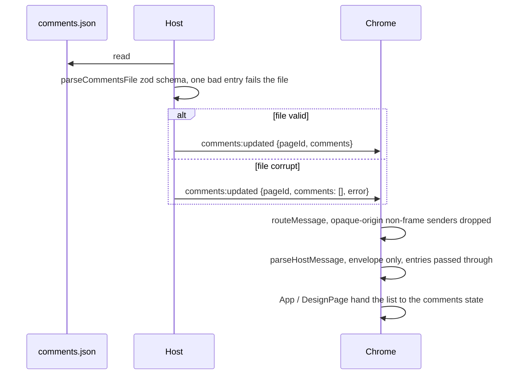

# Host message guard (11d) - Overview for review

Source of truth: `blueprint/history/features/11d-host-message-guard.md`. This file is the steering
summary, not the build spec.

## TL;DR

The chrome used to re-check every field of every comment the host posted, although the host already
checks each comment strictly when it reads `comments.json`. 11d deleted that second check (about 70
lines and 37 dead-weight mutants from 11f), kept every envelope check as a drift guard, and moved
the parser and router out of the message types file. No wire change.

## What you will see

Nothing new in normal use. One accepted edge: a hand-edited `comments.json` rect beyond 100,000 px
(the host checks it is finite, not its size) used to hide that comment. It now shows in the panel.
Its pin and jump follow the usual rules, so its jump highlight can be huge and spill across
neighbouring frames.

## Data flow

## Architecture decisions

- `src/webview/hostMessages.ts` is types only (563 → 268 lines), so the host's `import type`s stay
  DOM-free. `src/webview/hostMessageGuard.ts` holds `parseHostMessage` and `routeMessage`.
- The trust boundary is the host's `comments.json` parse plus `routeMessage`; the chrome parser is a
  drift guard for our own host, not a security check.
- The cast of the comment entries is rule 04's one recorded exception to "wire values are unknown
  until a guard checks them".
- Frame and page entry guards on `canvas:updated` stay.

## Out of scope

Any wire change, the host's own parsers (no cap added to `rectSchema`), the frame message guards,
zod in the chrome, 11e comments deep review.

## Glossary

| Term | Why it exists |
|------|---------------|
| Envelope | The message's own fields (`pageId`, the list, `error`), still checked by the chrome |
| Drift guard | Catches our own host posting a malformed message; not a defence against attackers |
| `routeMessage` | Sends frame messages to the frame parser and drops unknown sandboxed senders |

## Done means

`pnpm verify` green (926 tests), browser suite 231 passed, three mutation probes red then restored,
dual audit with ten P3 findings, all closed.
