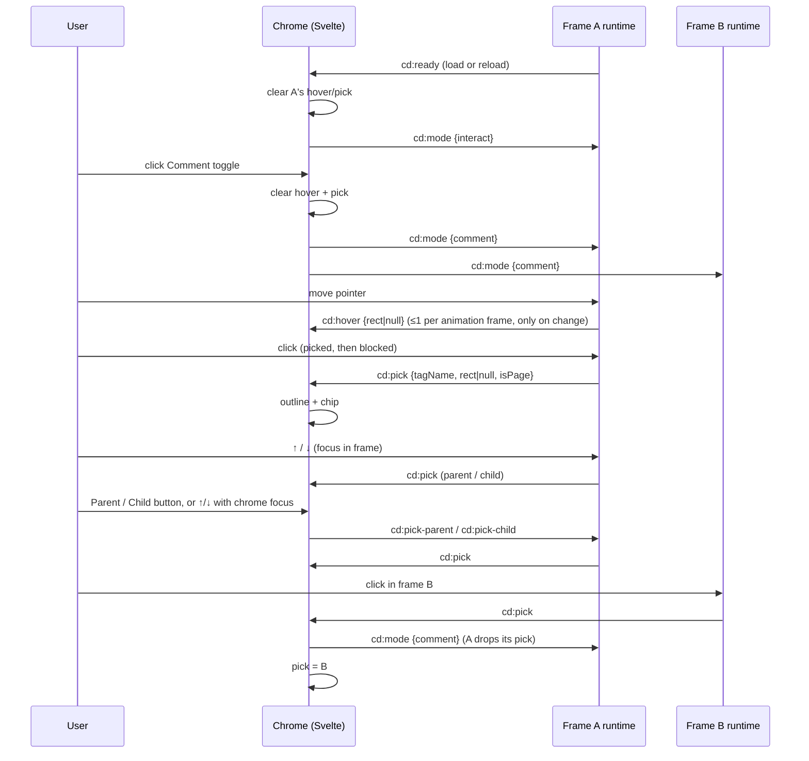

# Picking channel - Overview for review

> **Generated file.** Human-facing steering summary of the active work item:
> same content as `current-feature.md`, trimmed. Written at `/feature` when the
> spec is created, and kept current if the spec is revised. `/complete` may
> polish this into the archive-ready one-pager; it is not the first write.
> Open in Markdown preview to render the diagrams.

Source of truth: `blueprint/history/features/08d1-picking-channel.md`. This file is the steering summary, not the build spec.

## TL;DR

A Comment toggle in the toolbar. When it is on, clicks inside a frame never reach the design.
They pick the element under the cursor instead, and the chrome draws a crisp outline around it.
↑/↓ (or Alt+click) step to the parent or child. No comments are saved yet. This feature makes
picking precise and gives chrome its first way to talk to a frame.

## What you will see

- A **Comment** button in the toolbar (pressed state). It is disabled when there are no frames,
  including in untrusted workspaces.
- In Comment mode, a dashed outline follows the cursor over the design, and a click turns it into
  a solid pick outline.
- A chip shows the picked tag (`button`, `section`, ...) or "Whole frame", with **Parent** and
  **Child** buttons. ↑/↓ do the same, both right after a click (focus in the frame; the runtime
  handles them) and when the chrome has focus.
- Links, buttons, forms, selects, details, and video controls do nothing in Comment mode. They
  work again when you toggle off.
- Outlines stay glued to the element through pan, zoom, frame drag (still enabled in 8d1), and
  inner scroll. A pick scrolled out of view loses its outline but keeps its chip.

## Scope at a glance

| In | Out (later) |
|---|---|
| Chrome ↔ frame channel (`cd:mode`, `cd:pick-parent`, `cd:pick-child`; `cd:ready`, `cd:hover`, `cd:pick`) | Selectors, text, styles, pick point (8d2) |
| Click blocking in the frame runtime | `C` key, Escape, hint, popover, drag inertness (8f1) |
| `elementsFromPoint` + overlay rules, SVG → `<svg>`, page pick | Pins and `cd:anchors` (8f2) |
| Parent/child stepping, Alt+click | `comments.json`, MCP tools (8e) |
| Screen-space outlines in chrome | Picking inside a nested design `<iframe>` (known ceiling) |
| Picking fixture `fixtures/picking.html` | Host, MCP, disk changes |

## Data flow



Trust: the frame accepts commands only from the parent it captured at load. Chrome accepts frame
messages only from a registered iframe and only after the guards in `parseFrameMessage` pass. It
drops `cd:hover` and `cd:pick` outside Comment mode. Frame data is rendered as text or geometry
only. A null pick rect hides the outline but keeps the chip.

## Locked decisions

- **Hit testing is in-house:** native `elementsFromPoint` plus one pure `pickTarget`. A transparent
  element is skipped only when something that is not its ancestor sits underneath.
- **Outlines are drawn in chrome**, never inside the design DOM. The runtime still never writes to
  the design.
- **Every `cd:mode` resets the frame's pick** (path, hover, pending frame callback), which is how
  picking in another frame clears the old one. A reset frame posts nothing until its next click.
- **Click blocking and picking share one listener**, so picking can never be swallowed by the
  block.
- **"Paints nothing" is a pure, tested predicate** (`paintsFromStyle`, `isTransparentColor`):
  unknown color formats count as painted, which keeps the element.
- **Messages ship with their producers.** `cd:anchors` and `cd:key`, and the selector and style
  guards, wait for 8f2, 8f1, and 8d2. The toolbar toggle comes forward from 8f1 so 8d1 can be judged
  in F5.
- The exported `canvas.html` behaves exactly as before.

## Try it (F5)

```bash
cp fixtures/picking.html fixtures/dev-workspace/.cursor-design/artboards/picking.html
```

Run Extension, toggle Comment, and check at 10%, 100%, and 400% (ctrl+wheel or pinch past the
presets):
- hover matches the click target;
- the transparent overlay is skipped;
- card 3 picks card 3;
- SVG paths pick the `<svg>`;
- the scroll box re-outlines on scroll;
- nothing in the design fires;
- Alt+click and ↑/↓ step;
- the empty bottom area picks "Whole frame";
- picking in another frame clears the first and stays cleared.

Inside the nested `<iframe>`, nothing is hovered, picked, or blocked. That is a known limit. The
full checklist is in the spec's Testing section.

## Done means

Shipped: Comment toggle, precise picking with hover and pick outlines, Parent/Child stepping
(↑/↓ work right after a click, even with the Cursor chat open), and the first chrome → frame
channel. `pnpm verify` green with 272 tests; Chrome harness matrix and F5 passed; fresh
independent review passed. The picking rules (`commentPick`, `canvasFrames`, `routeMessage`,
`pickTarget`, `pickPath`) are pure modules with edge-case tests.

Open follow-ups (ledger): F-25 screen-reader announce, F-26 pointer capture on frame delete,
F-27 string-match test, F-28 inert picking code in the export.
