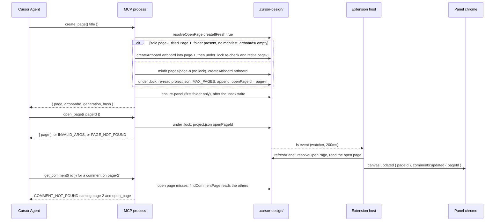

# 10c Page ops + MCP tools - Overview for review

Source of truth: `blueprint/history/features/10c-page-ops-mcp-tools.md`. This file is the
steering summary, not the build spec.

## TL;DR

The Agent can now list, create and open design pages (`list_pages`, `create_page`, `open_page`;
14 tools in total), and every other tool's result says which page it acted on. Opening or
creating a page moves your panel too, through the existing disk watcher. The disk also gained
`renamePage` and `deletePage`; nothing calls them until the 10d Pages menu.

## What you will see

- Ask the Agent for a new design: it calls `create_page`, your panel switches to a blank page,
  then the Agent fills its `artboard`.
- In a folder nobody has opened yet, the first `create_page` fills "Page 1" with your title
  instead of leaving an empty extra page.
- Every tool result carries `page: { id, title }`.
- `get_comment` / `resolve_comment` on a comment from another page say which page to open.
- `IMPLEMENT.md` names its page.
- If the open page's folder is removed by hand, the panel shows an error telling you to restore it.

## Key loop

## Decisions locked

- One open page: the Agent's `open_page` / `create_page` move your stage too.
- Page ids `page-<n>` are never reused, even after a delete.
- Delete moves the folder to `.cursor-design/deleted/`, opens the neighbour, never deletes the
  last page.
- A malformed page id is `INVALID_ARGS`; an unknown one is `PAGE_NOT_FOUND`.
- `page` is read before each tool's work, so a finished write is never reported as an error.
- Symlinked page folders are refused or skipped, never followed out of the workspace.
- The one MCP open-page wrapper landed here, so 11b drops that item.

## Out of scope

Pages menu, rename / delete UI and the delete modal (10d); MCP rename / delete (never); emptying
`deleted/` and page search (0.5.1).

## Glossary

| Term | Why it exists |
|---|---|
| Open page | The one page every tool and the panel act on; stored as `openPageId` in `project.json`. |
| `runOnOpenPage` | Wraps every non-page tool: resolves the page once and adds `page` to the result. |
| `deleted/` | Where a deleted page's folder goes, so a delete can be undone by hand. |

## Done means

`pnpm verify` green (68 files, 843 unit tests), `pnpm test:browser` 210 passed before the final
P3 rounds, audit F-06..F-28 closed, independent review passed on `a2c66a8`. Open follow-ups:
F-29..F-31 (P3), F-20 (unverified). Live Cursor run is 10e.
