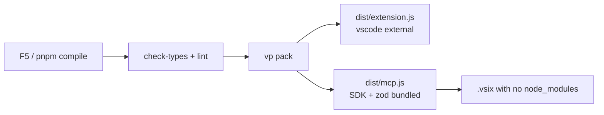
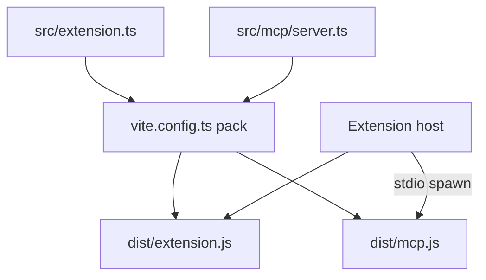
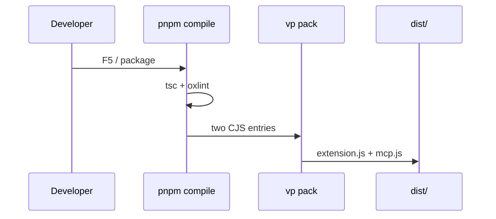

# Pack spike (7a) - Overview for review

Source of truth: `blueprint/history/features/07a-pack-spike.md`. This file is the steering summary, not the build spec.

## TL;DR

`vp pack` replaced `esbuild.js` for both extension bundles. Same F5 path: `compile` still type-checks and lints, then packs `dist/extension.js` and `dist/mcp.js`. Esbuild is gone. Vite+ stays so 7b can add `vp check`.

## Flow

## System map

## Key loop

## What you will see

- `vite-plus@1.3.0` and a root `vite.config.ts` with only a `pack` block.
- `pnpm compile` / `pnpm watch` / F5 / `pnpm vsix` still work.
- No `esbuild.js`. Watch task is `npm: watch:pack`.

## Data flow

Host loads `dist/extension.js`. MCP process is `dist/mcp.js` with the version string baked in. The `.vsix` ships those two files and no `node_modules`, so anything left `require()`'d besides Node builtins (and `vscode` on the host) would break at runtime.

## Architecture decisions

- Two-config `pack` array, `clean: false`, `dts: false`. Production: `vp pack --minify --no-sourcemap`.
- `deps.alwaysBundle` uses regexes so `zod/mini` and MCP `/stdio` stay inside `mcp.js`.
- `allowBuilds: esbuild` stays because vite-plus-core still installs esbuild.
- `.vscodeignore` now also drops `.pnpm-store/**`, `.cursor-design/**`, `notes.md`, `*.vsix`.

## Decisions locked

- Exact filenames, CJS, Node. `vscode` external on the extension only. Version define on MCP only.
- Isolated MCP handshake + `require` scan are the pack proofs. F5 evidence is manual (passed 2026-10-20).
- Real unit-test count is **177**, not 178.

## Out of scope

`vp check`, Vitest, Electron suite home, knip, new tests, Verify + CI (7b–7h). No `src/` change.

## Glossary

| Term | Why it exists |
|---|---|
| `vp pack` | Vite+ / tsdown command that writes the two CJS bundles |
| Isolated handshake | Run `mcp.js` in an empty folder so it cannot lean on repo `node_modules` |
| `allowBuilds: esbuild` | pnpm still needs esbuild's install script for vite-plus-core |

## Your actions

None required for the spike itself. Notion 0.2.1 is updated only if you ask.

## Done means

`compile` and 177 tests pass, F5 opens the stage, `.vsix` lists both dist files and no `node_modules`, and live docs name `vp pack` instead of esbuild.
