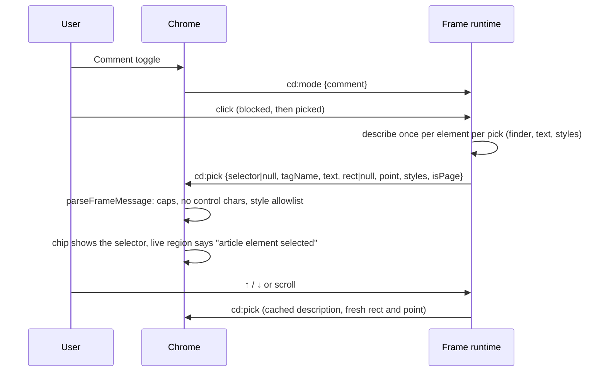

# Selectors (8d2) - Overview for review

Source of truth: `blueprint/history/features/08d2-selectors.md`. This file is the steering summary, not the build spec.

## TL;DR

Every Comment-mode pick now carries what a comment will store. That's a CSS selector unique in the frame's own document (built inside the frame by `@medv/finder`), the tag, a short text excerpt, 13 allowlisted computed styles and the click point. All of it is guarded, because a design's own script can fake a pick. F5 also turned up two stage bugs that were already on `main`, and both are fixed: frames reloading in a loop (flicker, zoom cut off) and trackpad pans stopping when they left a frame.

## Key loop

## What you will see

- In Comment mode the chip shows the picked element's selector, cut off with an ellipsis and shown in full on hover. Clicking card 3 of 5 identical cards gives a selector that matches only that card.
- Generated class names (`css-1x2y3z`, `svelte-abcdef`) never show up in selectors.
- Utility-class-heavy pages still get a selector: if finder overflows, the runtime builds an `:nth-of-type` path itself.
- Frames no longer flicker. Pinch and pan over frames run to the end of the gesture.

## Architecture decisions

- **Finder searches the whole document**, not `body`, so selectors are unique in the same way in the frame, in tests and later on disk (8e).
- **`selector` can be null** when no unique selector fits in 1000 characters. The pick still arrives.
- **`point` is relative to the picked element**, so pins (8f2) can follow the element.
- **Style values:** letters and digits in any script, plus `_ #%.,()'"/+-`. Anything else is dropped, never cleaned up.
- **Frame reload fix (F-51):** `Frame.svelte` reads `id` and `html` through `$derived` copies, so a new frame record no longer reloads the iframe.
- **Trackpad pan fix (F-52):** the chrome stays pinned over a page with hidden scroll room. Scroll that Chromium hands up after a gesture leaves a frame becomes a pan (`scrollSinkStep`), but only within 1 s of a frame wheel and only for steps of 2500 px or less.

## Out of scope

- Storing comments, the disk match and MCP tools (8e); the popover and the `C` key (8f1); pins (8f2).
- Playwright browser tests, which are next (8d3).

## Glossary

| Term | Why it exists |
|---|---|
| finder | Library that builds the shortest CSS selector unique in a document |
| `cd:pick` | Message a frame sends the chrome when the user picks an element |
| Scroll sink | Hidden page scrolling that catches the end of a trackpad gesture after it leaves a frame |
| OOPIF | An iframe running in its own browser process. Chromium locks a gesture to the one where it started |

## Your actions

- Decide F-28: should the exported `canvas.html` carry the inert picking runtime, now about 12 KB more per frame?
- F-46's cheap fix is queued as a small `/fix` after this merge.

## Done means

`pnpm verify` passes (306 tests). The independent review passed on `269a2d7`. In Cursor F5, zoom and pan work over frames with no flicker. Selector picks were checked with real clicks in Chrome.
