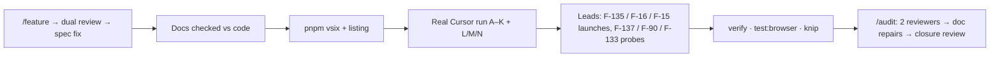
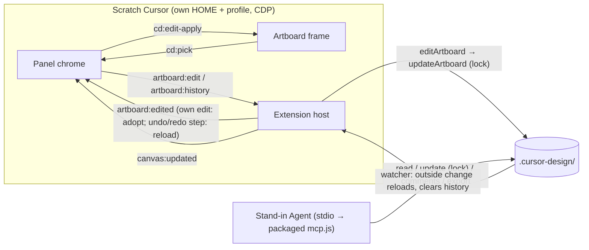

# 9g Verify - Overview for review

> **Generated file.** Human-facing steering summary of the active work item:
> same content as `current-feature.md`, trimmed. Written at `/feature` when the
> spec is created, and kept current if the spec is revised. `/complete` may
> polish this into the archive-ready one-pager; it is not the first write.
> Open in Markdown preview to render the diagrams.

Source of truth: `blueprint/history/features/09g-verify.md`. This file is the steering summary, not the build spec.

## TL;DR

0.4 Edit-lite was verified without a human at the keyboard. Agents drove a separate, isolated Cursor 3.29.9 running the packaged `.vsix`, edited all five fields on a real frame, undid and redid them, and diffed the file after each step. They also acted as the Agent over MCP, exported the handoff and checked comment staleness. All cases A–K pass. Eight leads got a measured verdict. README and the Agent skill now match shipped code. No product code changed; one test line guards a new skill number.

## Flow

## System map

No new flows. The rig used only shipped calls:

## What you will see

- README:
  - a 0.4 status line and an **Edit mode** section;
  - Limits now say artboard writes are locked since 9c;
  - after an extension update, quit and reopen Cursor (a toggle or window reload keeps the old MCP server running);
  - a new smoke line (2026-11-20, Cursor 3.29.9).
- Agent skill:
  - **Tool descriptions can be out of date** (follow the skill and ask the user once to quit and reopen Cursor);
  - **File size** (keep each artboard under 1,500,000 characters).
- System map: `artboard:edited` shows `canUndo` / `canRedo`.
- Notion 0.4 page: shipped status, four Done-when lines ticked with case letters, 9f/F-135/fingerprint notes.

## Decisions locked

- Evidence is real or marked **not run: reason**. Nothing was handed to Bombic.
- Three checks were corrected mid-run:
  - J's regex needs a digit (the runtime's own selector code matched).
  - F-144 is timed from the runtime's own `setAttribute` (a capture listener on `window` runs after the runtime).
  - The launch line needs `env -i`, a short profile path, `--use-mock-keychain` and `--classic`.
- F-16 and F-161 were reopened for a follow-up `/fix` (Bombic). F-137 is accepted, mitigated by the skill's size bullet.

## Results

| Area | Outcome |
|---|---|
| A–K on the installed `.vsix` | all pass (one-line diffs, exact undo/redo shas, Agent `conflict` then edits kept, clean export, comment stale → fresh) |
| Closed by evidence | F-25 (live region always mounted), F-133 (every frame-HTML producer goes through `panelFrames`), F-15 (watch task) |
| Supports accepting (Bombic to decide) | F-90 (0 long tasks at 500 pins), F-125 (weak), F-144 (5.5 ms per keystroke) |
| Confirmed | F-16 blank panel (reopened), F-135 old server until quit (docs + skill), F-137 ~180 ms text edit near the cap (accepted) |
| New | F-161 export writes meta/manifest without the lock (reopened for `/fix`) |
| Gates | `pnpm verify` 732 tests, `pnpm test:browser` 168 passed, `pnpm knip` clean |

## Glossary

| Term | Why it exists |
|---|---|
| Scratch Cursor | A second Cursor with its own `HOME`, profile and extensions, so agents can test without touching yours |
| CDP | Chrome DevTools Protocol: how Playwright drives Cursor's windows and webviews |
| Stand-in Agent | A small Node MCP client that makes the same tool calls Cursor's Agent would |
| Lead | An `unverified` finding: a suspected risk waiting for evidence |
| Source tag | `data-cd-src="N"`, numbering elements in the panel's copy only, never on disk |

## Your actions

None required. Optional: decide on accepting F-90, F-125 and F-144.

## Done means

All four Notion "Done when" lines and every 9g plan clause have real-run evidence (cases B–K). The `.vsix` installs and runs. The docs match the code. Every lead has a recorded verdict.
