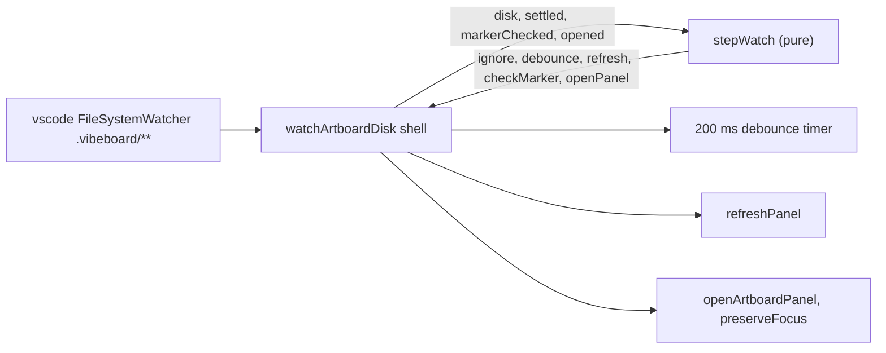
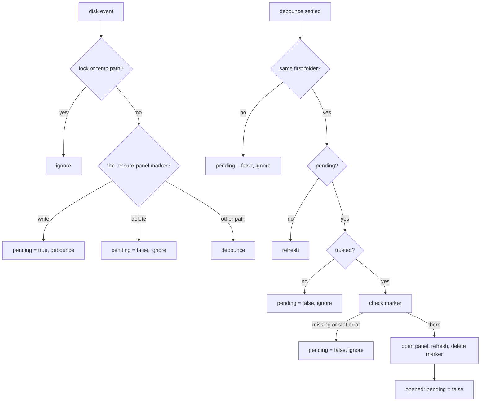

# Watcher pure step (11c3) - Overview for review

Source of truth: `blueprint/history/features/11c3-watcher-pure-step.md`. This file is the steering summary, not the build spec.

## TL;DR

The disk watcher's decisions now live in one pure function, `stepWatch`, which has the watcher's
first test (35 cases, every transition row, 10 mutation probes all caught). The vscode watcher,
the 200 ms timer and the marker stat and delete stay a thin shell that asks `stepWatch` what to
do. Nothing the user or the Agent sees changed.

## System map

No message, call or disk write between processes changed. Inside the host:

## Rule logic

One flag, `markerPending`, decides between a plain refresh and opening the panel:

## What you will see

Nothing new. The panel still refreshes about 200 ms after a write under `.vibeboard/`, ignores
lock and temp files, and opens without taking focus when the Agent's `create_page` writes
`.ensure-panel`.

## Decisions locked

- Behavior unchanged, edge races included; a fix would be its own `/fix`. No new
  `try`/`finally`: a throw mid-open leaves the marker pending, as before.
- The state stays one module-level flag shared across watcher replacements. No watcher factory:
  the 11c3 line asked only for the pure step.
- `watchStep.ts` exports exactly `stepWatch`, `IDLE_WATCH_STATE` and the `WatchEvent` type, and
  imports the one lock/temp rule `isLockOrTempPath`.
- The shell reads trust and the folder through the existing ports.

## Out of scope

A watcher factory, clock injection, a unit test of the vscode shell, the page-bound post port
(11c4), `parseHostMessage` (11d), comments (11e).

## Glossary

| Term | Why it exists |
|------|---------------|
| `.ensure-panel` | Marker file the Agent's `create_page` writes so the host opens the panel |
| Pure step | A function with no I/O: state and event in, next state and effect out, so it tests without mocks |
| Debounce | Waits 200 ms after the last disk event so a burst of writes causes one refresh |

## Done means

`pnpm verify` passed (75 files, 927 tests); probes a-j each turned a test red; one fresh Opus
audit traced every old watcher branch to one new row and found nothing to fix.
