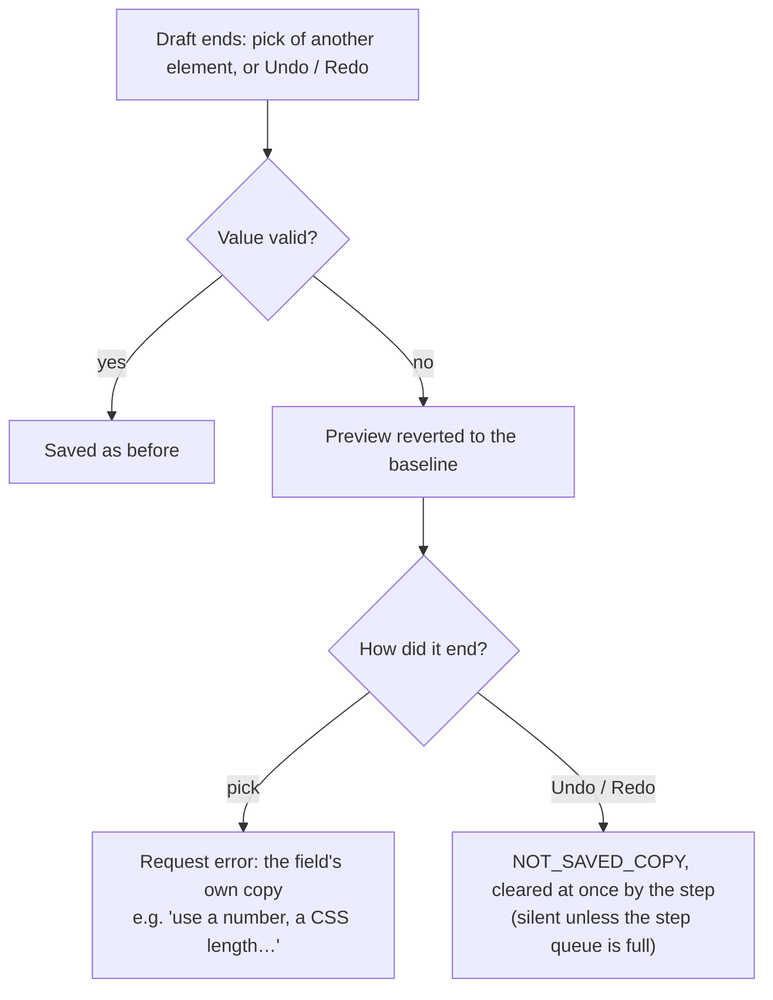

# Backlog: small product fixes - Overview for review

Source of truth: `blueprint/history/fixes/backlog-small-product-fixes.md`. This file is the steering summary, not the build spec.

**Branch:** `fix/backlog-small-product-fixes` · **Type:** Fix · **Status:** shipped (completed 2026-11-20)

## TL;DR

Cleared the open findings that needed product code: a double read of `comments.json` (F-75), a
legacy webview-state key that never went away (F-139), two missing `ponytail:` marks (F-141), the
wrong "Not saved: the frame changed" copy when a pick of another element ends an invalid draft
(F-142), and the last CommentCard layout numbers coupled to other components (F-114). The audit
repairs F-155 and F-156 corrected descriptions only. F-28, F-56 and F-57 were archived as
`accepted` (Bombic's decision). No message, disk format or process flow changed, so there is no
data-flow chart.

## Rule logic

An open draft whose element is no longer picked, or that Undo / Redo ends, is re-validated by
`#commit`:

## What you will see

- Edit mode, type `4 apples;` in Padding, press Enter (field error shows), then click another
  element: the request error reads "Not saved: use a number, a CSS length such as 1.5rem, or leave
  it empty.", not "the frame changed".
- Same value, no Enter, click straight onto another element: the same field copy.
- Everything else looks and behaves the same (the comment card and thread measured identical
  before and after). `get_comment` reads `comments.json` once instead of twice. Vitest grew by one
  test (731 → 732), the browser suite by three (165 → 168 passed, 198 skipped).

## Architecture decisions

| Finding | Before | After |
|---|---|---|
| F-75 | `getComment` read the whole file to check it exists, then read it again; `readCommentsFile` re-typed the helper's one line | Pre-check deleted from `getComment`; `readCommentsFile` calls `commentsTextIfExists` (one owner; the writers keep their no-`.lock` pre-check) |
| F-139 | `saveCommentUi` carried an old `commentMode: true` forever | The destructure drops it; a browser test seeds the key and sees it gone after the first save |
| F-142 | A pick of another element ended any invalid draft with `NOT_SAVED_COPY` | `invalidDraftCopy` in `editDrafts.ts` gives the field's own copy on a pick; `notSaved` takes `{ key, message }`; `#commit` takes `ending: 'field' \| 'pick' \| 'step'` |
| F-141 | Colour cannot be cleared; focus falls to body on a pick-emptying reload; neither marked | Two `ponytail:` comments in `Inspector.svelte`, each with its upgrade path |
| F-114 | `.actions` right margin re-typed the sm Button padding; the thread line re-typed the entry gap | Theme token `--cd-button-pad-sm` read by Button and by the card's right outdent only; a card-local `--card-entry-gap`, outside `--cd-`, read by the gap and the line |

## Decisions locked

- **F-142: a pick of another element that ends an invalid draft names the field's own cause,**
  never `NOT_SAVED_COPY`. Revised by the lead on 2026-11-20 while you were away: in Chromium the
  field blurs before the frame's pick arrives, so "error already shown" and "clicked straight away"
  look the same at pick time, and a silent drop would lose the value. You may override; the
  `ponytail:` names the `relatedTarget` upgrade.
- **Undo / Redo ends an invalid draft silently** (the step clears the copy; it shows only with a
  full step queue). Unchanged from before; marked `ponytail:` in `invalidDraftCopy`.
- **F-114: only the right outdent is the Button's side padding;** the left 6px and the bottom
  `-4px` stay same-file numbers.
- **No-visual-change proof was a one-time measurement**, not a committed test (rule 09 bans pixel
  assertions).
- **F-75 got no new test:** behaviour is unchanged and existing tests pin the outcomes.

## Out of scope

- Unverified findings that need triage (F-16, F-25, F-90, F-125, F-133, F-135, F-137, F-144; still
  in the ledger).
- A cheaper existence check for the four comment writers.
- Other negative margins in the chrome (`Pins.svelte`, `CommentPopover.svelte`).

## Glossary

| Term | Why it exists |
|---|---|
| Draft | One inspector field's uncommitted input, tied to the element it started on |
| Field error | The per-field "Not saved: …" copy a refused commit (Enter / blur) shows under the field |
| Request error | The inspector's live-region banner; `NOT_SAVED_COPY` is "Not saved: the frame changed. Try again." |
| Webview state | The record VS Code keeps for the panel across a tab switch (`getState` / `setState`) |

## Your actions

- Optional: try the two F-142 paths above in the panel (F5 or the browser harness).
- Optional: `pnpm gallery` to eyeball the comment card and thread.

## Done means

- `pnpm verify` passed with 732 Vitest tests; `pnpm test:browser` 168 passed, 198 skipped.
- The step 3 before / after card measurement was identical.
- Ledger: F-75, F-114, F-139, F-141, F-142, F-155, F-156 `closed` and F-28, F-56, F-57 `accepted`,
  all archived with this fix.
