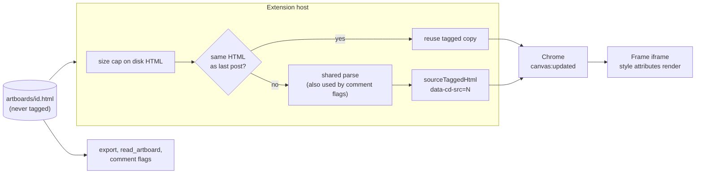
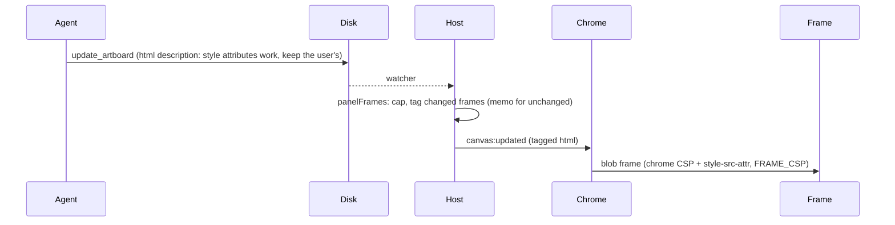

# 9a Source tags + inline-style CSP - Overview for review

Source of truth: `blueprint/history/features/09a-source-tags-inline-style-csp.md`. This file is the steering summary, not the build spec.

## TL;DR

The first slice of 0.4 Edit-lite. Nothing to click yet; it lays two foundations:

- **Source tags.** Every element written in an artboard file now carries `data-cd-src="N"` in the copy the panel shows. Later edits (9b-9e) name an element by N, and the extension finds its exact characters on disk. Disk files, exports and comment selectors never see the tags.
- **Inline styles render.** `style="…"` attributes now work in frames. Both the Agent skill and the MCP `html` description tell the Agent to keep the user's style attributes.

Zero new dependencies. Independent review passed (fresh Opus 5.5, all four lenses).

## System map

## Key loop

## What you will see

- Frames look the same; an artboard with `style="…"` now renders it.
- Frame devtools show `data-cd-src="0"`, `"1"`, … on elements (39 on the dev-workspace canvas).
- Disk files and exports have no tags.

## Decisions locked

- Numbers follow start-tag order in the file, from 0. Not numbered: implied tags, parser-inserted fakes, `script`/`style`/`title`/`textarea`, template content, SVG `text`.
- A misnested formatting element (`
<b>x

y`) shares its original's number; 9b refuses a duplicated number.
- A tagging failure never blanks the stage: that frame posts untagged and logs once.
- Only the chrome CSP changed (`style-src-attr 'unsafe-inline'`); `FRAME_CSP` is unchanged, so `url()` in a style and inline `on*` handlers stay blocked.

## Out of scope

Reading the numbers back (9b-9e), undo (9f), frame-runtime changes, the chrome's own no-`style=` convention.

## Glossary

| Term | Why it exists |
|---|---|
| Source tag (`data-cd-src`) | Names one element by its position in the file, so an edit lands on exactly that element |
| Frame copy | The HTML the panel renders; tagged and stamped, never written back to disk |
| Tagged-copy memo | Keeps unchanged frames from being re-parsed on every file event |
| `style-src-attr` | The CSP switch that lets `style="…"` attributes apply |

## Verification

- `pnpm verify` 596 unit tests; `pnpm test:browser` 136 passed (182 gallery skipped).
- Audit: 7 P3 findings fixed and closed by re-review; independent review passed at `4f899d9`.
- F5 in Cursor (Bombic, 2026-11-19):
  - tags in devtools: pass (39);
  - a hand-added style attribute renders: pass;
  - disk untouched: pass;
  - export clean: pass.
  - Agent sees the new `html` description: the live server serves it (direct `tools/list` probe), but Cursor's Agent still quoted the old text after a server restart and a fresh chat. Tracked as F-135 for 9g.

## Your actions

- F-135: check what makes Cursor's Agent pick up changed MCP tool descriptions (full quit?).
- Notion 0.4 page: fix the sentence that says an edit sends the generation (the plan uses the content hash).
