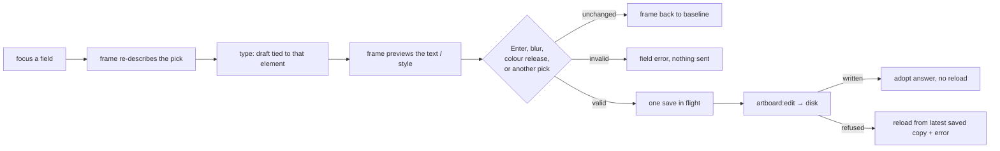

# 9e Edit fields + save - Overview for review

> **Generated file.** Human-facing steering summary of the active work item:
> same content as `current-feature.md`, trimmed. Written at `/feature` when the
> spec is created, and kept current if the spec is revised. `/complete` may
> polish this into the archive-ready one-pager; it is not the first write.
> Open in Markdown preview to render the diagrams.

Source of truth: `blueprint/history/features/09e-edit-fields-save.md`. This file is the steering summary, not the build spec.

## TL;DR

The Edit-mode inspector is live. Type in Text, Font size, Padding or Margin, or drag the colour
picker, and the frame updates as you go. Enter or leaving the field saves (the colour saves on
release) through the 9c checked write. The frame does not reload after your own save, so scroll
and page state stay. A refused save reloads the frame, keeping your earlier saved edits, and
says why. An edit interrupted by an outside change is never written to the wrong element; it
says "Not saved: the frame changed. Try again." No host, disk-core or MCP change.

## Flow



## Key loop

```mermaid
sequenceDiagram
  participant C as Chrome
  participant F as Frame
  participant H as Host
  C->>F: cd:pick-refresh (on focus)
  F->>C: cd:pick (repost)
  C->>F: cd:edit-apply {text | style} (each keystroke)
  C->>H: artboard:edit {.., hash, field, value, liveText?} (on commit)
  H->>C: artboard:edited {hash, generation, html}
  C->>C: adopt, no reload; next queued save uses this hash
  H->>C: canvas:updated (echo, identical): nothing changes
```

## What you will see

- Editable fields for an editable element; the Text field only for plain text.
- Live preview in the frame while typing; the selection outline follows a growing element.
- `16` saved shows back as `16px`; an unchanged field saves nothing.
- A bad size value: "Not saved: use a number, a CSS length such as 1.5rem, or leave it empty."
- A refused save or interrupted edit: an announced error at the top of the inspector.
- An element whose `style` attribute is over 5,000 characters: a hint instead of the style fields.

## Decisions locked

- A save always targets the element its draft started on (frame, source number, document
  version), never the current pick.
- Preview uses the edit core's own string rules (moved to the parse5-free `editValues.ts`); the
  frame only sets the text or the style attribute.
- One save in flight per panel; a refusal drops the waiting ones.
- No reload after your own save; a forced reload rebuilds from the latest adopted HTML; stale
  pre-write refreshes are skipped.
- Escape in a field does not revert (undo is 9f); the colour cannot be cleared.

## Out of scope

Undo / redo (9f), Agent conflict on a real frame, export and `.vsix` checks (9g), clearing the
colour, mixed-content text, classes, per-side spacing, 0.4.1.

## Glossary

| Term | Why it exists |
|---|---|
| Draft | A field's uncommitted input, tied to one element, so a late blur can't save to a newly clicked one |
| Adopt | Taking the host's answer (new HTML, hash, generation) without rebuilding the iframe |
| Stale pre-write post | A refresh that read the file before your save; skipped so the frame doesn't flash back |
| Independent review | A fresh reviewer with no build context checks the whole change before landing |

## Your actions

The Cursor (F5) checks were not run: save each field and `git diff` the artboard file, colour
drag saves once, scroll kept after a save, an editor change while a field is dirty. Open
findings carried forward: F-141, F-142, F-143 (P3), F-144 (P3, unverified).

## Done means

Five fields save to disk from the inspector with live preview and no frame reload; refused or
interrupted edits say why; `pnpm verify`, `pnpm test:browser` and the gallery pass; independent
review passed on `5c8a33a`.
