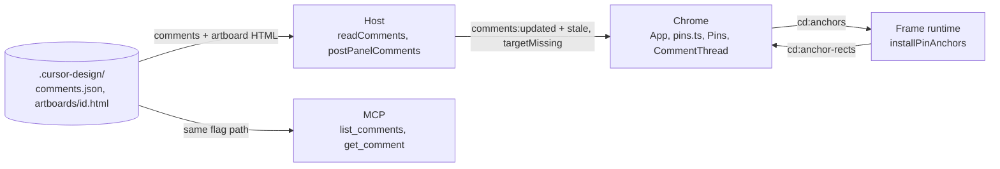
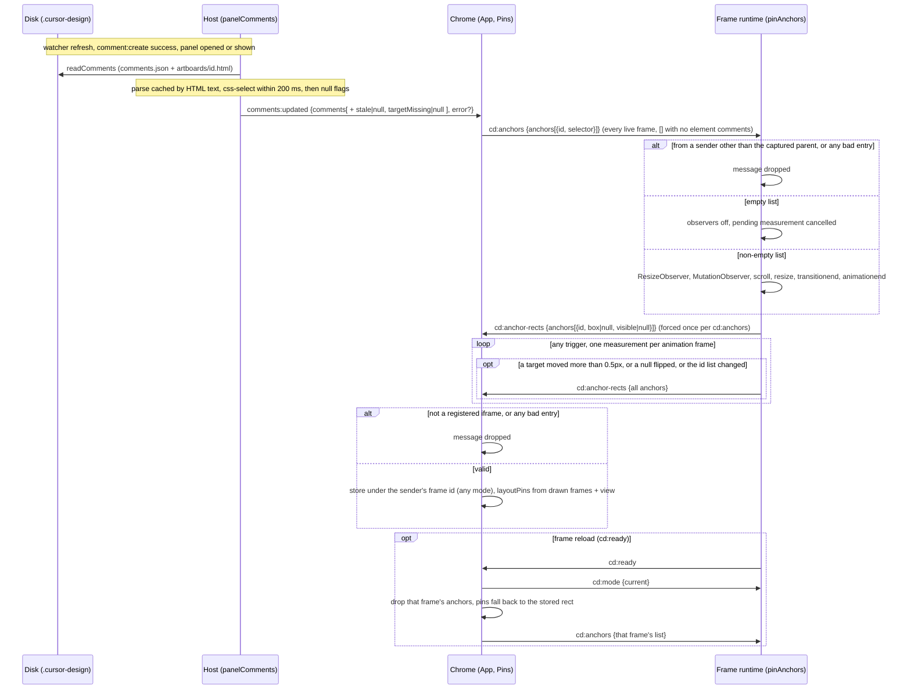
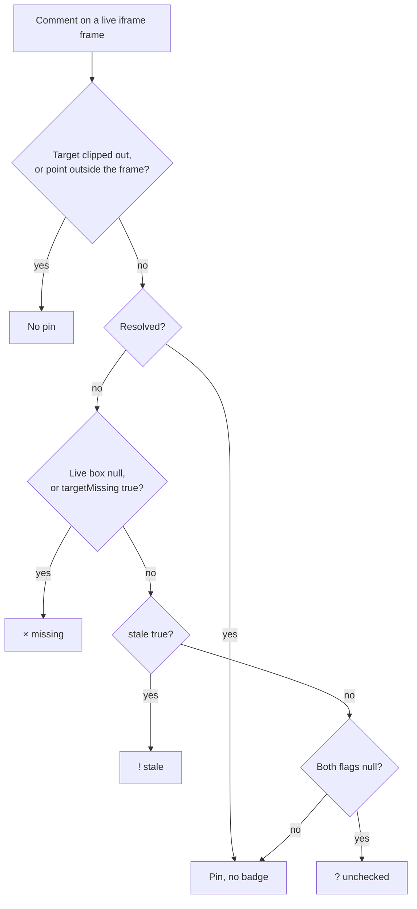

# Pins (8f2) - Overview for review

Source of truth: `blueprint/history/features/08f2-pins.md`. This file is the steering summary, not the build spec.

Open in Markdown preview to render the diagrams.

## TL;DR

Every comment now shows a pin on the canvas. The pin sits on its element inside the live frame and
follows scroll, resize, DOM changes, frame drag, zoom and pan. It shows its status and one warning
badge. A click opens a read-only thread. Reply, Resolve and Copy arrive in 8g and 8h.

## System map

## Key loop

## Rule logic

## What you will see

- A 20px pin on each commented element: **open** is filled, **sent** is a hollow ring, **resolved**
  is dimmed with a ✓ and sits under the others.
- One corner badge: **!** stale, **×** target missing, **?** unchecked. Resolved pins never get one.
- A page comment pins to its fraction of the frame.
- A target scrolled out of its box hides its pin. A target the design removed shows **×** near its
  stored position.
- A pin click opens a popover with the target, status, badge text, body and replies. Escape or Close
  returns focus to the pin. If the comment or pin goes away, it closes and focus moves to the stage.
- While you write a new comment, a click on a pin picks the element under it.

## Architecture decisions

- Flags use the same `commentFlags` as `get_comment`. `null` means unchecked, never guessed.
- Live beats disk: a target the frame cannot find is missing whatever disk said.
- Untrusted ids never become object keys: payloads are arrays, and anchor state is a `Map` per frame.
- The parse is cached by HTML text (32 frames at most). Target checks stop after 200 ms per read and
  report the rest unchecked, with a hint to read again.
- Artboard `<style>` blocks no longer log chrome CSP violations (F-90): `stampArtboardHtml` parses
  into a detached root.

## Out of scope

- Reply, Resolve, Reopen, the comments panel and click to jump (8g). Copy and marking sent (8h).
- Following an element during a CSS animation: pins catch up on transition or animation end.
- Image and web-font load triggers, because `FRAME_CSP` blocks those loads.
- An HTML byte cap, or parsing in a worker.

## Glossary

| Term | Why it exists |
|---|---|
| Anchor | A comment's selector, which the frame resolves to a live element |
| `box` / `visible` | The target's full box, and the part of it you can actually see |
| Stale | The target element changed on disk since the comment |
| Unchecked | The target cannot be checked from disk, or the read ran out of budget |
| Thread | The read-only popover that shows a comment and its replies |

## Your actions

Run the `## Try it now` path in the archive. The independent review could not exercise F5, so these
were not checked there: pins across panel hide/show, a real `update_artboard` flipping a badge to
stale, and the webview console under the real CSP.

## Done means

- `pnpm verify` and `pnpm test:browser` are green.
- Pins, states, badges, page pins and the read-only thread work as described above.
- Carried forward open: F-88 (a thread can be hidden but still open after a `cd:frame-height`
  shrink), F-91 (a twin clamp) and F-92 (an out-of-date `postToFrame` comment).
