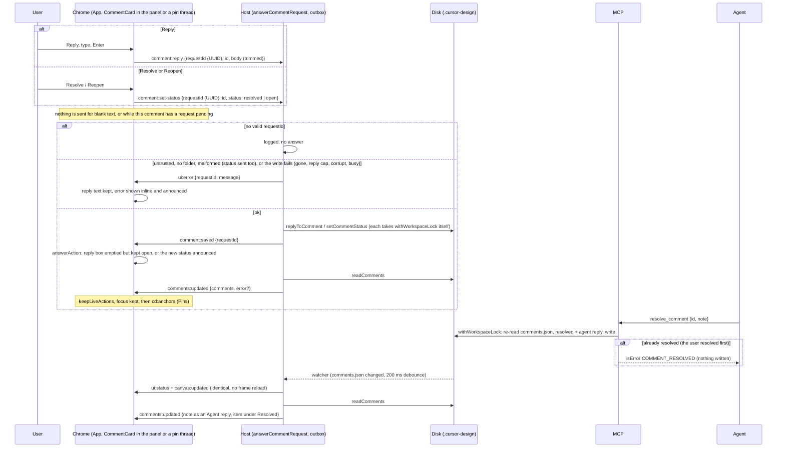

# Comments panel - Overview for review

Source of truth: `blueprint/history/features/08g-comments-panel.md`. This file is the steering summary, not the build spec.

Open in Markdown preview to render the diagrams.

## TL;DR

A collapsible Comments panel on the right lists every comment: unresolved ones first, resolved
ones last and dimmed. You can reply, resolve and reopen from the panel and from a pin's thread.
The Agent's `resolve_comment` notes show up as Agent replies. Clicking a comment's target chip pans
the canvas to it and flashes its outline for 1.5 s. Copy prompt is not here; it comes in 8h.

## Flow

1. Click **Comments (N)** in the toolbar. The panel opens on the right and the canvas narrows.
2. **Reply** on a comment, type, press Enter. The host writes `comments.json`, and your reply shows
   as `You`. The box stays open and empty for the next one.
3. **Resolve** moves the item to Resolved, and focus lands on its **Reopen**.
4. The Agent resolves a comment in chat. Its note arrives through disk and the watcher and shows as
   an `Agent` reply.
5. Click a target chip. The canvas centers the target, zooming out only if it would not fit, and
   flashes its outline.

## System map

```mermaid
flowchart LR
  Agent["Cursor Agent"]
  MCP["MCP process<br/>resolve_comment"]
  Disk[(".cursor-design/comments.json")]
  Host["Extension host<br/>watcher, answerCommentRequest,<br/>postPanelComments, outbox"]
  Chrome["Webview chrome<br/>App, CommentsPanel, CommentThread,<br/>CommentCard"]
  State[("webview state<br/>stageView, commentsPanelOpen")]
  Agent -->|MCP tool call| MCP
  MCP -->|"withWorkspaceLock: resolved + agent reply"| Disk
  Disk -->|"fs events, 200 ms debounce"| Host
  Chrome -->|"comment:reply, comment:set-status, each with a requestId"| Host
  Host -->|"replyToComment, setCommentStatus (each takes the lock), readComments"| Disk
  Host -->|"comment:saved or ui:error for that requestId, then comments:updated"| Chrome
  Chrome -->|"setState: each save keeps the other key"| State
```

Click to jump never leaves the chrome: no message goes to the host or a frame.

## Key loop

## What you will see

- **Comments (N)** right after the Comment toggle; N counts unresolved (open and sent) comments.
- Two groups, **Unresolved** and **Resolved** (dimmed), each in file order. An empty list says how
  to add a comment. A broken `comments.json` says "Comments are unavailable." and the banner
  explains why.
- Each comment: target chip with its frame name, `You`, how long ago, status, any stale / missing
  / unchecked badge, the body, replies labelled `You` or `Agent`, then **Reply** and **Resolve**
  (or **Reopen**).
- A failed save keeps your text, shows the error under the comment and announces it.
- Pin threads have the same buttons. A reply box open in the panel is open in the thread too, with
  the same text.
- A comment whose frame is not on the canvas is listed with "Frame not shown." and no jump.

## Data flow

| What | Where it lives | Who writes it |
|---|---|---|
| Replies and status | `.cursor-design/comments.json` | Host through the disk lib (under `.lock`); Agent through `resolve_comment` |
| Panel open or closed | Webview state `commentsPanelOpen`, beside `stageView` | Chrome; survives hide / show, never on disk |
| Typed reply text, pending request, last error | App memory, keyed by comment id | Chrome; reset by a webview reload |
| Jump flash | App memory, 1.5 s | Chrome |

## Architecture decisions

- **One host handler** for create, reply and set-status (`answerCommentRequest`, replacing
  `createCommentFromChrome`). Every attempt with a valid `requestId` gets one answer, posted before
  the list refresh. It never wraps the disk lib's own lock (the lock is not reentrant).
- **Rules outside the views.** Grouping, relative time, the reply / status state, the jump target
  and the jump view are pure modules with unit tests; App only wires them.
- **One comment card** for the panel and the thread, and **one live region** in App, which speaks
  whether or not the panel is open.
- **Focus is kept, never stolen.** Buttons use `aria-disabled` while busy, never `disabled`. Focus
  that fell to body after an update goes back to the same control, and only while the webview has
  focus, so an Agent resolve never pulls you out of chat.

## Decisions locked

- **`requestId` on both new requests, plus a `comment:saved` answer** (the 0.3 plan let the id be
  left out). A failure maps back to the box that sent it, so text is never lost.
- **Only the target chip jumps**; a whole-card click would swallow the card's buttons.
- **The jump centers the target box** and only zooms out. A page comment centers its pin and
  flashes the whole frame. A missing target flashes where it was stored.
- **The panel comes first in Tab order** and CSS draws it on the right (the plan's "focus order
  panel → stage").
- **The panel starts closed.** A user Resolve after the Agent's is a no-op that still succeeds.

## Out of scope

- Copy prompt, Copy all open and marking sent (8h).
- Deleting or editing comments or replies, and nested threads.
- Scrolling an element into view inside its frame on jump, and animating the jump.
- Panel resize, filters, search, a keyboard shortcut, and highlighting the item on pin click.
- A host answer timeout, and any MCP tool, Agent skill or frame CSP change.

## Glossary

| Term | Why it exists |
|---|---|
| `requestId` | A random id on each request, so its answer finds the box or button that sent it |
| `comment:saved` | The host's "written to disk" answer to a reply or status change |
| Pending | A request sent but not answered yet; that comment's buttons wait for it |
| Unresolved | Open or sent comments; resolved ones are listed below them, dimmed |
| Live region | A hidden line screen readers speak, such as "Reply added." |
| Webview state | Small memory VS Code keeps for the panel across hide / show, not on disk |
| Flash | The 1.5 s outline drawn on a target after a jump |

## Your actions

Nothing is owed. `/check` recorded the F5 checks you reported: Reply, Resolve and Reopen wrote
`comments.json`, a reply kept a resolved comment resolved, an Agent note appeared live while the
cursor stayed in chat, the panel survived hide / show, and the console showed no CSP violation. To
see it yourself, run `## Try it now` in the archive.

## Done means

- `pnpm verify` green (38 test files, 487 tests at review) and `pnpm test:browser` green (104/104,
  including `commentsPanel.spec.ts`).
- The independent review passed at `d72811d`. F-84 to F-89 and F-91 to F-93 are closed. F-90 (the
  open panel rebuilds every item on each `cd:anchor-rects`, unprofiled) carries forward as
  `unverified` (P3).
