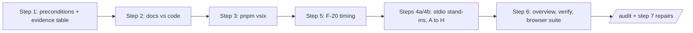

# 10e Verify - Overview for review

Source of truth: `blueprint/history/features/10e-verify.md`. This file is the steering summary, not the build spec.

## TL;DR

0.5 Projects + pages is verified, with no manual testing by Bombic. Agents ran every check they could against the packaged `vibeboard-0.1.0.vsix`, using three stdio stand-ins for the Agent: the 0.5 server, the real 0.4 server and a patched stale server. Docs now match the shipped code. The real-Cursor panel run could not happen: Cursor 3.32 refuses `--remote-debugging-port`. Panel cases D, E and F are recorded `not run`, and the browser tests stand in for them.

## Flow

## What you will see

- README gains a **Pages** section: menu, New blank page, rename, delete, keys. The Export Handoff row now says "open page".
- `docs/limits.md` gains "Coming from cursor-design 0.4", the no-way-back sentence and a corrected Older server line. `docs/edit-mode.md` says undo history is per page.
- The six read MCP tools no longer say "Does not write". They now say they may first settle the design folder. `readOnlyHint` is kept, with a `ponytail:` comment.
- Rule 02, the system map, `project-plan.md` §3/§5/§7 and the project overview now match the code.

## Results

| Case | Result |
|---|---|
| A: 0.4 folder → `.vibeboard/` → Page 1 | pass: byte-identical, and the 4 baseline calls deep-equal (rename reproduced with `mv`) |
| B: older servers | pass: the stale server fails 11/11 on the tombstone and writes nothing; the real 0.4 server never touches `.vibeboard/` (it recreates `.cursor-design/`) |
| C, G, H: Agent page tools, cross-page comment, export per page | pass at the MCP level |
| D, E, F: switch leaks, undo, rename/delete in the panel | not run: Cursor 3.32 blocks CDP; browser tests stand in |
| F-20 `list_pages` at 100 pages × 10 frames | 26 ms median: `supports accepting` (finding marked invalid) |
| `pnpm verify` / `pnpm test:browser` | 73 files, 879 tests / 231 passed, 224 skipped |

## Decisions locked

- **No real-Cursor launch** (Bombic, 2026-11-26). An attempt to patch a copy of Cursor.app triggered a macOS "damaged" alert and was stopped. `/Applications/Cursor.app` was never changed. Bombic's own Cursor session (21:20) is the real-Cursor evidence for the Agent tools.
- **No tombstone at `.cursor-design/`.** cursor-design 0.4 users uninstall it, then quit and reopen Cursor.
- **`readOnlyHint` stays `true`** on the read tools; dropping it is a product call for later.

## Out of scope

- Behavior changes; the only `src/` edits are tool descriptions and comments.
- The Notion 0.5 page patch: drafted in the archive, applied only on Bombic's yes.

## Glossary

| Term | Why it exists |
|---|---|
| Tombstone | A file named `artboards` at the `.vibeboard/` root, so a stale server that expects a folder there fails instead of writing |
| Stand-in | A small Node MCP client that plays the Agent over stdio, so no LLM or Cursor UI is needed |
| Stale server | A copy of the 0.4 server patched to use `.vibeboard/`, standing in for an old process that outlived an update |
| CDP | Chrome DevTools Protocol; how agents drove Cursor before 3.32 blocked it |

## Your actions

- Rebuild the `.vsix` (`pnpm vsix`) before your next install; the test build has the old tool descriptions.
- Say yes or no to the Notion 0.5 patch.

## Done means

Every case passes or is recorded `not run` with its reason, the docs match the code, and `pnpm verify` passes. No P0/P1 finding remains. F-37 and F-38 (P3, fixed) stay in the ledger for a later re-review.
