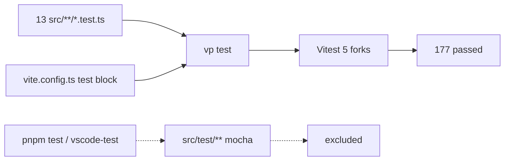
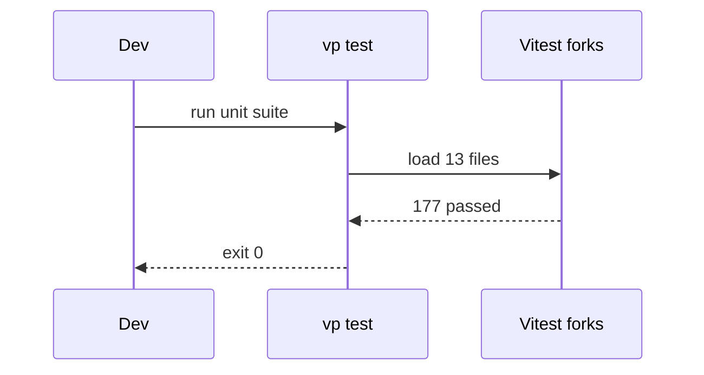

# vp test - Overview for review

Source of truth: `blueprint/history/features/07c-vp-test.md`. This file is the steering summary, not the build spec.

## TL;DR

`vp test` runs the 13 TypeScript unit files through Vite+'s bundled Vitest. AGENTS.md now declares `Test: vp test`. Product behavior (panel, MCP, disk) is unchanged.

## Flow

1. Config lives in `vite.config.ts` (`include` / `exclude` / `pool: 'forks'` / `passWithNoTests: false`).
2. The 13 files import `test` / `afterEach` from `vite-plus/test` and still assert with `node:assert/strict`.
3. `vp test` prints **177 passed** (or 175 + 2 skipped as root). `src/test/**` stays out.

## System map

## Key loop

## What you will see

- `vp test` → 177 passed (non-root) or 175 passed + 2 skipped (root chmod cases).
- AGENTS.md Commands: `Test: vp test` immediately after Check.
- `package.json` `scripts.test` remains `vscode-test` (Electron; 7d).

## Data flow

Developer runs `vp test` → Vite+ resolves bundled Vitest → forks pool loads only `src/**/*.test.ts` excluding `src/test/**` → pass/fail totals.

## Architecture decisions

- Imports from `vite-plus/test`, not a direct `vitest` dependency.
- Config in existing `vite.config.ts` (no `vitest.config.ts`).
- Locked unit count is **177**; plan/overview “178” still includes the mocha sample.
- Compile (`pnpm compile` writing `dist/extension.js` + `dist/mcp.js`) is the F5 proxy; no live Extension Host demo required for 7c.

## Decisions locked

- 177 (not 178) for the unit lock.
- `pool: 'forks'`; no test-body or `fileParallelism` edits.
- No `package.json` Test script; documented command only.
- No Verify command yet (7h). Do not run `/tests`.

## Out of scope

Electron/`out`/mocha types (7d), type-aware lint/knip (7e), coverage/fast-check (7f), MCP client contracts (7g), Verify+CI (7h), product behavior.

## Glossary

| Term | Why it exists |
|---|---|
| `vp test` | Documented unit Test command (Vite+ / Vitest). |
| `vite-plus/test` | Re-export of bundled Vitest APIs; avoids a direct `vitest` dep. |
| forks pool | Process isolation across test files (env / temp-dir safety). |
| 177 | Frozen unit inventory; mocha sample in `src/test/` is excluded. |

## Done means

`vp test` matches the locked totals; `pnpm run check` and `pnpm compile` (both `dist/` files) pass; Test command declared in AGENTS.md + coding-standards; no product change.
