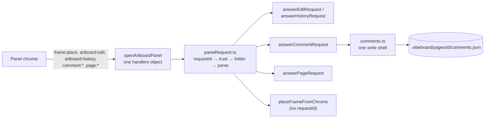

# Host dedupe (11b) - Overview for review

Source of truth: `blueprint/history/features/11b-host-dedupe.md`. This file is the steering summary, not the build spec.

## TL;DR

A refactor: each host job now has one implementation. Nothing changes for you or the Agent: the same messages, the same error copy, the same files on disk, the same MCP tools. 74 test files and 880 tests pass, the old 879 plus one new routing test.

## System map

## What you will see

Nothing new. Two log-only differences appear in the Output panel (Vibeboard):
- A `page:*` request with no requestId is logged under its own type.
- A frame move refused in an untrusted or folder-less window now gets a log line.

## Decisions locked

- **One request preamble in `src/host/panelRequest.ts`.** It holds the requestId, trust, folder and parse checks, and every chrome request handler plus frame moves start with it. It can't live in `chromeMessages.ts`, which must stay free of `vscode`.
- **One `comments.json` write shell.** `changeCommentsFile` handles ownership, existence, lock, read, change and write for add, reply, status, mark-sent and resolve. A missing file still means no lock and no write.
- **One handlers object.** `setArtboardPanelHandlers` has six keys, and the panel routes edit and undo/redo itself.
- **No dispose flags.** `activate` pushes the watcher's cleanup once, and the MCP provider's reset is pushed together with the provider. This also re-registers the watcher's cleanup after a deactivate and reactivate in one host, which the old flag missed.
- **MCP open-page wrapper dropped from 11b.** It already shipped in 10c as `runOnOpenPage`. The build plan and overview now say so.

## Out of scope

Ports and mock-free host tests (11c), `parseHostMessage` (11d), the comments deep review (11e), and any message, copy, disk or MCP change.

## Your actions

- Optional F5 smoke: drag a frame, edit a field and undo it, add a comment and copy it, open and rename a page.
- The Notion quality-pass note needs the same "MCP wrapper shipped in 10c" change, once you say yes.

## Done means

`pnpm verify` passes, there are no open P0 or P1 findings, the audit found one P3 (F-39) that is fixed and closed, and the work is one squash commit on local `main`.
