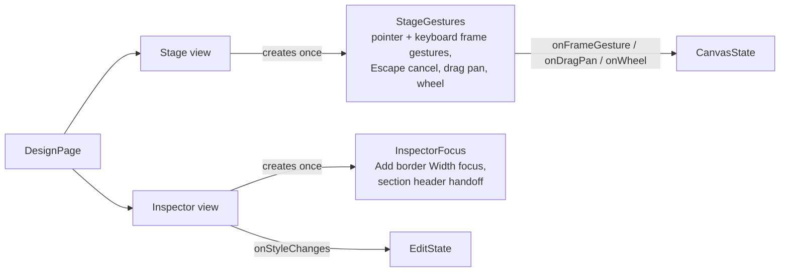

# Stage + Inspector helpers (11e3) - Overview for review

Source of truth: `blueprint/history/features/11e3-stage-inspector-helpers.md`. This file is the steering summary, not the build spec.

## TL;DR

Two views lost their stateful glue. `Stage.svelte`'s gestures now live in `StageGestures` (`src/webview/stageGestures.svelte.ts`), and `Inspector.svelte`'s focus handoff in `InspectorFocus` (`src/webview/inspectorFocus.svelte.ts`). Nothing the user sees changed. A missing browser guard for empty-stage drag panning was written first, and the 11e1 baseline was re-measured. This closes item 11e and the whole quality pass (item 11).

## System map

## What you will see

Nothing new in the panel. In the code: Stage's script went from 336 to 160 lines, the Inspector's from 203 to 140, each now reading as layout plus props.

## Data flow

No message, disk, MCP or CSP change. The classes call the same prop callbacks the views called before, at call time, so a changed prop still applies.

## Decisions locked

- Drag pan and the wheel listener count as gesture glue and moved with the frame gestures; frame-focus tracking, focus reveal, `focusViewport` and the resize observer stayed in Stage.
- Effect order kept: Stage's focus poll before the Escape listener; Inspector's Width focus, then the pre-render read, then the handoff.
- No unit tests: Vitest here does not compile runes. The browser suites plus eight mutation probes are the check.
- The re-measure keeps the plan's answer: no single comments module.

## Out of scope

- D1 (stage focus handle off `PinThread`) and the other unpicked 11e1 items.
- New pure rules; any behavior, look or timing change.

## Glossary

| Term | Why it exists |
|---|---|
| Gesture glue | Pointer-capture and key-hold bookkeeping between the DOM events and the pure gesture rules in `frameGesture.ts` |
| Focus handoff | When a re-render removes the focused inspector field, focus goes to its section header instead of falling to the page body |
| Probe | A deliberate break in the code to prove one named test fails, then reverted |

## Done means

- `pnpm verify` green (75 files, 927 tests); `pnpm test:browser` 233 passed.
- All eight probes failed their named test.
- Audit F-01 to F-05 (all P3) closed after two re-review rounds.
