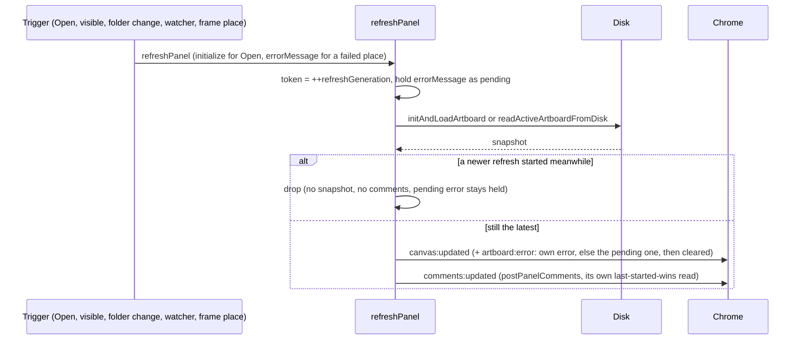

# 11a Panel refresh + frame key - Overview for review

Source of truth: `blueprint/history/features/11a-panel-refresh-frame-key.md`. This file is the
steering summary, not the build spec.

## TL;DR

The panel now has one way to refresh: `refreshPanel`, last started wins. A slow read that a newer
refresh overtook can no longer put old frames on the stage or wipe undo history. A failed drag's
error is held until the next post, so the drag always ends. The frame caches key by page too, so
the same frame id on two pages never shares a cache entry. This lands before 10c, whose page tools
switch pages under a live panel.

## Key loop

Frame place writes first (lock, requested page) and returns only its error copy; then it calls
`refreshPanel`, so the refresh's generation is taken after the write.

## What you will see

Nothing new. The panel behaves as before, minus a rare flash of old frames or lost Undo when two
refreshes overlap. A drag or resize commit now also re-reads the comment list (one more read per
commit; the watcher echo already does the same).

## Decisions locked

- `refreshPanel` lives in its own file: the watcher imports it, and putting it in
  `handleOpenArtboard.ts` would make an import cycle.
- The watcher's own generation is gone; a folder change always starts a newer refresh.
- `refreshPanel` never rejects: one try/catch logs under `refreshPanel`.
- Frame place gains the comment re-read. The plan called it a snapshot-then-comments path, but it
  posted only a snapshot before.
- Audit F-06: a failed place's error is held from its refresh's start until the next post. A failed
  place writes nothing, so only `artboard:error` ends the chrome's committing drag.
- Two known gaps (`ponytail:`), each fixed by the next watcher echo: the latest refresh can straddle
  a write that starts no refresh of its own (edit answer, MCP write inside the debounce), and a
  plain refresh can overtake Open's first-time init read.
- Comment-only refreshes keep `postPanelComments`'s own generation. Undo keys stay
  `{ pageId, frameId }` (since 10b).

## Out of scope

11b–11e refactors; chrome, MCP, Agent skill, message and disk format changes; the chrome's "only the
latest list is held" ceiling.

## Glossary

| Term | Why it exists |
|------|---------------|
| Refresh generation | A counter: each refresh takes a number, and only the newest may post |
| Committing drag | The chrome holds a dropped frame where it was dropped until disk moves or an error arrives |
| Watcher echo | The disk watcher's own refresh after any write, which corrects a stale stage |
| Frame cache key | Workspace + page + frame id, naming one cached parse and tagged copy |

## Done means

All 4 steps checked; `pnpm verify` green (801 unit tests); one `pnpm test:browser` run green (210),
before the host-only F-06 repair; audit F-06 [P2] and F-07 [P3] closed by a fresh re-audit. No
live claim: the race is proved by unit tests with controlled promise order, and 10e's real-Cursor
run covers page switching.
