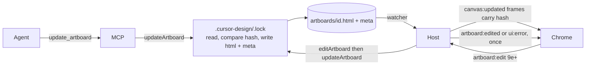
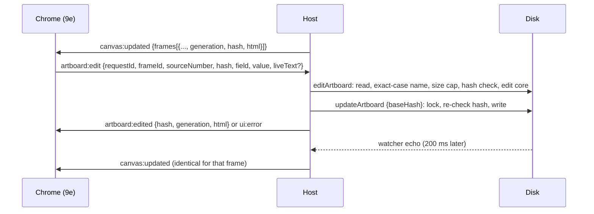

# 9c Checked write + edit message - Overview for review

Source of truth: `blueprint/history/features/09c-checked-write-edit-message.md`. This file is the steering summary, not the build spec.

## TL;DR

The artboard HTML now has two safe writers. The Agent's `update_artboard` reads, compares and
writes under the workspace lock, and the panel got a typed "change this one spot" message
(`artboard:edit`) that runs the 9b edit core against the file's exact content hash and gets
exactly one answer. Nothing in the panel sends it yet: Edit mode and the inspector come in 9d
and 9e.

## What you will see

- No new panel UI.
- The Agent can get `WORKSPACE_BUSY` from `update_artboard` while another write holds the lock
  (retry; up to 30 s after a crashed write). Its skill says so.
- `update_artboard` with the wrong letter case (`HERO` for `hero.html`) is now "not found"
  instead of renaming the file on macOS / Windows.

## System map

## Key loop

## Architecture decisions

- **Exact content hash, not generation,** is the edit base. The frame's `hash` is computed from
  the disk bytes (never the tagged copy, never the stored meta hash).
- **One lock owner: `updateArtboard`.** `editArtboard` parses before the lock and lets
  `updateArtboard` re-check the same hash under it: equal hash means equal bytes.
- **The answer's `html` is the echo's exact string** (`panelFrameHtml` seeds the tagged-copy
  memo), so 9e can adopt it without reloading the frame.
- **Panel copy is an allowlist:** Agent wording (`call read_artboard`, `set_artboard a new id`)
  never reaches the panel; refusals carry their own copy.
- **Edits over the 1.5M-char preview cap are refused** before anything is written.
- **One hash rule** (`scannedHashes`) feeds both the frame `hash` and the handoff badge; each
  frame is hashed once per refresh.

## Decisions locked

- A frame without `hash` is dropped by the chrome (no silent default).
- `liveText` is required for text edits and forbidden for style edits.
- Independent review was not run: Bombic directed completion after the fresh Opus audit, a
  re-review that closed F-134 / F-136, and an Opus + Sonnet refactoring review whose agreed
  fixes are in (spec step 7).

## Out of scope

Any chrome sender, Edit mode, inspector, live preview, adopting the answer (9d, 9e); undo/redo
(9f); locking `set_artboard` / `set_active_artboard`.

## Glossary

| Term | Why it exists |
|---|---|
| Content hash | SHA-256 of the file bytes; an edit made against an older file is refused instead of overwriting newer work |
| Workspace lock | `.cursor-design/.lock`, shared by the MCP process and the extension, so two writers never interleave |
| Source number | The `data-cd-src="N"` the host adds to the frame copy (9a); names the element to edit |
| Watcher echo | The panel refresh the file watcher triggers after any write, including the panel's own |

## Your actions

- Optional, skipped this time: F5 smoke of two Agent edits, and a fake `.lock` to see
  `WORKSPACE_BUSY` live (see the 9c chat; no blocker).

## Done means

- `pnpm verify` green (652 unit tests), `pnpm test:browser` green (136 passed).
- Audit: no P0-P2; F-134, F-136 closed; F-137 (double parse on text edits) stays unverified for
  9e; F-135 for 9g.
