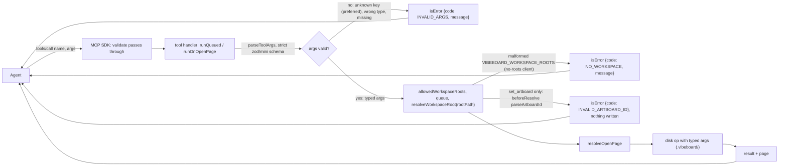

# 11g1 MCP tool args - Overview for review

Source of truth: `blueprint/history/features/11g1-mcp-tool-args.md`. This file is the steering summary, not the build spec.

## TL;DR

Every vibeboard MCP tool now checks its arguments once, up front, against a strict schema. A wrong
type, a missing field or an argument name the tool does not take gets `INVALID_ARGS` with a
message that names the field and says how to fix it. Clients now see real types in `tools/list`.
The disk code lost its leftover type checks; the panel was already checked by its own schema.

## Flow

## What you will see

- `place_frame({ artboardId: "hero" })` answers `place_frame does not take artboardId. Fix args and retry.`
  (before, the extra key was ignored).
- `tools/list` shows `type`, `required` and `additionalProperties: false` for all 14 tools.
- A hand-written, malformed `VIBEBOARD_WORKSPACE_ROOTS` env answers `NO_WORKSPACE` with a fix-it
  message instead of quietly serving only the first folder.
- Nothing changes in the panel.

## Decisions locked

- Unknown keys are rejected (D1). At most 3 are named, each cut to 64 characters.
- Schema errors answer before workspace roots, so they win over `NO_WORKSPACE` / `INVALID_ROOT`.
- A bad-character `set_artboard` id is still refused before anything is written.
- `place_frame` with a missing or non-string `id` is now `INVALID_ARGS` (was `INVALID_ARTBOARD_ID`).
- Existing messages stay word for word; three are new (`place_frame` `id`, wrong-type `viewport`,
  the env one). `VIBEBOARD_WORKSPACE_ROOTS=''` counts as unset.

## Out of scope

- Chrome ↔ host messages (11g2), frame → chrome (11g3), disk file schemas (11g4).
- Bounds on `place_frame` x / y over MCP.

## Glossary

| Term | Why it exists |
| --- | --- |
| `zod/mini` | The small zod build; already bundled in the MCP server, no new dependency |
| Strict schema | Rejects keys it does not list, so typos surface instead of being ignored |
| `INVALID_ARGS` | The error code an Agent reads to fix its own call |
| Independent review | A fresh reviewer with no builder context signs off on the exact commit |

## Your actions

- Run the Cursor F5 check in the archive's **Try it now**. It settles F-11 (whether real clients
  accept the stricter advertised schema), still `unverified` in the ledger.

## Done means

- `pnpm verify` green (938 tests), dual audit plus re-reviews closed 16 findings, independent
  review passed on the checkpoint, 11g1 checked in the build plan.
