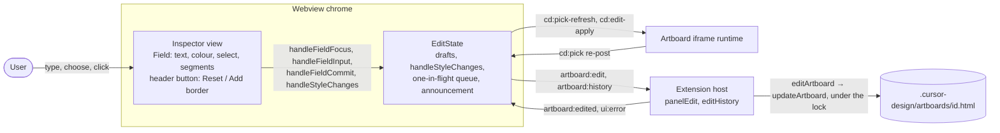
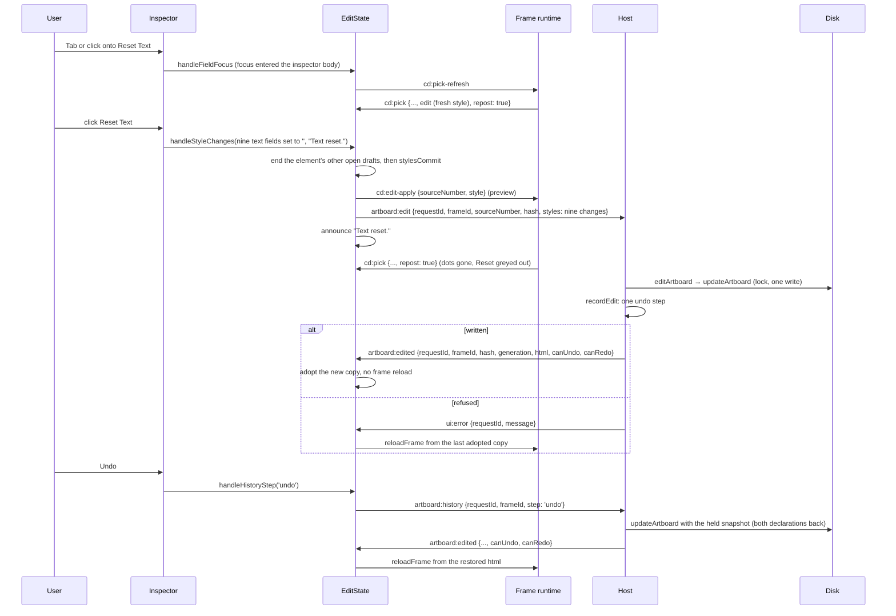
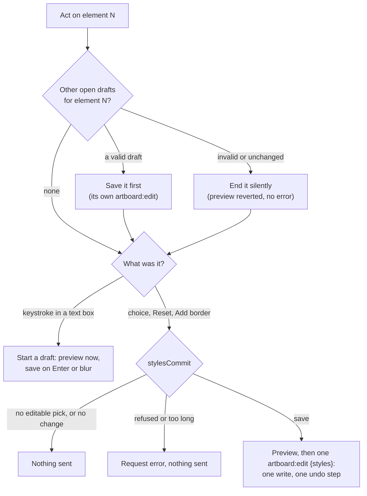

# Inspector redesign (9i) - Overview for review

> **Generated file.** Human-facing steering summary of the active work item:
> same content as `current-feature.md`, trimmed. Written at `/feature` when the
> spec is created, and kept current if the spec is revised. `/complete` may
> polish this into the archive-ready one-pager; it is not the first write.
> Open in Markdown preview to render the diagrams.

Source of truth: `blueprint/history/features/09i-inspector-redesign.md`. This file is the steering
summary, not the build spec.

## TL;DR

The Edit-mode inspector is now the redesign approved on 2026-11-20 (`prototypes/inspector.html`).
Its sections adapt to what you pick, every 9h field has a compact two-column control with a blue
"set on this element" dot, each section has a Reset, and Border offers Add border. It is
chrome-only: the host, disk, MCP, Agent skill and every message are unchanged. 9i is the first
sender of a multi-change `artboard:edit {styles}`, so a Reset is one write and one Undo step.

## Flow

1. In Edit mode, click an element in an artboard. The inspector shows the sections for that kind
   of element.
2. Type in a text box (Size, Color, Padding…): the frame previews each keystroke, and Enter or
   blur saves.
3. Choose from a select or click a toggle (Weight, I / U / S, Align): it saves at once.
4. Click **Reset** on a section, or **Add border**: one save of several changes.
5. Press **Undo** once to undo the whole Reset.

## System map

Only the chrome changed. Every arrow above already existed after 9h; what is new is who sends
`artboard:edit {styles}` with several changes, and when `cd:pick-refresh` goes out.

## Key loop

Reset Text on a heading with `style="font-size: 40px; font-weight: 700"`, then Undo:

## Rule logic

What happens when you act on element N (a choice, Reset or Add border, or the first keystroke
of a new draft):

Why: with one open draft per element, no save of that element can land between a draft's start
and its commit, so no preview ever puts back a stale style.

## What you will see

- **Text-only element** (an `h1`): Text (Content, Size, Color, Weight, I / U / S, Align, Leading,
  Tracking, Case), then Appearance, Spacing and Border.
- **Text mixed with elements** (a paragraph with a link): Typography, the same fields without
  Content, plus "To change these words, ask the Agent or select a part that holds only text."
- **Container or `img` / `input` / `hr`**: Appearance, Spacing and Border only.
- **Appearance**: Background, Radius, Overflow, Opacity. **Spacing**: Padding and Margin (one
  shorthand box each), and Gap for flex or grid, or when gap is already set.
- **Border**: Width, Style and Color when the element has a border, else an **Add border** button
  that writes `1px solid` and moves focus to Width.
- **Values**: a blue dot and full text mean set on this element; grey text is the computed value
  from the design's CSS. Number boxes show the value as typed (`0.04em`), with no unit label.
- **Selects and toggles** always show the computed value. A value outside the list shows as an
  extra option and saves nothing.
- **Reset** clears its section in one save. It stays visible but greyed when nothing is set, and
  screen readers hear "Reset Text", "Reset Border" and so on, then "Text reset."
- **Errors** name the field's own rule, for example "Not saved: use a number from 0 to 1, or leave
  it empty." under Opacity.
- **Width**: 296px (at most 30% of the panel), one column below 260px.

## Data flow

- A text box keeps the 9e draft path: focus refreshes the pick, input previews through
  `cd:edit-apply`, Enter or blur sends one `artboard:edit` with one style change.
- A choice, Reset or Add border goes through `handleStyleChanges`: it previews the whole result
  and sends one `artboard:edit` with every change. The host writes once and records one undo
  step.
- Answers, adopt-without-reload, refusal reload, one save in flight, and the "Not saved: the frame
  changed. Try again." outside-change rule are all unchanged from 9e / 9f / 9h.
- Nothing new reaches disk: `.cursor-design/artboards/<id>.html` gets the same inline-style edits
  9h could already write.

## Architecture decisions

- **Chrome-only.** 9h's `styles` list already carried several changes; 9i only adds a sender. No
  host, disk, MCP or message change.
- **One apply rule.** Previews and saves both run `applyStyleChanges`, so what you see is what is
  written.
- **One save path for every non-draft control.** Choices, Reset and Add border all call
  `handleStyleChanges` and the pure rule `stylesCommit` in `src/webview/editDrafts.ts`.
- **`Field` is a `ui/` primitive with one consumer** (`src/webview/ui/Field.svelte`). This is a
  recorded rule 08 exception: its focus ring, set dot and error edge are control-state styles only
  `ui/` may hold.
- **One held-key guard**, `src/webview/ui/keyRepeat.ts`, shared by the header and segment buttons.
- **Drafted fields stay rendered**: a Gap or border box you are emptying does not vanish
  mid-typing.

## Decisions locked

- Bombic's decisions 1–6 (2026-11-20) in `blueprint/reference/9i-inspector-notes.md`.
- **Set dot**: a field is set when its section's Reset would remove something because of it (its
  own declaration or a longhand; a `border` / `border-<side>` parent for border fields).
- **Reset never removes** an inline `font`, `background` or `text-decoration` shorthand. The Agent
  removes those.
- **One open draft per element**: a new draft, a choice, Reset or Add border first ends the
  element's other drafts. Valid ones save, invalid ones end silently.
- **Focus**: Width after Add border. The Border button keeps focus after Reset and reads Add
  border. A focused field that disappears (Gap hidden, border fields gone) hands focus to its
  section's button. A double-click or a held Enter never sends a second save.
- **Known ceilings** (`ponytail:` in code): re-choosing a select's current option saves nothing;
  arrow keys on a closed select save each step on some platforms; two choices within one
  animation frame can read the state before the first; Align assumes left-to-right; the picker
  drops alpha.

## Out of scope

- Any host, disk, MCP, Agent skill or message change.
- Per-side spacing, font family, shadow, transform, filter, width and height, layout controls.
- A custom listbox, alpha in the picker, per-field unset for selects and toggles (Reset covers
  it).
- Removing inline `font` / `background` / `text-decoration` shorthands.
- 0.4.1 (mode switch opens the matching panel) and 0.5 Projects + pages.

## Glossary

| Term | Why it exists |
|---|---|
| Set dot | Tells you a value lives in this element's `style` attribute, so Reset would clear it, versus a grey value from the design's CSS. |
| Draft | A text box's unsaved value. It previews live and saves on Enter or blur, so typing never writes per keystroke. |
| One open draft per element | Saves another field's pending value first, so no preview restores a stale style. |
| Choice | A select or toggle click. It saves at once, with no draft, since the value is always valid. |
| Reset | Clears one section's inline values in one save, so one Undo brings them all back. |
| Add border | Gives a borderless element `1px solid` in one click, then focuses Width to adjust it. |
| Pick | The element you clicked in the frame, as the frame describes it (`cd:pick`). The inspector shows it. |
| Pick refresh | `cd:pick-refresh` on focus re-reads the pick, so a draft or choice starts from the current style, even if a design's script changed it. |
| Computed value | What the browser actually renders, shown grey as the placeholder or the select's value. |

## Your actions

- Decide whether to apply the drafted Notion 0.4 patch (in the spec's **Notes for the AI**). It
  is applied only after your yes.
- Decide whether to push `main`.

## Done means

- **Shipped**: adaptive sections, every 9h field in the new controls, the set dot, Reset per
  section, Add border, per-field error copy, focus hand-off and announcements, the narrow
  one-column fallback, fixture elements, gallery states and the README Edit mode section.
- **Evidence**:
  - `pnpm verify`: 766 unit tests passed.
  - The full browser suite passed 197; one case that could not fail was then removed.
  - `pnpm gallery`: 208, with the contrast check.
  - Real Cursor: cases a–h passed on the packaged `.vsix`.
  - The audit plus two re-audits closed F-01..F-12, with no P0 or P1.
