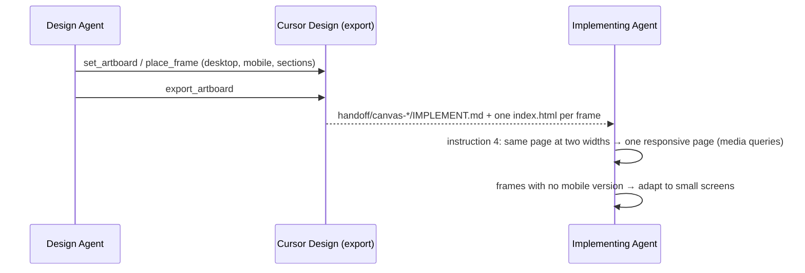

# IMPLEMENT.md responsive variants - Overview for review

Source of truth: `blueprint/history/fixes/implement-md-responsive-variants.md`. This file is the steering summary, not the build spec.

## TL;DR

Canvas handoffs used to tell the implementing Agent "never merge frames". The 6f dogfood showed that's wrong: a desktop frame and a mobile frame of the same page should become one responsive page. Instruction 4 in every new `IMPLEMENT.md` now says so. Nothing else about export changed. This closes 6f and with it all of 0.2 (feature 6).

## Key loop

## What you will see

Instruction 4 in a newly exported `IMPLEMENT.md`:

> 4. Each frame is a complete design at its `width`. In the implemented app, frames that show the same page at different widths (for example desktop and mobile, usually in the same `group`) are variants: build one responsive page that matches each frame at its width, combining their styles with media queries instead of pasting each frame's CSS and JS side by side, and keep each frame's classes and JS behavior. If it is unclear which frames are variants of one page, ask the user. Frames with no narrow variant should adapt to small screens in the implemented app. Never hard-code a frame's width on `body`.

Instructions 1–3 and 5–7 are byte-identical to 6e.

## Decisions locked

- "Frames are never merged" in the project overview is about the export tree (each frame stays its own pristine `index.html`). The new rule is about the implemented app.
- Variants are recognized from `group`, labels and widths. When that's unclear, the implementer asks the user. The handoff gains no pairing field.
- Task-specific details (which frames, app entry file, breakpoint) belong in the user's request, not the handoff.

## Out of scope

Export tree, `canvas.html`, manifest, staleness, old handoffs on disk, the 6e archive, README (its stale 0.1 export trial is tracked as F-12).

## Evidence

- Test pins the whole `## Instructions` section against a literal string. 177 tests pass, and `pnpm compile` passes.
- F5, 2026-10-18: export `canvas-20261018T160927516Z` shows the new instruction 4 on one line, with the other six instructions unchanged.
- 6f dogfood, 2026-10-18 (export `canvas-20261018T152500728Z`): a clean four-frame export (desktop, mobile, pricing, FAQ), and a responsive `sample-app` built from it at 1280 and 390. Its only failure was the old instruction 4, which this fix replaces. 6f is ticked on that evidence.

## Glossary

| Term | Why it exists |
|---|---|
| Frame | One artboard file placed on the canvas at a fixed width |
| Variant | Frames showing the same page at different widths, e.g. desktop and mobile |
| Handoff | The `handoff/canvas-*/` folder an implementing Agent builds from |

## Your actions

- Restart the MCP server (or the F5 host) after `pnpm compile`. A running MCP process keeps its old bundle, which is why the first F5 check failed.

## Done means

New exports carry the new instruction 4. 6f and feature 6 (0.2 Multi-frame canvas) are checked in the build plan.
