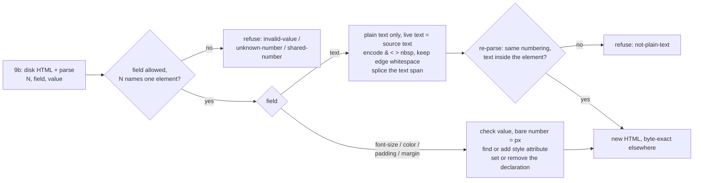

# Edit core (9b) - Overview for review

Source of truth: `blueprint/history/features/09b-edit-core.md`. This file is the steering summary, not the build spec.

## TL;DR

The engine behind Edit mode now exists, but nothing calls it yet. Give it an artboard's HTML from
disk, an element's source number (the `data-cd-src` number from 9a), a field and a value. It
returns the new HTML with only that one spot changed, every other byte the same, or a typed
reason it refused. 9c connects it to the panel and the disk write.

## Flow

## What you will see

Nothing in the panel yet. You get 26 new unit tests that pin exact output strings, so a test
fails if any byte outside the edited spot moves. Examples:

- `
\n  Old\n
` with text `New` becomes `
\n  New\n
`.
- `
` with padding `8 16` becomes `style="color: red; padding: 8px 16px"`.
- `<head></head>` with text is refused, because the text would move into an implied `<body>` and
  renumber the page.

## System map

No cross-process flow changed. The module sits in `src/disk/` next to 9a's source tags and
shares their one numbering walk, so a number means the same element in the frame and on disk.

## Decisions locked

- **String splices only.** Edits use parse5 source offsets and never re-serialize the file.
- **Text** only on elements holding nothing but text. After the splice the core re-parses and
  refuses if the numbering moved or the text landed outside the element. `&`, `<`, `>` and the
  no-break space are encoded, a newline becomes a space, and the source's edge whitespace stays.
  Cap: 5,000 characters.
- **Styles:** a set changes the last occurrence in place or appends one declaration; clearing
  removes it. `padding` / `margin` drop their ten longhands on set and clear. A later `font`
  makes a new `font-size` move to the end.
- **Safe values:** colour only as `#rrggbb`; sizes and spacing only letters, digits,
  `. % + - * / ( ) ,` and spaces, balanced, no comments, at most 200 characters after `px`.
- **Refusals** are a typed result in a fixed order: `unknown-number`, `shared-number`,
  `not-plain-text`, `text-changed`, `invalid-value`, `unsupported-style`.

## Audit

A fresh Opus reviewer found one P1, two P2s and three P3s, all fixed and closed on re-review:

- An `<image>` tag (parse5 calls it `img`) made the guard throw.
- An append after `A&copy` merged into the previous declaration.
- `<pre>\n  Old` text was refused.
- A duplicate helper, untested guards and a redundant check.

## Out of scope

Host wiring, lock, hash and messages (9c). Frame-side checks and live text (9d). Live preview,
save and undo (9e, 9f). Classes, style blocks, border, per-side spacing.

## Glossary

| Term | Why it exists |
|---|---|
| Source number (`data-cd-src`) | Names an element by its start-tag order in the file, so the edit finds its exact characters |
| Re-parse check | Proves a text edit didn't change the page structure before it is written |
| Longhand | `padding-left` and friends: dropped when the shorthand is set, or the edit would look ignored |
| `ponytail:` note | A deliberate, documented limit with its upgrade path |

## Your actions

Settle the Notion 0.4 "Element mapping" wording (generation vs content hash) before `/feature 9c`.

## Done means

`pnpm verify` passes (624 tests); every edit's output is pinned byte for byte; findings
F-136 to F-141 are closed.
