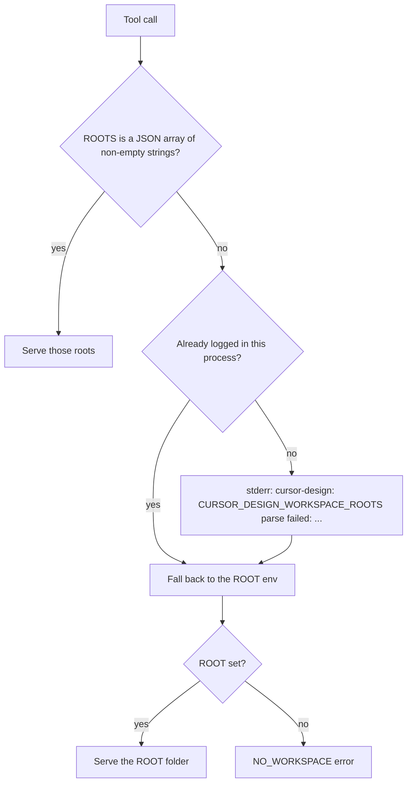

# Audit code problems - Overview for review

Source of truth: `blueprint/history/fixes/audit-code-problems.md`. This file is the steering summary, not the build spec.

**Branch:** `fix/audit-code-problems` · **Type:** Fix · **Status:** verified · **Fixes:** F-76 (also closes audit repairs F-153, F-154)

## TL;DR

Cleanup from the 2026-11-20 comment audit. One visible change: a broken
`CURSOR_DESIGN_WORKSPACE_ROOTS` value now prints one stderr line per MCP process instead of
failing silently. Everything else removes twin helpers, a pass-through wrapper and a dead check,
with identical behavior. No message, disk format or process flow changed.

## Rule logic

What the MCP does with the workspace-roots env on every tool call:

## What you will see

- Normally nothing: the extension always writes a valid ROOTS value.
- If ROOTS is ever bad (our bug), the Cursor MCP log shows the line above once, and tools keep
  working from the first workspace folder.
- The existing lock and comment-target stderr lines read exactly as before.

## Architecture decisions

| Before | After |
|---|---|
| Two disk-lib stderr writers (`logLockError`, `logTargetReadError`) | One `logStderr(scope, error)` in `src/disk/errors.ts`, byte-identical output |
| `toolSchema` forwarder in `artboardTools.ts` | Calls `toolInputSchema<ToolArgs>(...)` directly |
| `intersectRect` in `pins.ts` | Reuses the frame's `clipRect` |
| `CommentCard` re-derived pending states | Uses `replyPending` / `anythingPending` from `commentActions.ts` |
| "Other content" test written twice in the frame runtime | One `hasOtherContent` in `editTarget.ts` |
| Frame cache key built three times | One `frameCacheKey` in `commentViews.ts` |
| Dead label/handle guard in `Stage.svelte` `startDrag` | Deleted |

## Decisions locked

- `textExcerpt` is not a twin of `toOneLine`: it keeps format characters so a picked text still
  agrees with the raw disk text. It got a one-line comment instead.
- Host-side disk errors still go to the Extension Host log, not the Cursor Design Output channel.
  Recorded as a `ponytail:` ceiling on `logStderr`; upgrade path is host callers using `logDiskError`.
- Invalid ROOTS still falls back to ROOT (no hard failure); the log fires once per process.
- The three heavy `selectorMatch` scale tests get a 30 s timeout (F-154): the linear-time bound
  stays the guard, the wall clock was flaking under parallel Verify.

## Out of scope

Routing host-side disk errors into the Output channel; failing tool calls on a bad ROOTS.

## Glossary

| Term | Why it exists |
|---|---|
| `CURSOR_DESIGN_WORKSPACE_ROOTS` | Env the extension sets on the MCP process: the list of workspace folders it may serve |
| Twin helper | Two functions doing the same job under different names; rule 03 treats it as a bug |
| `ponytail:` comment | Marks a deliberate shortcut with its known limit and upgrade path |

## Done means

- `pnpm verify` passes (59 test files, 729 tests).
- The ROOTS unit test asserts exactly one stderr line across six invalid values.
- `git grep` finds no `intersectRect`, `logLockError`, `logTargetReadError`, `memoKey` or
  `toolSchema` under `src` or `.claude`.
- Findings F-76, F-153 and F-154 closed by `/audit current`.
