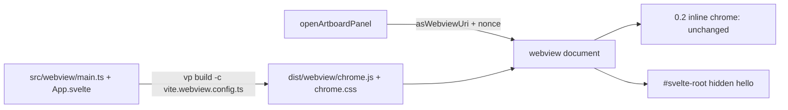
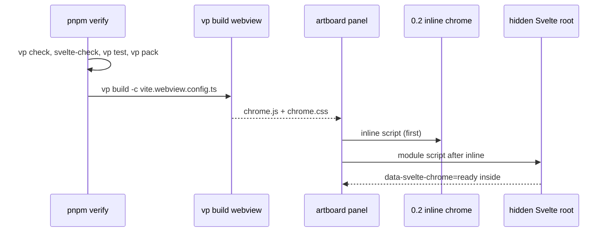

# Svelte toolchain - Overview for review

Source of truth: `blueprint/history/features/08a-svelte-toolchain.md`. This file is the steering summary, not the build spec.

## TL;DR

Svelte 5 now builds to `dist/webview/chrome.js` and `chrome.css`, loads in the artboard webview under the existing CSP, and `svelte-check` plus that webview build run in `pnpm verify` (and CI). The 0.2 template-string chrome is unchanged. You should see nothing new in the panel.

## Flow

1. `src/webview/main.ts` mounts hidden `App.svelte` onto `#svelte-root`.
2. `vp build -c vite.webview.config.ts` emits `dist/webview/chrome.js` + `chrome.css`.
3. The host shell nonce-loads those files via `asWebviewUri`, with `localResourceRoots = dist/webview`.
4. If the bundle is missing or throws, the 0.2 chrome still runs: separate script, separate root, CSP unchanged.

## System map

## Key loop

## What you will see

- Same 0.2 toolbar, frames, zoom, and pan.
- In webview devtools: hidden `#svelte-root` with `data-svelte-chrome="ready"`, and no new CSP violations.
- `pnpm verify` now runs `svelte-check --tsconfig ./tsconfig.webview.json --fail-on-warnings` and the webview build.
- This session: user started the Extension Development Host and reported no errors. Hidden hello root and missing-bundle path were not confirmed.

## Data flow

Source files -> webview Vite build -> `dist/webview/` -> nonce'd `<link>` + `<script type="module">` in the chrome document. No disk, MCP, or message-contract change.

## Architecture decisions

- One Vite instance: `vite` is aliased to `@voidzero-dev/vite-plus-core@1.3.0`.
- TypeScript package is `~6.0.3` for `svelte-check`; lint and type-aware check stay on TS 7 via tsgolint.
- Frame-runtime IIFE plugin and `happy-dom` wait for 8b.

## Decisions locked

- No CSP loosening (`unsafe-inline` / `unsafe-eval` stay out).
- Bundle failure cannot take down 0.2 chrome.
- `localResourceRoots` is extension `dist/webview` only, never the workspace.

## Out of scope

Porting chrome to Svelte (8b), frame-runtime bundling, `happy-dom`, CSP / MCP / disk / message changes.

## Glossary

| Term | Why it exists |
|---|---|
| `#svelte-root` | Hidden mount point that proves the toolchain without changing 0.2 UI |
| `chrome.js` / `chrome.css` | Fixed bundle names the host shell loads |
| `svelte-check` | Type gate for `.svelte` files; `tsc` does not type-check them |
| Vite+ core alias | Keeps vite-plugin-svelte on the same Vite as `vp` |

## Your actions

Optional F5 leftovers: confirm `[data-svelte-chrome="ready"]` inside `#svelte-root`, zero CSP violations, then delete `dist/webview/chrome.js` and reload — 0.2 chrome should still work.

## Done means

- `pnpm verify` includes svelte-check and the webview build, and exits 0.
- A clean webview build writes `dist/webview/chrome.js` and `chrome.css`.
- Host HTML has nonce'd module script + stylesheet from `asWebviewUri` on those files, plus hidden `#svelte-root`.
- 0.2 chrome behavior is unchanged.
