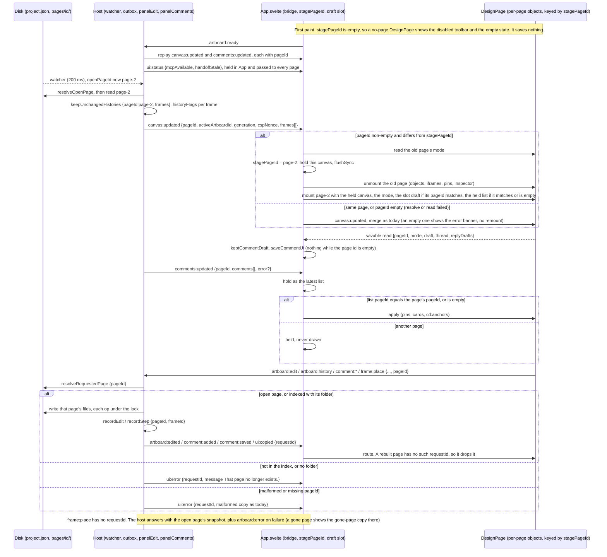

# Page-scoped panel (10b) - Overview for review

Source of truth: `blueprint/history/features/10b-page-scoped-panel.md`. This file is the steering summary, not the build spec. Open in Markdown preview to render the diagrams.

## TL;DR

The panel learns which page it is showing. Every canvas snapshot and comment list from the host names its page. When the page changes, the chrome throws away everything it built for the old page and starts clean: frames, picks, pins, the inspector, open threads and reply boxes. It never draws one page's comments on another. Every request the chrome sends names its page, and the host acts on that page even if another page is open by then. If the page is gone, the answer is "That page no longer exists.". Undo history is kept per page. There is still no page UI: today a page changes only when someone edits `project.json`. 10c adds the Agent's page tools and 10d the Pages menu.

Also folded in: F-11, a test for the host's snapshot and frame-place wiring to the resolver.

## What you will see

Nothing new in normal use: one page, same panel, same first paint. With a second page made by hand (edit `project.json`'s `openPageId`):
- The stage switches to the other page's frames and fits them all in view.
- Pins, comment cards, the open thread, reply boxes, the pick outline and the inspector reset. Nothing from the old page shows on the new one, even when both have a frame with the same id.
- A comment you were typing on page A disappears on B and comes back when you return to A.
- Your mode (Interact / Comment / Edit) and the comments panel's open state stay as they were.
- A failed read (busy lock, corrupt file) shows today's error banner on the current page; it does not count as a page switch.
- After a tab switch, which reloads the webview, the page keeps its zoom and pan.
- Keyboard focus is not moved after a switch (10d's menu owns that).

## Scope at a glance

| In | Out (later) |
|---|---|
| `pageId` on `canvas:updated` and `comments:updated` | Pages menu, `page:*` messages, page list (10d) |
| `pageId` on the 8 page-bound chrome requests; host acts on that page | `list_pages` / `create_page` / `open_page`, page ops, delete (10c) |
| "That page no longer exists." for a gone page | `COMMENT_NOT_FOUND` page hint, `IMPLEMENT.md` page line (10c) |
| Undo history keyed by page and frame | Forget a deleted page's history (10c, when delete exists) |
| Chrome rebuilds per-page state on a switch; comments only for their page | F-09 silent empty stage for a missing open-page folder (10c) |
| Comment draft and saved stage view remember their page; fit-all on switch | Remembering zoom per page (not asked; fit-all stays) |
| `isPageId` moves to `layout.ts` (no zod or `node:crypto` in the chrome) | Focus target after a switch (10d) |
| F-11 host wiring test; system map, rules 02/05/08 | Disk format, MCP, Agent skill, README: unchanged |

## Data flow

## Locked decisions

- **One message rule.** `pageId` is the page the host read, also when the read fails after the page resolved. It is `''` only when no page was resolved: untrusted workspace, no folder, or a resolver error. A fresh folder reads as `page-1` and nothing is written.
- **`''` means "no page".** It is the stage id of the first paint, so the first paint is unchanged. A `''` snapshot or list applies to the page on stage as today's error and never triggers a switch.
- **The host acts on the requested page, never the page open now.** One new disk resolver, `resolveRequestedPage`:
  - it refuses an id that fails `isPageId`, then runs today's `resolveOpenPage`;
  - the open page passes as is;
  - any other page must be listed in `project.json` and have its folder, or the answer is `PAGE_NOT_FOUND` → "That page no longer exists.".
- **A rebuild, not a clear-out.** A new `DesignPage.svelte` under `{#key}` holds the five per-page state objects and the stage. App keeps only what spans pages:
  - the bridge;
  - status;
  - the latest comment list;
  - the draft slot;
  - the mode to hand to the next page (the picker still owns it).

  Same-id frames on two pages become fresh documents.
- **One comment draft slot** `{pageId, draft}`. The page reports its draft with its own `pageId`, so a mid-switch read never stamps the wrong page. The staged page's draft takes the slot and replaces another page's. A draft that ends on its own page clears the slot. It returns only on its page, in Comment mode, with its frame still there.
- **Saved stage view carries its page.** A switch fits all in view, and a reload on the same page restores the saved view. No 0.4 compatibility is needed, because no serializer means webview state never survives an update.
- **Undo history is per page and frame.** Switching away and back keeps it while the page's files are unchanged.
- **Zero new dependencies; no disk, MCP or skill change.**

## Choices a reviewer may flip

None of these is a blocking question; each is reversible.
- The mode carries across a switch.
- The comments panel's open state carries across a switch.
- `''` never remounts a staged page.
- No focus move after a switch until 10d.

## Steps

1. `pageId` on host → chrome state, `isPageId` to `layout.ts`, F-11 test.
2. Undo history keyed by page.
3. Page-bound requests carry `pageId`; `resolveRequestedPage`; gone-page copy.
4. Pure chrome rules: saved-state parsers, `keptCommentDraft`.
5. `DesignPage` restructure and `pages.spec.ts`.
6. System map, rules 02/05/08, F-11 resolution, Verify.

## Try it now

In the dev fixture:
1. Copy `pages/page-1/` to `pages/page-2/`.
2. Add `{ "id": "page-2", "title": "Page 2" }` to `project.json` `pages`.
3. Flip `openPageId`. The panel switches on the next watcher refresh, with nothing carried over.
4. Flip it back. The page-1 comment draft returns, and Undo still works on page 1.

`/check` can drive this, and 10e is the real `.vsix` run.

## Done means

Shipped on 2026-11-23: `pnpm verify` passes (836 unit tests), `pnpm test:browser` passes (209), and a fresh Fable 5.2 independent review passed with findings F-11 to F-19 closed. Two non-blocking findings stay open for a follow-up `/fix`: F-20 [P2] (no test pins `pageId` on the reply, status and copy requests) and F-21 [P3] (the staging `canvas:updated` stays referenced for the page's life). No real Cursor run yet; 10e covers it.
