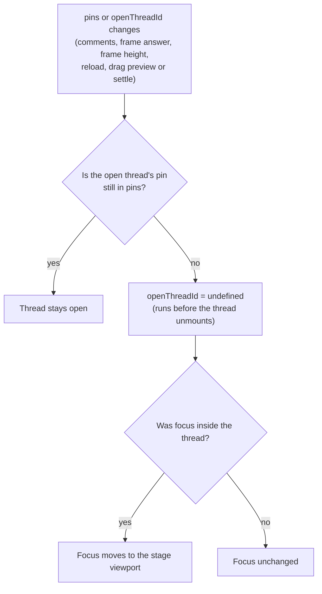

# Fix: Pin review follow-ups - Overview for review

Source of truth: `blueprint/history/fixes/pin-review-follow-ups.md`. This file is the steering summary, not the build spec.

## TL;DR

Closes the three findings left open by the independent review of 8f2 Pins (F-88, F-91, F-92). It also fixes one flaky 8f2 browser test and adds a test for the pin observer. The only visible change: an open comment thread now always closes when its pin disappears, and it never comes back by itself.

## Rule logic

## What you will see

- An open thread closes, and focus moves to the stage, whenever its pin stops being placed: the page got shorter, a drag settled or was refused, the frame reloaded, or the comment went away.
- When the pin comes back, the thread stays closed. Before this fix, the thread could stay invisibly "open", focus fell to the page body, and the thread popped back later.
- Nothing else changes visibly.

## Architecture decisions

- **F-88:** one `$effect.pre` in `App.svelte` replaces the 5 per-caller `keepThread()` calls. Every path that moves pins is covered, including the 3 that were missing and any future one. It is "pre" so it runs before the thread leaves the DOM, which keeps the focus fallback working.
- **F-91:** `capAnchorRect` uses the shared `clampNumber` instead of two private copies with the same bounds. In the exported `canvas.html`, only the `anchorRects` code in each embedded runtime changes.
- **F-92:** the `'*'` target origin stays. Only its comment changed: a sandboxed frame has no origin to target, it can only navigate to `blob:`, and it receives only its own comment ids and selectors.

## Decisions locked

- No new message, contract or helper. The system map changed only the pins sentence and its "last verified" line.
- The observer test wraps `ResizeObserver` inside the frame. This departs from the browser-test rule on purpose, because the observed set is invisible to the page.
- The `DOOMED.rect` test data moved to y 200. The old value made `a removed target shows the missing badge at its stored rect` fail 3 of 8 runs.

## Out of scope

- The other open, fixed and unverified findings in the ledger (F-09 to F-84).
- Changing what `cd:anchors` sends, or the postMessage target.

## Glossary

| Term | Why it exists |
|---|---|
| Pin | The dot on a design element that marks a comment. Clicking it opens the comment's thread. |
| Placed | The pin has a position inside its frame. A pin whose target and stored position both fall outside the frame is not drawn. |
| `$effect.pre` | A Svelte reaction that runs before the screen updates, so it can move focus before the thread is removed. |
| Pin observer | Watches the commented elements' sizes inside a frame, so pins follow them. |

## Your actions

- Optional F5 in `fixtures/dev-workspace`: open a thread near the bottom of a design, have the design delete its element and shorten the page, then lengthen it again. The archive's `## Try it now` has the steps.

## Done means

- `pnpm verify` is green: 36 test files, 451 tests.
- `pnpm test:browser` is green: 81 passed, including the 2 new `pins.spec.ts` cases.
- F-88, F-91 and F-92 are closed by an independent review and archived with this fix.
