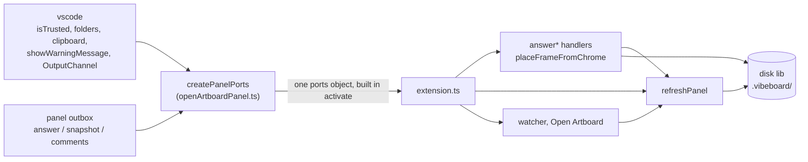

# 11c1 Host ports - Overview for review

Source of truth: `blueprint/history/features/11c1-host-ports.md`. This file is the steering summary, not the build spec.

**Branch:** `feature/host-ports` · **Build attempt:** 1 · **Shipped:** 2026-11-27

## TL;DR

Shipped. Six host handlers get all vscode I/O from one `PanelPorts` object built in `activate`; none imports `vscode`. Tests swap glue mocks for a fake ports object: `vi.mock(` 32 → 15, every test name kept. `pnpm verify`: 74 files, 882 tests. Audit: five P3s, all fixed (await re-audit).

## Goal

The host's panel request and refresh handlers stop importing vscode. One small `PanelPorts` object
(trust, workspace root, log, the three panel posts, clipboard, modal confirm) is built once in
`activate` and passed in. Six modules (`panelRequest`, `panelEdit`, `panelComments`, `panelPages`,
`artboardDisk`, `refreshPanel`) then load without vscode, and their tests drop the glue mocks.
11c2 moves those tests onto real disk.

## What you will see

Nothing in the product. The panel, the Agent and disk behave exactly as before. In the code:
`vi.mock(` calls across the six host tests drop from 32 to 15, and the six modules have no runtime
`vscode` import.

## Scope at a glance

| In | Out |
|---|---|
| `PanelPorts` + `createPanelPorts` in `openArtboardPanel.ts` | Real-disk test rewrites (11c2) |
| The six modules take `ports` instead of `outputChannel` | Watcher logic (11c3), only its log arg changes |
| Watcher, Open Artboard, `extension.ts` pass `ports` through | Webview post port (11c4) |
| Manifest check via the disk lib's `lstatOrUndefined` | `canvasSnapshot`, `hostFs`, `openArtboardPanel` test mocks |
| Tests swap glue mocks for a fake ports object, assertions kept | Messages, disk format, MCP, Agent skill, chrome |

## Wiring (11c1)

No message between processes, and no disk write, changes. The diagram shows the in-process wiring
only.

## Locked decisions

- **Split of 11c (2026-11-27, Bombic):** 11c1 host ports, 11c2 host tests on real disk, 11c3 watcher
  pure step, 11c4 page-bound post port. The split is by layer, because the shared preamble ties
  every handler together.
- **refreshPanel joins the ports**: it is the same panel I/O. `canvasSnapshot` and `hostFs` keep
  their mocks: spies only, or the vscode edge itself.
- **Getters for trust and root**, read at call time, as today, and tested: ports are built once in
  `activate`, so a captured value would send panel writes to a stale folder.
- **Logs stay byte-identical**: the canvas read-log line goes through `log(scope, text)`, which
  prints the same text.
- **One behavior detail:** the manifest existence check moves from a vscode stat to the disk lib's
  lstat (rule 07: the host reaches `.vibeboard/` only through the disk lib). Only a *dangling*
  symlinked manifest changes: it now counts as present, so the page reads as an empty stage or
  shows the ownership error, where today Open fails trying to create the default artboard. Neither
  version writes anything. A `ponytail:` comment marks it in code; the build-plan line and the
  Notion page say so too.

## Steps

1. Ports type and builder, plus one builder test: the native delete modal (`modal: true`) and the
   trust / root getters following live changes.
2. Manifest check through the disk lib first (it needs no ports); `artboardDisk.test` moves to a
   temp root with a real manifest file, and the page-list test gains a `readCanvasView` count so it
   cannot pass on the manifest-missing path.
3. Every handler on ports in one mechanical step; the test glue mocks become a fake ports object.
   Only a named list of assertion rewrites is allowed; anything else means behavior changed.
4. Owner catalog, system map check, `pnpm verify`.

## Try it

No F5 needed: no chrome or message change. Optional `/check` in the Extension Development Host:
Copy prompt (clipboard port) and a page delete (modal port).

## Done means

- No runtime `vscode`, `hostFs` or panel import in the six modules (grep checked).
- Same test names; only the spec's allowed rewrites.
- `createPanelPorts` tested: native modal, call-time trust/root, rejected clipboard write rejects.
- One behavior detail: a dangling symlinked `manifest.json` now counts as present (`ponytail:` comment).

## Your actions

- Add the manifest-check note to the Notion 0.5 version page (rule 00).
- Optional: `/check` Copy prompt and page delete in the Extension Development Host (vscode side not run live).
